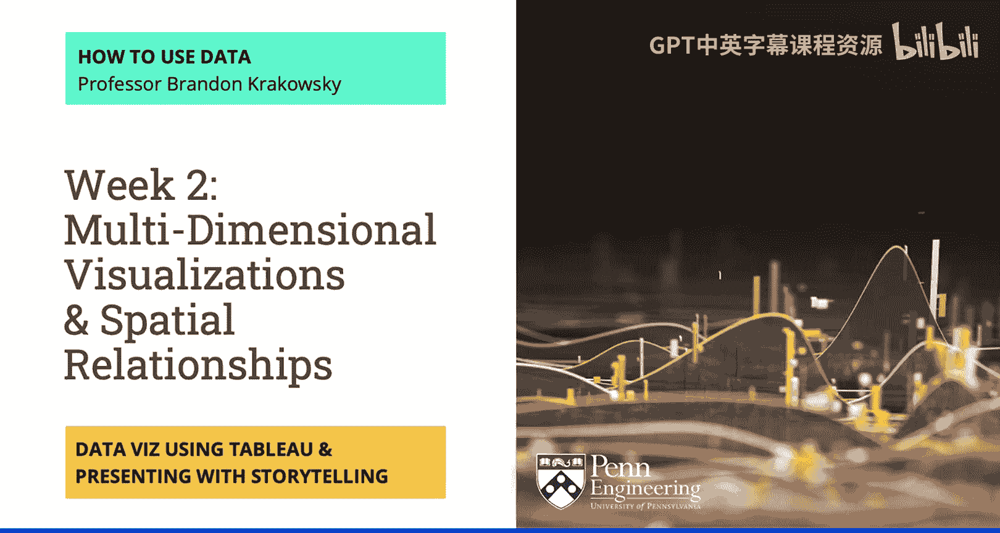

# 数据可视化：模块二：多维可视化与复杂关系导论 🎯

在本模块中，我们将进入多维可视化领域，并学习如何描绘复杂的空间关系。本模块旨在扩展您的数据可视化能力，使您能够分析和呈现涉及多个维度和来源的数据。

上一节我们完成了基础可视化的学习，本节中我们将来看看更高级的数据表达方式。

## 核心内容概述

您将学习如何有效地创建多维可视化，以揭示数据中更深层次的洞察，同时探索空间关系及其视觉呈现方法。

以下是本模块的一个关键焦点：

*   **使用 Tau 管理多表分析**：您将学习如何创建和管理关系，并通过连接数据集来增强您的可视化效果。

通过掌握这些高级技巧，您将准备好应对更复杂的数据可视化挑战。

## 总结

本节课中我们一起学习了模块二的总体目标：即从基础图表迈向多维度和空间关系的可视化。我们了解到，本模块的核心在于使用工具（如Tau）整合多源数据，并创建能够揭示复杂关系的图表，为后续的具体技术学习奠定了基础。