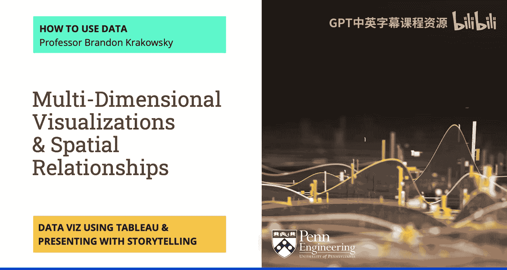
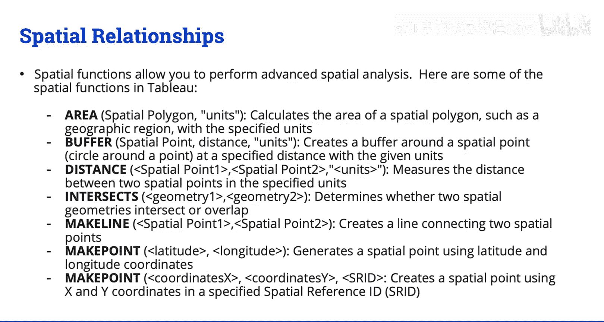

# uPenn《如何运用数据2、3（Python预测分析、数据可视化和叙事）｜How to Use Data》中英字幕 p60 15_多维可视化与空间关系.zh_en [BV1LqxEzcEBy_p60]

Multidisional visualizations focus on exploring and analyzing multiple variables and how they relate to each other。

 and the data is typically represented along two axes。Here are some multidisional visualizations。

 scatter plots， which investigate the relationship between different variables。

 showing if one variable is a good predictor of another or if they tend to change independently。

A scatter plot represents distinct data points on a single chart and a density chart to visualize patterns or trends in dense data with many overlapping marks。

 You can do this in Tau by grouping， overlaying marks and color coding them based on the number of marks in the group。

This shows the average rate of infant mortality and female life expectancy for different countries。

Maps serve as an excellent tool for visually analyzing spatial patterns with Tau。

 the process of incorporating multiple layers onto a customized base map becomes effortless。

 enabling a seamless visualization of patterns。There are several different types of maps in Tableau。

Sppatial functions allow you to perform advanced spatial analysis。

 Here are some of the spatial functions in tableau。

 The area function calculates the area of a spatial polygon。

 such as a geographic region with the specified units。

The buffer function creates a buffer around a spatial point or a circle around a point at a specified distance with the given units。

The distance function measures the distance between two spatial points in the specified units。

The intersex function determines whether two spatial geometries intersect or overlap。

The makeline function creates a line connecting two spatial points。

The Makepoint function generates a spatial point using latitude and longitude coordinates。

 or creates a spatial point using X and Y coordinates and a specified spatial reference ID。😡。

