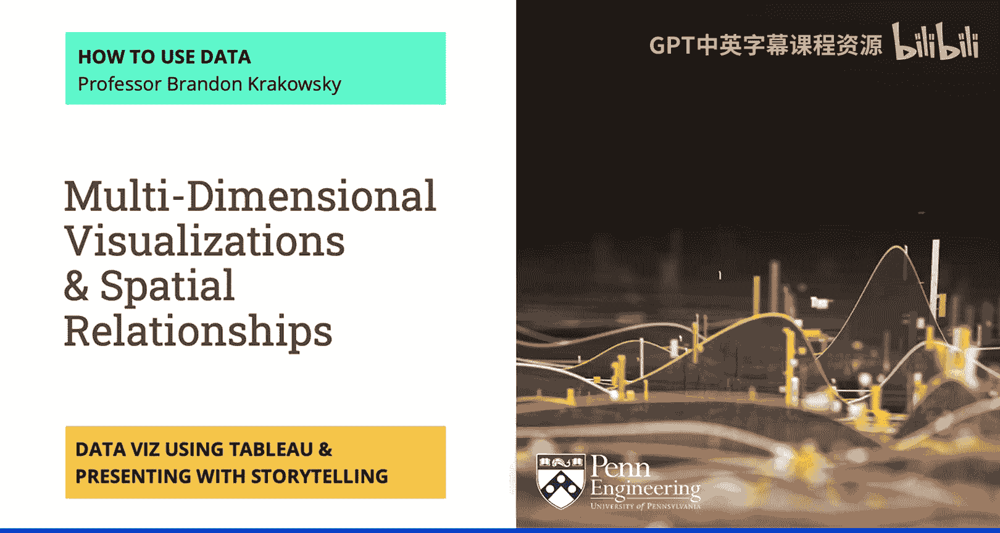
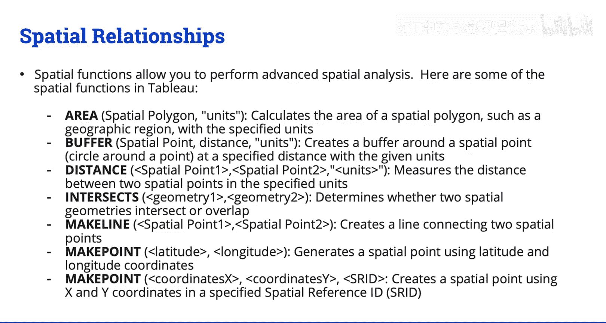

# 数据可视化：第15章：多维可视化与空间关系 📊

在本节课中，我们将学习多维可视化技术，并探索如何利用地图和空间函数来分析数据中的空间关系。多维可视化专注于探索和分析多个变量及其相互关系。

## 多维可视化概述

多维可视化侧重于探索和分析多个变量及其相互关系，数据通常沿两个坐标轴表示。以下是几种常见的多维可视化方法。

上一节我们介绍了多维可视化的基本概念，本节中我们来看看具体的图表类型。

### 散点图与密度图

散点图用于研究不同变量之间的关系，显示一个变量是否是另一个变量的良好预测指标，或者它们是否倾向于独立变化。散点图在单个图表上表示不同的数据点。对于具有许多重叠标记的密集数据，可以使用密度图来可视化其中的模式或趋势。

在Tableau中，您可以通过分组、叠加标记并根据组中的标记数量对其进行颜色编码来实现这一点。下图展示了不同国家的婴儿死亡率和女性预期寿命的平均比率。

## 空间分析与地图可视化

地图是可视化分析空间模式的绝佳工具。在Tableau中，将多个图层合并到自定义底图上的过程变得轻而易举，从而能够无缝地可视化模式。

以下是Tableau中几种不同类型的地图。

## 空间函数

空间函数允许您执行高级空间分析。以下是Tableau中的一些空间函数。

以下是这些空间函数的详细说明：

*   **AREA函数**：计算空间多边形的面积，例如具有指定单位的地理区域。公式为：`AREA(spatial_geometry, unit)`
*   **BUFFER函数**：在空间点周围创建缓冲区，或在指定距离处以给定单位围绕一个点创建一个圆形。公式为：`BUFFER(spatial_point, distance, unit)`
*   **DISTANCE函数**：测量两个空间点之间的距离，单位为指定单位。公式为：`DISTANCE(point1, point2, unit)`
*   **INTERSECTS函数**：判断两个空间几何图形是否相交或重叠。公式为：`INTERSECTS(geometry1, geometry2)`
*   **MAKELINE函数**：创建一条连接两个空间点的线。公式为：`MAKELINE(point1, point2)`
*   **MAKEPOINT函数**：使用纬度和经度坐标生成一个空间点。或者，使用X和Y坐标以及指定的空间参考ID创建空间点。公式为：`MAKEPOINT(latitude, longitude)` 或 `MAKEPOINT(x, y, srid)`

## 总结

本节课中我们一起学习了多维可视化的核心图表——散点图与密度图，并深入探讨了如何利用地图和一系列空间函数（如`AREA`、`BUFFER`、`DISTANCE`等）来分析和呈现数据中的空间关系与模式。