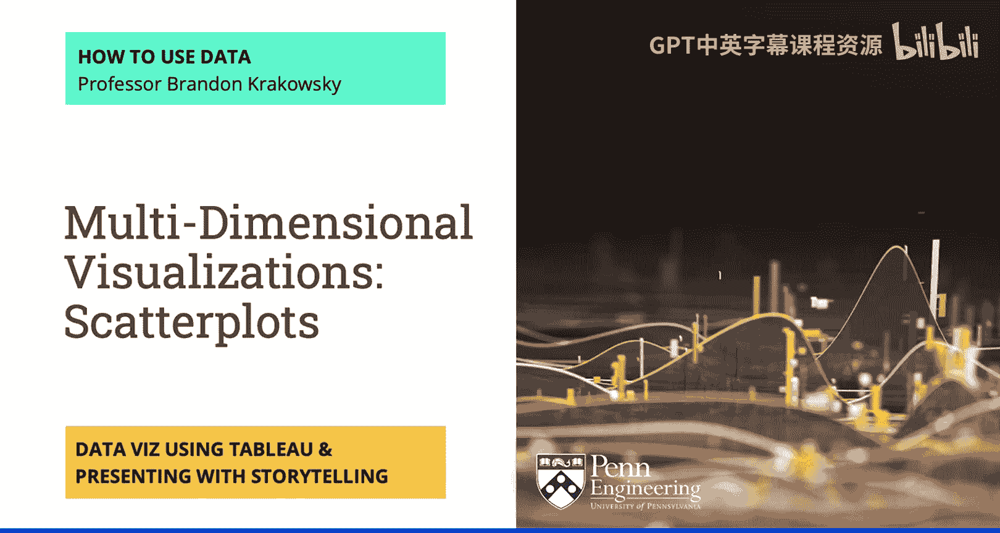
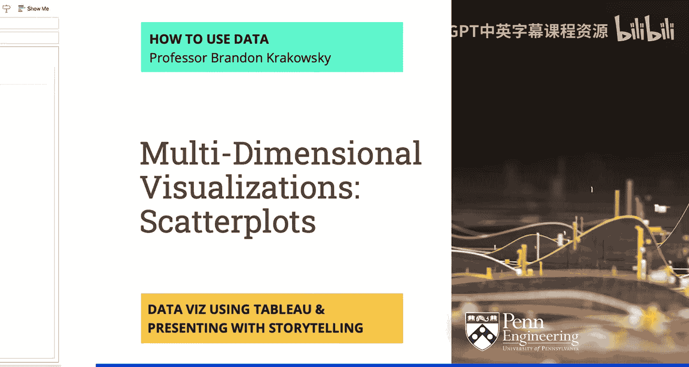
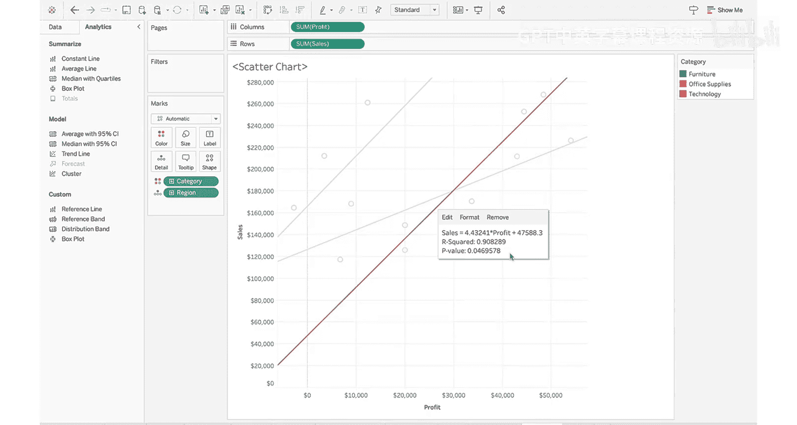

# uPenn《如何运用数据2、3（Python预测分析、数据可视化和叙事）｜How to Use Data》中英字幕 p61 16_编程演示：多维可视化之散点图.zh_en [BV1LqxEzcEBy_p61]

In Tableau， you can create a scatter plot by placing at least one measure on the column shelf and at least one measure on the row shelf。

 A scatter plot can use several mark types By default， Tableau uses the shape mark type。

Depending on your data， you might want to use another mark type。

 such as a circle or a square to use scatter plots and trend lines to compare sales to profit。

 Follow these steps。 Dr the profit measure to columns。

 Tableau aggregates the measure as a sum and creates a horizontal axis。

 drag the sales measure to rows。 Tableau aggregates the measure as a sum and creates a vertical axis。

 Measures can consist of continuous numerical data。 When you plot one number against another。

 You're comparing two numbers。 The resulting chart is analogous to a Cartesian chart with X and Y coordinates。

Drag the category dimension to color。 This separates the data into three marks。

 one for each dimension member， and encodes the marks using color。

Drag the region dimension to detail on the marks card。 Now， there are many more marks in the view。

 The number of marks is equal to the number of distinct regions in the data source multiplied by the number of categories to add trend lines from the analytics pane。

 drag the trend line model to the view and then drop it on the model type。

A trend line can provide a statistical definition of the relationship between two numerical values to add trend lines to a view。

 Both axes must contain a field that can be interpreted as a number。 By definition。

 that is always the case with a scatter plot。 Tableau adds three linear trend lines。

 One for each color that you're using to distinguish the three categories。 However。

 the cursor over the trend lines to see statistical information about the model that was used to create the line。

 And those are all the steps used to create a scatter plot and tableableau。

