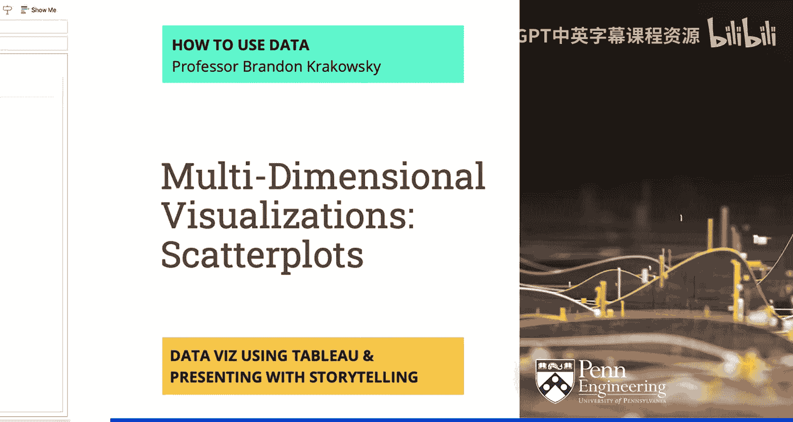
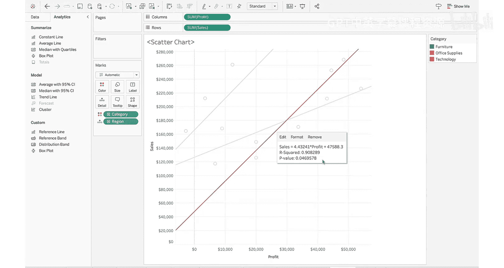

# 数据可视化：16：编程演示：多维可视化之散点图 📊

在本节课中，我们将学习如何在 Tableau 中创建散点图。散点图是一种强大的可视化工具，用于展示两个数值变量之间的关系。我们将通过具体的步骤，演示如何将数据字段拖放到行列功能区，并添加颜色、细节和趋势线来增强图表的表达能力。

## 概述

散点图通过将数据点绘制在二维坐标系中，直观地展示两个连续数值变量之间的关联。在 Tableau 中，创建散点图需要至少将一个度量放在列功能区，另一个度量放在行功能区。接下来，我们将分步详解创建过程。

## 创建基础散点图

在 Tableau 中，您可以通过将至少一个度量放在列功能区，并将至少一个度量放在行功能区来创建散点图。

默认情况下，Tableau 使用形状标记类型。根据您的数据，您可能希望使用其他标记类型，例如圆形或方形。

为了使用散点图和趋势线来比较销售额与利润，请遵循以下步骤。

1.  将“利润”度量拖到列功能区。
    Tableau 将该度量聚合为总和，并创建水平轴。
2.  将“销售额”度量拖到行功能区。
    Tableau 将该度量聚合为总和，并创建垂直轴。

度量可以由连续的数值数据组成。当您将一个数字与另一个数字进行对比绘制时，实际上是在比较两个数字。生成的图表类似于具有 X 和 Y 坐标的笛卡尔图表。

## 添加颜色与细节维度

上一节我们创建了基础的二维散点图。本节中，我们来看看如何通过添加维度来引入更多信息层次。

将“类别”维度拖到标记卡的颜色按钮上。这会将数据分成三个标记（每个维度成员一个），并使用颜色对标记进行编码。

将“区域”维度拖到标记卡的详细信息按钮上。现在，视图中的标记数量变得更多。标记的数量等于数据源中不同区域的数量乘以类别的数量。

## 添加趋势线

在添加了分类和区域细节后，图表已经能展示丰富的信息。为了进一步量化变量间的关系，我们可以为视图添加趋势线。

从分析窗格中，将趋势线模型拖到视图上，然后将其放置在模型类型上。

趋势线可以为两个数值之间的关系提供统计定义。要为视图添加趋势线，两个轴都必须包含可以解释为数字的字段。根据定义，散点图始终满足此条件。

Tableau 会添加三条线性趋势线，每条对应一种用于区分三个类别的颜色。将光标悬停在趋势线上，可以查看用于创建该线的模型的统计信息。

## 总结

本节课中，我们一起学习了在 Tableau 中创建散点图的完整流程。我们从构建基础的二维图表开始，然后通过添加颜色和详细信息来引入更多数据维度，最后通过添加趋势线来量化并展示变量间的统计关系。这些步骤共同构成了一种强大的多维数据可视化方法。