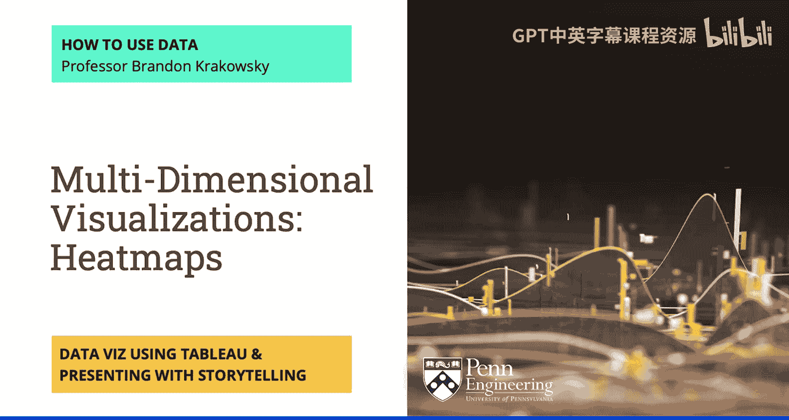
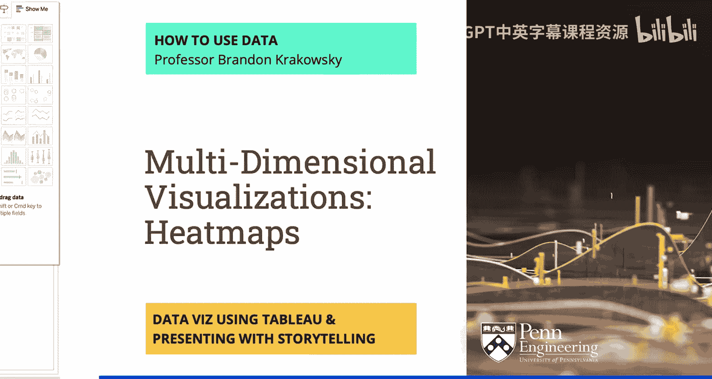
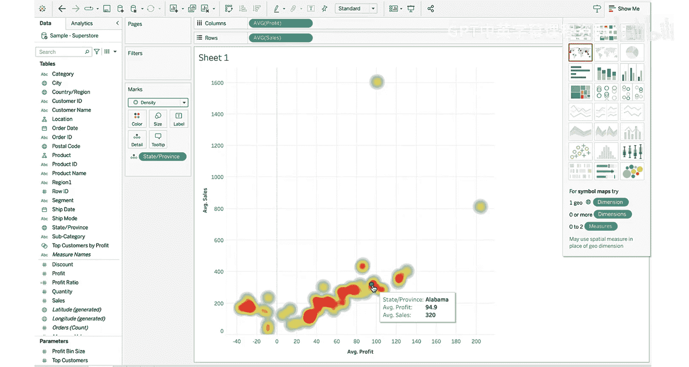

# uPenn《如何运用数据2、3（Python预测分析、数据可视化和叙事）｜How to Use Data》中英字幕 p62 17_编程演示：多维可视化之热力图.zh_en [BV1LqxEzcEBy_p62]

Now let's talk about a heat map。

Use density charts to visualize patterns or trends in dense data with many overlapping marks。

 Tableau does this by grouping overlaying marks and color coding them based on the number of marks in the group。

Density maps help you identify locations with greater or fewer numbers of data points。In tableau。

 you can create a chart using the density mark by placing at least one continuous measure on the column shelf and at least one dimension or measure on the row shelf。

 or vice versa。 And then adding a field to the marks card to show how density charts can help make sense of overlapping marks in tableau。

 We're going to start with a scatter plot with a large number of marks and recreate it as a density chart。

 Let's use a density chart to compare order sales with profit by location。To begin with。

 add the Mesure profit to the column section。We select the aggregation type as A V G。

 That is an average of the field values。 Then We drag the measure sales to the row section。 Again。

 set the aggregation type as average。 Now， you can see an empty plot with two axes。 Now。

 we' add a dimension field。 drag the state province dimension to the detail card in the mark section。

 This will add a group circle representing different states on the plot showing average sales and average profit for each state。

 Select density mark。Here， we're converting this plot into a density heat map by selecting the shape as density。

 This will change the shape of data points from circles to density spots。 That is。

 the color scheme of data points will follow a density gradient。

To select a color scheme of your choice， right click on Col card and explore the options。From here。

 we can also set the intensity and opacity and other border effects based on these settings for this heat map。

 the regions with most data points or dense regions will be in red orange。

 whereas the areas with lesser scattered data points appear in greenish blue shades。So in this way。

 we create a heat map or density heat map in tableau to see more details of the data points in the map。

 hover your cursor over the density points。 We could see all the relative details on the text label。

