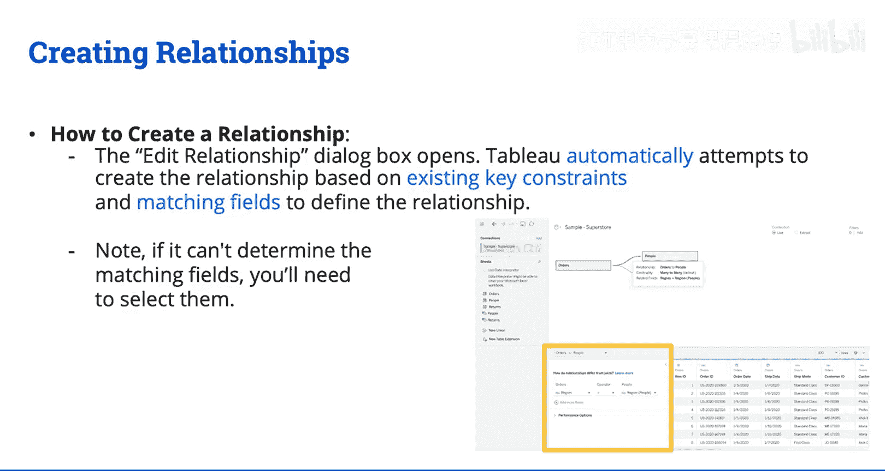

# uPenn《如何运用数据2、3（Python预测分析、数据可视化和叙事）｜How to Use Data》中英字幕 p63 19_多表分析.zh_en [BV1LqxEzcEBy_p63]

Relationships in tableau are a new and dynamic way of combining data from multiple tables for analysis。

 A relationship simply defines how two tables relate to each other。

 but does not merge them together like a joint。A join results in a new table and doesn't allow us to query the original tables individually。

Think of a relationship like a contract between two tables。

The individual tables remain distinct and maintain their own level of details。

 which are expressions also known as LOD expressions that allow you to compute values at the data source level and the visualization level。

😡，Tabau will decide the most appropriate join at runtime based on what fields you've dragged into the view。

 Here are some requirements for relationships。When relating tables。

 the fields that define the relationships must have the same data type。

You can't define relationships based on geographic fields。

Circular relationships aren't supported in the data model。

 which is the overall structure of the tables you add to the canvas in the data source view。

You can't define relationships between published data sources。

 which are sources of data like a file or a database that have been published to a tableableau server and shared。

😡，You can create relationships in the default logical layer of Tableau's data source view Here are the steps。

 drag a table to the canvas。😡，Then drag another table to the canvas When you see the noodle between the two tables。

 drop that table。The Edit relationshipship dialog box opens。

 Tableau automatically attempts to create the relationship based on existing key constraints and matching fields to define the relationship。

If it can't determine the matching fields， you'll need to select them。

