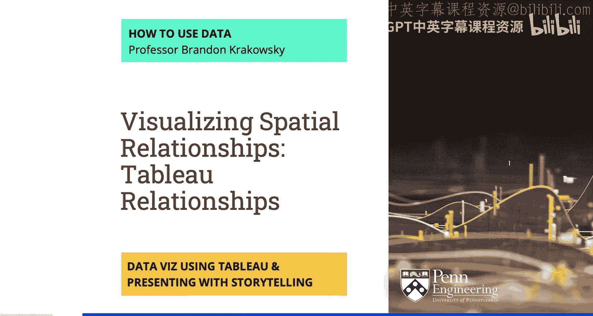
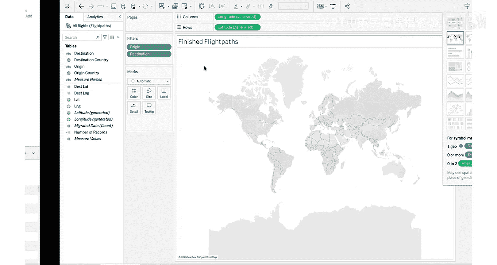

# uPenn《如何运用数据2、3（Python预测分析、数据可视化和叙事）｜How to Use Data》中英字幕 p64 20_编程演示：Tableau关系分析.zh_en [BV1LqxEzcEBy_p64]

As we talked about the definition and requirements of relationships。

 we're going to teach you how to create a relationship in Tableau。

Just like we talked about in the lecture， we can create relationships in the logical layer of the data source。

 This is the default view of the canvas。 As you see on the data source page。

 drag a table to the canvas。 Dr another table to the canvas。

 When you see the noodle between the two tables， drop that table。

 The edit relationship dialog box opens。 Tableau automatically attempts to create the relationship based on existing key constraints and matching fields to define the relationship。

If it can't determine the matching fields， you'll need to select them to change the fields。

 select a field pair， and then click in the list of fields below to select a new pair of matching fields to add multiple field pairs。

 Click add more fields。If no constraints are detected。

 a many to many relationship is created and referential integrity is set to some records match。

 These default settings are a safe choice and provide the most flexibility for your data source。

 The default settings support full outer joins and optimized queries by aggregating table data before forming joins during analysis。

 All column and row data from each table becomes available for analysis。In many analytical scenarios。

 using the default settings for a relationship gives you all of the data you need for analysis。

 Using a many to many relationship will work， even if your data is many to one or one to one。

If you know the particular cardinality and referential integrity of your data。

 you can adjust the performance options settings to describe your data more accurately and optimize how Tableau queries the database。

Add more tables following the same steps as needed。

 After you've built your multi table related data source， you can dive into exploring that data。

