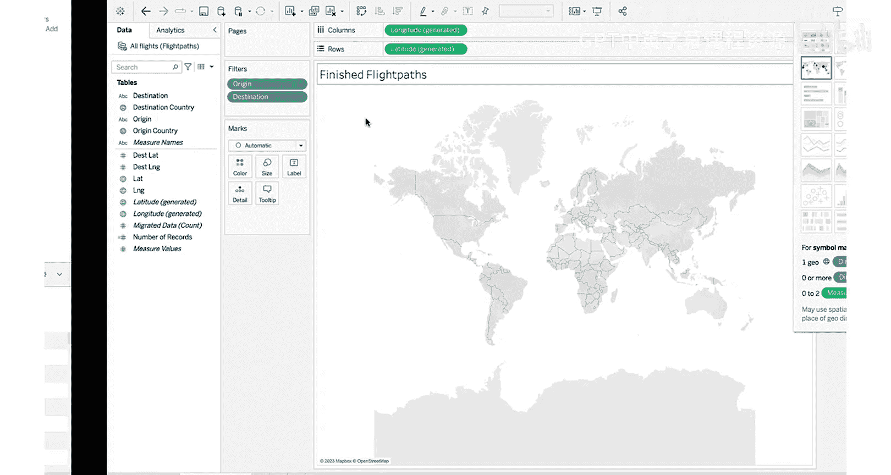

# 数据科学实战：第20章：Tableau关系分析编程演示 🧩

在本节课中，我们将学习如何在Tableau中创建数据表之间的关系。上一节我们介绍了关系的定义和要求，本节中我们来看看具体的操作步骤。

## 概述

我们将从Tableau数据源的逻辑层开始，演示如何通过拖放操作连接多个数据表，并配置关系属性。

## 创建关系

在Tableau数据源页面，默认视图是画布。以下是创建关系的步骤：

1.  将一个数据表拖拽到画布上。
2.  将另一个数据表也拖拽到画布上。
3.  当看到两个表格之间出现连接线时，放置该表格。
4.  此时，“编辑关系”对话框会自动打开。

## 配置关系

Tableau会自动尝试基于现有的键约束和匹配字段来创建关系。如果无法确定匹配字段，则需要手动选择。

以下是配置关系的具体操作：

*   若要更改字段，请先选择一个字段对。
*   然后在下方的字段列表中点击，以选择一对新的匹配字段。
*   若要添加多个字段对，请点击“添加更多字段”。

## 关系设置与性能优化

如果Tableau未检测到约束，则会创建一个**多对多**关系，并将参照完整性设置为“部分记录匹配”。

这些默认设置是一个安全的选择，能为您的数据源提供最大的灵活性。默认设置支持完全外连接，并通过在分析期间形成连接前聚合表数据来优化查询。每个表中的所有行列数据都可用于分析。

在许多分析场景中，使用关系的默认设置即可获得分析所需的全部数据。即使您的数据是多对一或一对一关系，使用多对多关系也同样有效。

如果您了解数据的特定基数和参照完整性，可以调整性能选项设置，以更准确地描述数据并优化Tableau查询数据库的方式。

## 构建多表数据源

根据需要，按照相同的步骤添加更多表格。在构建好多表关联数据源之后，您就可以深入探索这些数据了。

## 总结

本节课中我们一起学习了在Tableau中创建和配置数据表关系的完整流程。我们掌握了通过拖放界面连接表格、在对话框中定义匹配字段，以及根据数据特性调整关系设置以优化查询性能的方法。