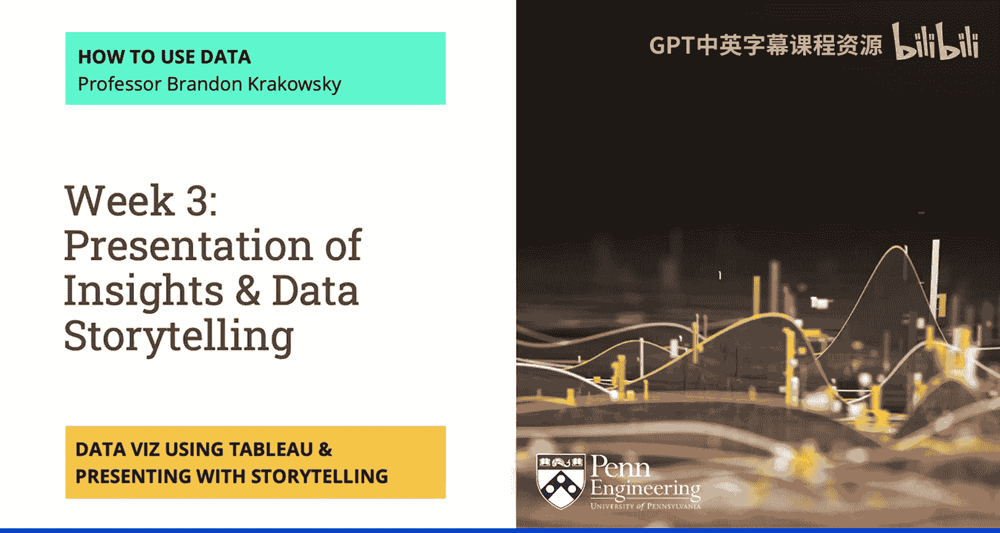
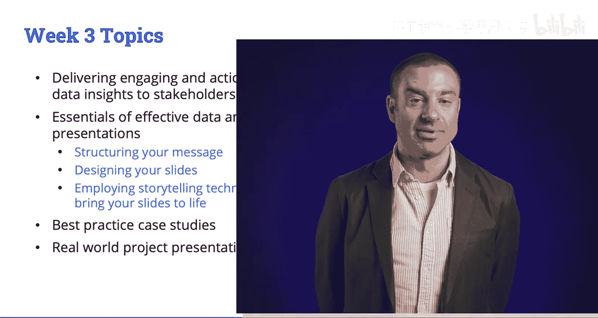

# uPenn《如何运用数据2、3（Python预测分析、数据可视化和叙事）｜How to Use Data》中英字幕 p65 21_模块三导论：洞见呈现与数据叙事.zh_en [BV1LqxEzcEBy_p65]

The final module of our course centers on the art of presenting insights and storytelling with data。

 here we emphasize the importance of not just analyzing data。

 but also communicating your findings in a way that's engaging and actionable for stakeholders。😡。

You'll learn the essentials of creating effective data analytics presentations。

 focusing on structuring your message， designing your slides。

 and employing storytelling techniques to make your data come to life。😡。

This module includes case studies on best practices for data presentation and storytelling。😡。

Culminating in an actual real world project presentation。😡，Through these real world examples。

 you'll discover how to analyze， interpret and present data insights effectively。

 En your audience not only understands your findings， but is also motivated to act on them。

 By the end of this module， you'll possess the skills to deliver data driven presentations。

 A crucial capability in today's information rich environment。😡。

