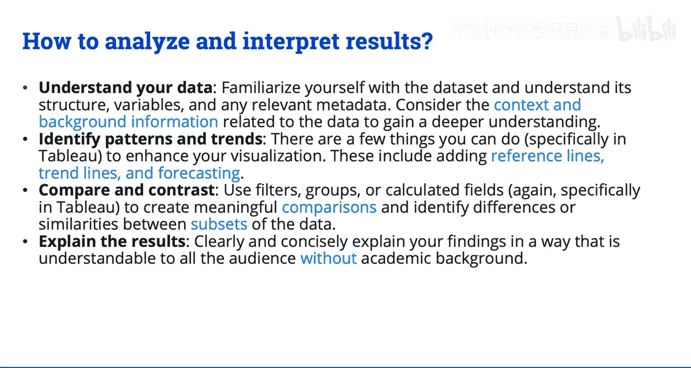

# 数据分析实战：第22章：分析解读结果导论 📊

在本节课中，我们将学习数据分析流程的最后一步：如何分析和解读你的结果。这一步骤是将数据转化为洞见的关键，确保你的分析工作能够产生实际价值。

---

## 理解你的数据

在解读结果之前，你必须确保自己充分理解数据。这包括熟悉整个数据集，理解其结构、变量以及任何相关的元数据。

考虑与数据相关的背景信息，以获得更深层次的理解。例如，了解数据是如何收集的、代表的时间范围或地理区域，有助于你更准确地解读数字背后的含义。

---

## 识别模式与趋势

上一节我们介绍了理解数据的基础，本节中我们来看看如何从数据中识别有意义的模式与趋势。在Tableau等工具中，你可以通过几种特定功能来增强可视化效果，从而更清晰地揭示这些模式。

以下是几种在Tableau中识别模式的有效方法：
*   **添加参考线**：例如，在图表中添加一条表示平均值的线，可以快速判断数据点与整体水平的关系。
*   **添加趋势线**：通过拟合一条趋势线，可以直观地展示数据随时间或其他变量变化的总体方向。
*   **进行预测**：利用工具的预测功能，可以基于现有趋势推断未来的可能情况。

---

## 比较与对比数据

识别出模式后，下一步通常是比较不同的数据子集，以发现差异或相似之处。这能帮助你更深入地理解数据。

在Tableau中，你可以通过以下方式创建有意义的比较：
*   **使用筛选器**：聚焦于特定的数据子集，例如只看某个地区的销售数据。
*   **使用分组**：将数据按类别分组，比较不同组别的表现。
*   **使用计算字段**：创建新的度量或维度，进行更复杂的对比分析，例如计算同比增长率。

---

## 解释结果

当你完成了分析和可视化之后，需要将你的发现清晰地传达给受众。你的解释应当简洁明了，即使是没有学术背景的听众也能理解。

这意味着你需要：
*   避免使用过多的专业术语。
*   用通俗的语言描述图表所展示的故事。
*   明确指出最重要的发现是什么。

---

## 提供洞见与建议

数据分析的最终目的不是展示数字，而是驱动行动。因此，在解释结果之后，你需要基于分析结果和相关可视化，提供有意义的建议。

这包括：
*   **提供建议**：根据你的发现，提出具体、可操作的建议。
*   **解释影响**：说明你的发现有何实际意义。
*   **关联决策**：阐述这些发现如何为决策提供信息，或如何解答最初的研究问题。

---

本节课中我们一起学习了分析和解读数据分析结果的完整流程。我们从**理解数据**开始，进而**识别模式与趋势**，通过**比较与对比**深化认识，然后学习如何**清晰地解释结果**，最后将一切落脚于**提供有价值的洞见与建议**。掌握这一流程，你就能将原始数据转化为能够指导实际行动的强大洞见。