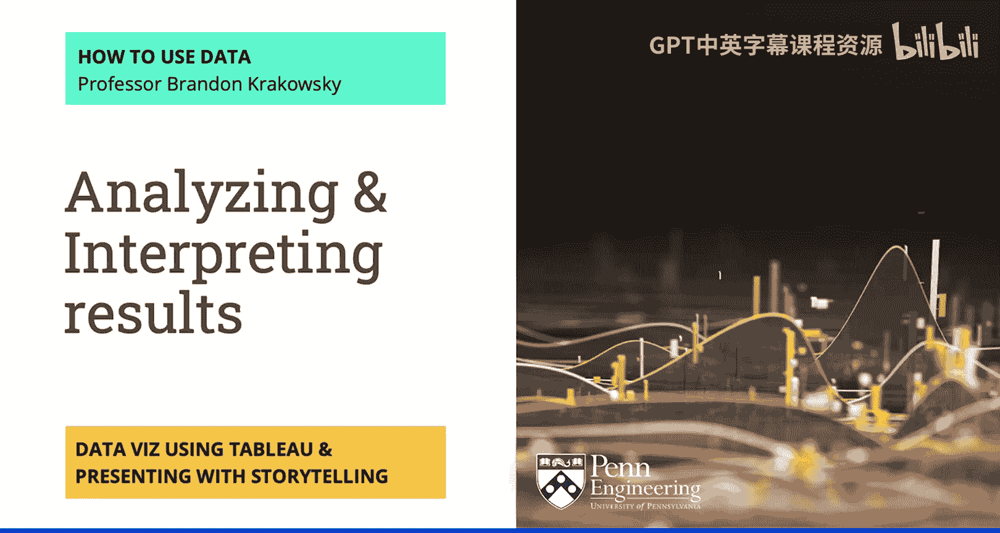
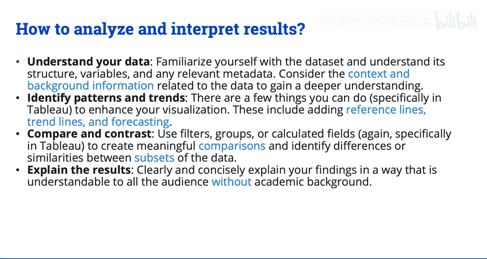

# uPenn《如何运用数据2、3（Python预测分析、数据可视化和叙事）｜How to Use Data》中英字幕 p67 23_分析与结果解读.zh_en [BV1LqxEzcEBy_p67]

嗯。At the end of the data analytics process， you'll need to analyze and interpret your results。

 Make sure you understand your data， familiarize yourself with the data set and understand its structure。

 variables， and any relevant metadata。😡。

Consider the context and background information related to the data to gain a deeper understanding。😡。

Identify patterns and trends。 As we saw， there are a few things you can do specifically in Tau to enhance your visualizations。

 These include adding reference lines， trend lines and forecasting。Compare and contrast data。

 use filters， groups or calculated fields， again， specifically in tableau。

 to create meaningful comparisons and identify differences or similarities between subsets of the data。

 Explain the results， clearly and concisely explain your findings in a way that is understandable to the audience without academic background。

Finally， provide insights and recommendations based on your results and associated visualizations。

 offer meaningful recommendations。😡，Explain the implications of your findings and how they can inform decision making or address the research questions at hand。

