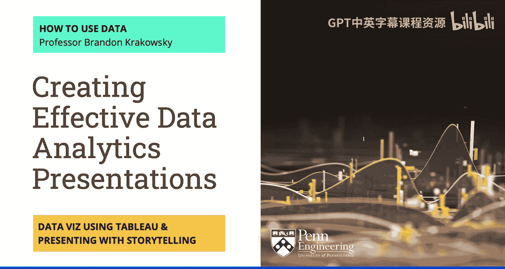
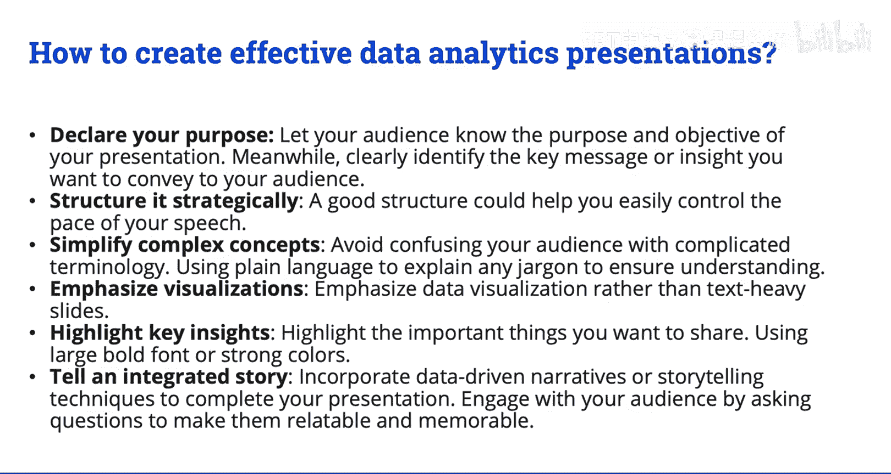

# uPenn《如何运用数据2、3（Python预测分析、数据可视化和叙事）｜How to Use Data》中英字幕 p68 24_打造高效的数据分析演示.zh_en [BV1LqxEzcEBy_p68]

When you're structuring your data analytics presentation， think about the following elements。

 to clear your purpose。 let your audience know the purpose and objective of your presentation。 Also。

 clearly identify the key message or insight you want to convey to your audience。😡。

Structure your presentation strategically。 A good structure can help you easily control the pace of your speech。

😡，Simplify complex concepts， Aid confusing your audience with complicated terminology。

 using plain language to explain any jargon to ensure understanding。Emphasize visualizations。

 emphasizes data visualizations rather than text heavy slides。And highlight the key insights。

 meaning， highlight the important things you want to share。 use large， bold fonts or strong colors。

Finally， tell an integrated story， In data driven narratives or storytelling techniques to complete your presentation。

 engageage with your audience by asking questions to make your presentation relatable and memorable。

