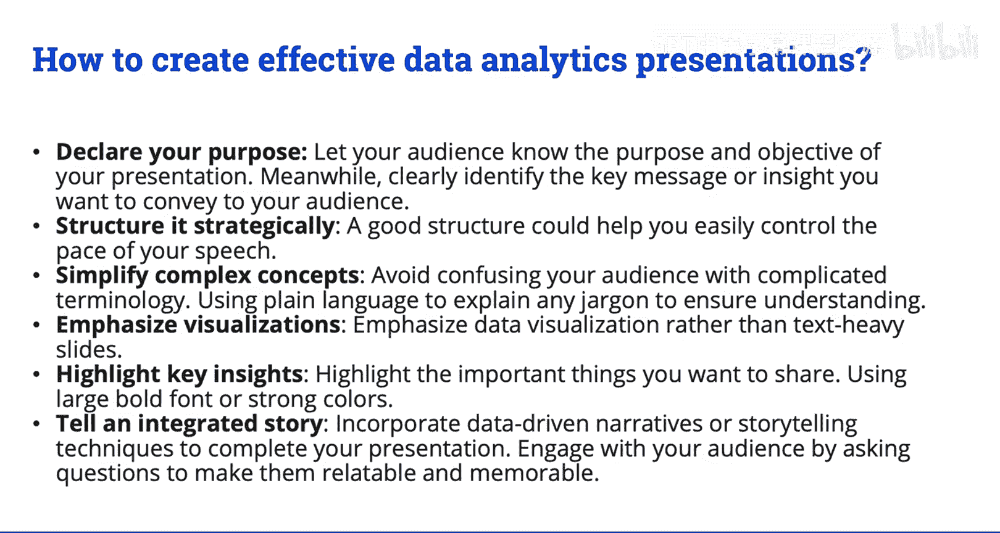

# 数据分析演示：第24章：打造高效的数据分析演示

在本节课中，我们将学习如何构建一个高效、清晰且引人入胜的数据分析演示。一个结构良好的演示不仅能有效传达信息，还能确保听众理解并记住你的核心发现。

---

上一节我们介绍了数据分析演示的重要性，本节中我们来看看构建演示时需要关注的核心元素。

## 明确目的与核心信息

首先，你需要明确演示的目的。让听众了解你演示的目标和意图。

同时，清晰地识别出你想要传达给听众的关键信息或核心见解。

---

明确了演示的目标后，接下来我们需要为演示内容搭建一个清晰的框架。

## 构建策略性结构

策略性地构建你的演示结构。一个好的结构可以帮助你轻松控制演讲节奏。

以下是构建演示结构时需要注意的几个关键点：

*   **简化复杂概念**：避免使用复杂的术语让听众感到困惑。使用平实的语言解释任何专业术语，以确保理解。
*   **强调可视化**：强调数据可视化，而不是制作文字密集的幻灯片。
*   **突出关键见解**：这意味着，突出你想要分享的重要内容。可以使用大号、粗体字体或醒目的颜色来强调。
*   **讲述完整故事**：在演示中运用数据驱动的叙事或讲故事技巧。
*   **与听众互动**：通过提问与听众互动，使你的演示更具关联性和记忆点。

---

本节课中我们一起学习了打造高效数据分析演示的核心要点。我们首先强调了明确演示目的和核心信息的重要性。接着，我们探讨了如何策略性地构建演示结构，包括简化概念、善用可视化、突出关键点、讲述数据故事以及与听众互动。遵循这些原则，你将能创建出清晰、有力且令人印象深刻的数据分析演示。