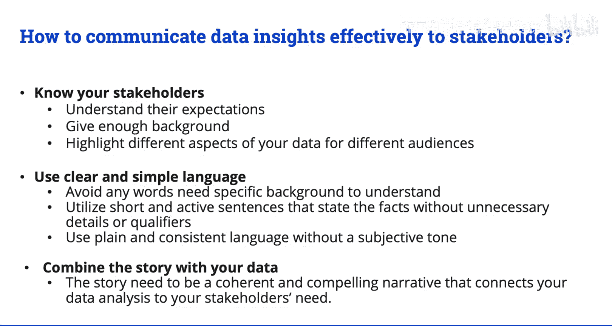

# uPenn《如何运用数据2、3（Python预测分析、数据可视化和叙事）｜How to Use Data》中英字幕 p69 25_向利益相关者有效传达数据洞见.zh_en [BV1LqxEzcEBy_p69]

When presenting and communicating your insights， consider your audience。

Get to know your stakeholders。 This means understand their expectations。

 give enough background and highlight different aspects of your data as needed for different audiences。

Be sure to use clear and simple language。 Avoid words that require a specific background to understand。

 utilize short and active sentences that state the facts without unnecessary details or qualifiers。

 and use plain and consistent language without a subjective tone。 Combine the story with your data。

 The story needs to be a coherent and compelling narrative that connects your data analysis to the needs of your stakeholders。

😡。

