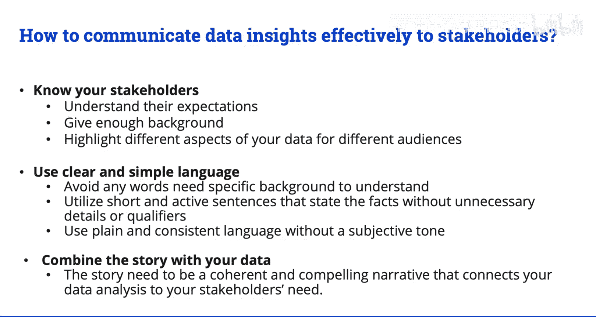

# 数据沟通：第25章：向利益相关者有效传达数据洞见 📊

在本节课中，我们将学习如何将数据分析的成果有效地传达给不同的利益相关者。核心在于理解受众、清晰表达，并将数据与一个连贯的故事相结合。

上一节我们探讨了数据分析的技术层面，本节中我们来看看如何将分析结果转化为有影响力的沟通。

## 了解你的受众 👥

进行演示和沟通时，首要考虑你的听众。

这意味着你需要了解利益相关者的期望。为不同的受众提供足够的背景信息，并根据需要突出数据的不同方面。

## 使用清晰简洁的语言 ✍️

确保使用清晰简单的语言。避免使用需要特定背景才能理解的术语。

以下是实现清晰沟通的几个要点：
*   利用简短、主动的句子陈述事实，避免不必要的细节或修饰语。
*   使用平实、一致的语言，避免主观语调。

## 将故事与数据结合 📖

故事需要是一个连贯且引人入胜的叙述，将你的数据分析与利益相关者的需求连接起来。

通过将数据嵌入一个相关的叙事中，你可以使洞见更容易被理解、记忆和采纳。

---

本节课中我们一起学习了有效数据沟通的三个关键要素：深入了解受众、使用清晰简洁的语言，以及构建一个以数据为支撑的连贯故事。掌握这些技巧能确保你的分析洞见产生实际影响。