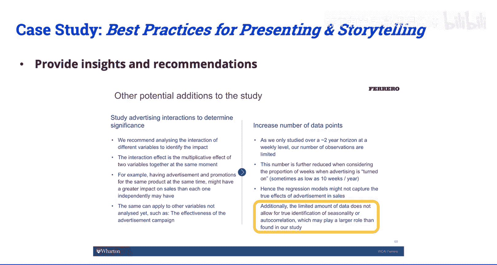

# uPenn《如何运用数据2、3（Python预测分析、数据可视化和叙事）｜How to Use Data》中英字幕 p70 26_叙事最佳实践.zh_en [BV1LqxEzcEBy_p70]

Here's another real world example of how a team of data student analysts and data scientists worked with a company to solve a real world business problem。

For this specific case， we want to look at the final parts of the data analytics process。

 interpreting and communicating results， in particular。

 best practices for presenting and storytelling。😡，The company is Ferrero。

 the largest privately held chocolate and confectionery company in the world。

Let's learn more about the business context。 In 2018。

 Ferrero had recently acquired significant additional brands。

 including Nestle's US Confectionery business and Kellogg's cookies and fruit snacks business。

Given these acquisitions， there was a business need to better optimize the advertising spending across the brands。

Ferrero wanted to solve the following business objective to build a marketing mix model to understand if there are opportunities to test the reallocation of advertising spend。

 specifically on TV advertising spend。A marketing mix model is a multivariate regression that uses marketing data to predict sales or volume outcomes。

Ferrero was specifically interested in the existence of halo interactions or times in which one product's advertising benefit another product。

For example， if they saw a statistically significant increase in TiTac Mit sales when TikTac gum was advertised on TV。

After completing the analysis， the student analysts interpreted in communicating their results in a presentation to Ferrero stakeholders。

What follows are some highlights from their final presentation to demonstrate some best practices for presenting and storytelling？

😡，Following these best practices can lead to more effective and impactful presentation of a data analytics project and help to convey the information clearly and engagingly to the audience。

 At the beginning of your presentation， providing a good agenda gives the audience a clear structure of your presentation and what's to be expected。

Including a brief background provides the audience with a contextual framework for better understanding the subject matter of your presentation。

😡，This slide in the presentation provides a bit of background information about Ferrero。

And this slide talks about Ferrero's acquisition of additional brands and the need to optimize advertising spend。

 This is the whole reason for building the marketing mix model。

 using maps as a visualization tool helps to effectively illustrate the geographical distribution。

 This slide visualizes the heavy advertising spend， and its effect on share of voice across markets。

 share a voice as a measure of the percentage of media spending compared to the total media expenditure for the product in the market。

Simplify complex concepts for the audience。 This slide clearly shows that two of Ferrero's brands。

 Titac and icebreaker mint have about the same total annual spend， but distributed differently。

Highlight key insights。 Here we see that Kinder UK spend is lower than other brands。

 even when considering total product count。And identify patterns and trends that tictac mint benefits when both gum or mint are promoted。

Provide insights and recommendations。 This provides insights and recommendations like further studying advertising interactions to determine significance。

 For example， having advertisement and promotions for the same product at the same time might have a greater impact on sales than each one independently may have。

This also notes other potential additions to the analysis。

 such as increasing the number of data points。

