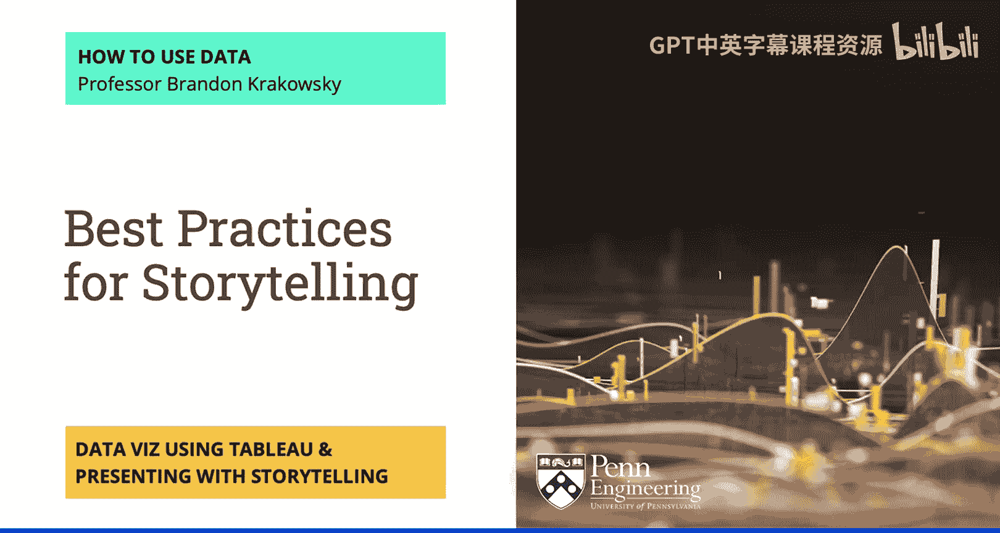
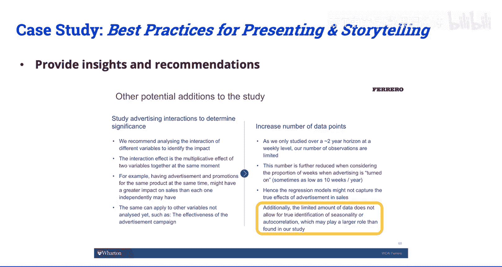

# 数据叙事最佳实践：26：叙事最佳实践 🎯

在本节课中，我们将学习如何有效地呈现和讲述数据分析结果。我们将通过一个真实世界的商业案例——费列罗公司的营销组合模型项目，来展示数据叙事的最佳实践。这些实践能帮助你更清晰、更有影响力地向观众传达复杂的信息。

---

上一节我们介绍了数据叙事的重要性，本节中我们来看看一个具体的应用案例。

## 项目背景与企业需求 🏢

费列罗是全球最大的私营巧克力和糖果公司。在2018年，该公司收购了包括雀巢美国糖果业务和家乐氏饼干及水果零食业务在内的多个重要品牌。

鉴于这些收购，企业产生了优化各品牌间广告支出的业务需求。费列罗希望达成的商业目标是：**建立一个营销组合模型，以了解是否存在重新分配广告支出（特别是电视广告支出）的测试机会**。

一个**营销组合模型**本质上是一个**多元回归模型**，它使用营销数据来预测销售额或销量结果。费列罗特别关注“光环效应”是否存在，即一个产品的广告是否会对另一个产品的销售产生益处。

例如，如果在电视上为TicTac口香糖做广告时，TicTac薄荷糖的销量出现了统计上显著的提升。

---

在完成分析后，学生分析师们需要向费列罗的利益相关者展示并解读他们的结果。以下是他们最终演示中的一些亮点，用以展示呈现和讲故事的最佳实践。

## 演示与叙事最佳实践 📊

遵循这些最佳实践，可以使数据分析项目的呈现更加有效和具有影响力，并有助于清晰、引人入胜地传达信息给观众。

### 1. 提供清晰的议程与背景

在演示开始时，提供一个好的议程能让观众对你的演示结构和预期内容有清晰的了解。包含一个简短的背景介绍，能为观众提供一个理解演示主题的背景框架。

以下是演示中相关的幻灯片示例：
*   一张幻灯片提供了关于费列罗的背景信息。
*   另一张幻灯片讨论了费列罗收购其他品牌以及优化广告支出的需求，这正是构建营销组合模型的根本原因。

### 2. 有效利用可视化工具

使用地图作为可视化工具，有助于有效地说明地理分布情况。

一张幻灯片可视化了高额的广告支出及其对跨市场“声量份额”的影响。**声量份额**是衡量某一产品在市场上的媒体支出占总媒体支出百分比的指标。

### 3. 为观众简化复杂概念

一张幻灯片清晰地展示了费列罗的两个品牌——TicTac和Icebreaker薄荷糖——年度总支出大致相同，但分布方式不同。

### 4. 突出关键洞察与模式

在这里我们看到，即使考虑产品总数，Kinder品牌在英国的支出也低于其他品牌。同时，分析识别出了一种模式和趋势：当口香糖或薄荷糖产品被推广时，TicTac薄荷糖会受益。

### 5. 提供见解与建议

这部分的演示提供了见解和建议，例如进一步研究广告互动以确定其显著性。例如，**同一产品同时进行广告和促销，可能比各自独立进行对销售产生更大的影响**。

演示还指出了分析中其他潜在的补充方向，例如**增加数据点的数量**。

---

本节课中，我们一起学习了数据叙事的最佳实践。我们通过费列罗的案例，了解了从提供清晰背景、有效可视化、简化概念，到突出洞察和提供可行建议的完整叙事流程。掌握这些技巧，能让你在呈现数据分析结果时更具说服力和影响力。