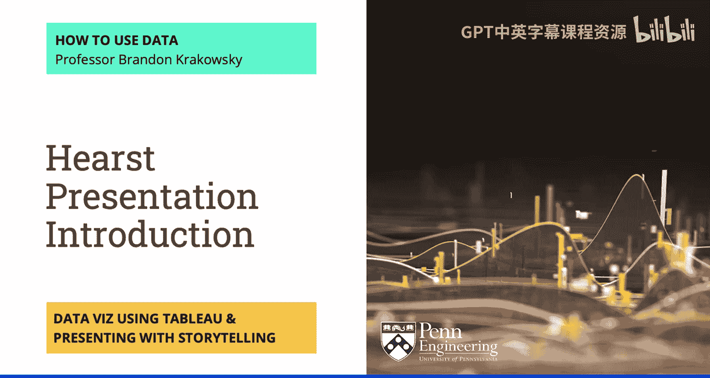
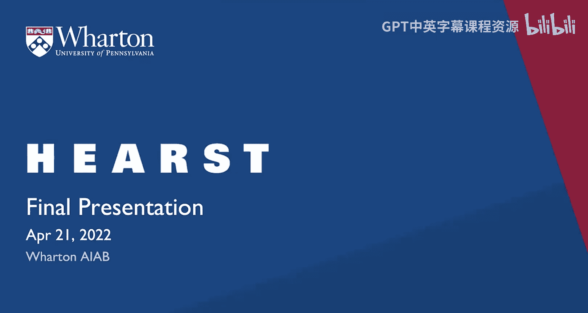

# uPenn《如何运用数据2、3（Python预测分析、数据可视化和叙事）｜How to Use Data》中英字幕 p71 27_演示开场.zh_en [BV1LqxEzcEBy_p71]

Good morning everyone we are here to discuss the final presentation for Earth analyticsly Acccelerator。

This is the team that will be presenting today and we have worked on this over the last couple of months let's do a quick round of introductions starting with Y hell everyone I Yon Ch I'm a second year masters here at studyri data science and I'm mostly responsible for Buau of implementation the all。

Hi yeah hi everyone， my name is Angelita and I'm currently freshman in Wharton study of finances statisticss I mainly worked on the part of a lot of one。

😊，Hi everyone， my name is Rashad， I'm currently a sophomore a goodgra studying computer science。

 finance certificate and I also work with Angelo Laiv。Yeah。

They died is Simon A a currentlyne near sophomore studying Sis。

 and Edward were Roo and Glouceon of the A。Hi， my name is Cdy and I'm also studying computer science and Im also focused on the Kney classical hard this and I'm Chandra。

 I'm a second year MB student at Qua and I'm majoring in business。😊。

