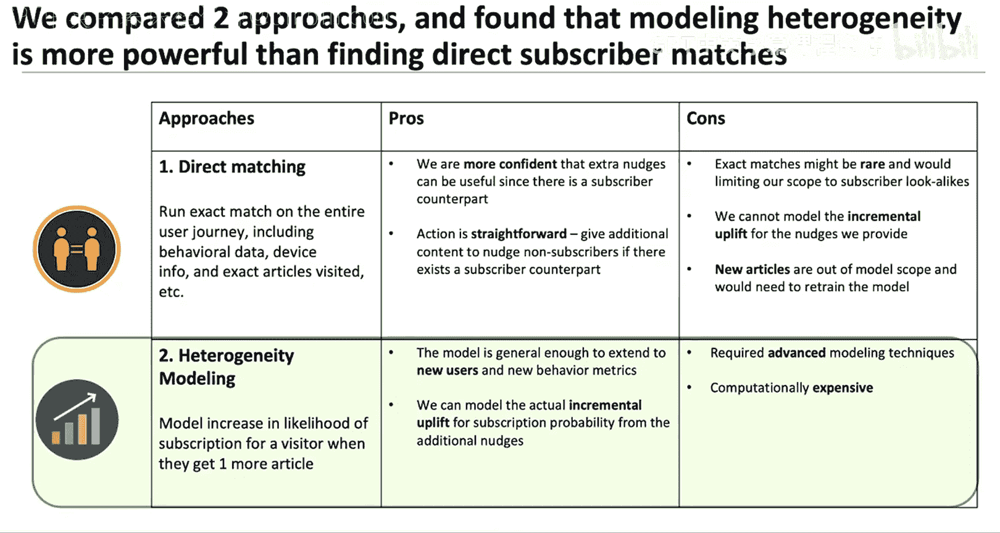

# uPenn《如何运用数据2、3（Python预测分析、数据可视化和叙事）｜How to Use Data》中英字幕 p72 28_背景与方法论.zh_en [BV1LqxEzcEBy_p72]

Today we will keep presenting our background and approach towards developing this project。

 then going over the project M three distinct steps and finally ending with the results of the R model and the next steps that emerge。

So。Starting with the objective。Our key goal here was to develop a dynamic meter to enhance the conversion rate of visitors on Het's newspaper websites。

 so currently the reader that we have on the news websites is quite tight we have the option to offer people to articles when they are inside jobography and zero articles when they are outside jobography and we wanted to approach this in a more dynamic way maybe being restrictive with people would look like subscribers and being a bit more lenient with people who need to read more in order to become。

So。To create this dynamic meter， we started it with a few guiding prints。

Firstly we wanted to focus on subscription propensity and not maybe redirecting them to the other threenew websites that we have and secondly we had to consider the data caveats that we were working with。

 for example the historical geography meter would create some bias in the user behavior because people outside geography were more restricted。

So。啊。Moving forward with this， thisP data that we were working with。

We had access to the page view data of visitors， the content that they were looking at。

 their payroll behavior and information on subscribers。We access the data for Houston Chronicle。

For this year， starting from first Chan， till March end。

We removed anyone from this data who were or who was already a subscriber so that we can focus on conversion behavior。

That is when people are hit with a paywall， they either convert or don't cut。

Here we see that primarily there were two types of data buckets。

 one was related to the device source content or browser of the user。

 the other was related to their behavior， which is total page views。

 their frequency of visit and the time spent which is closer to let's say the monetary value of a user。

と。Why the modern that we develop is for chronicle。The methodology can be applied to other new server of sites as well。

Please let me know if you have any questions until now and otherwise we can move on。

We also had discussions with industry experts within Watton。

In terms of our dynamic meter is usually built in the industry and we found that there are two key approaches。

One is direct matching that is when we have a large enough data set of subscribers。

 we can try to find whether a non subscribeubscriber who is visiting looks exactly like a subscriber and treat them as a subscriber。

But we found that this approach was a bit restrictive and given that the data size of subscribers that we were working with were also limited we wanted a more nuanced approach so we ended up developing something called a heterogeneity Morty which understands the nuances of visitors heaviers and so that we are able to classify people as potential subscribers even if they would exactly look like a subscriber but are some distance from them。

