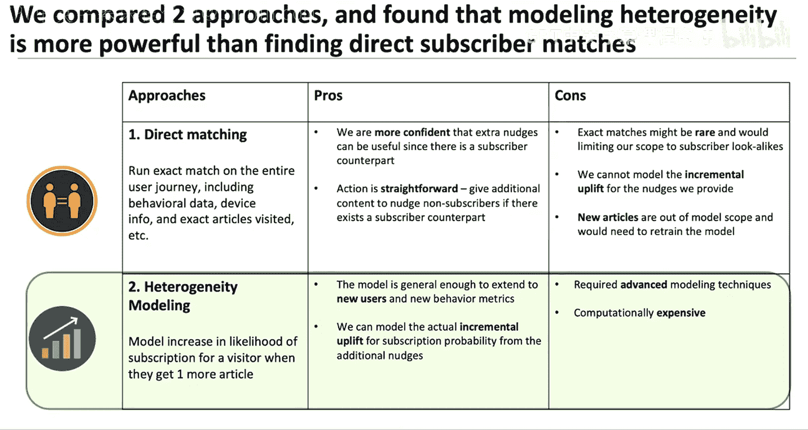

# 宾大《如何运用数据2、3》课程：第28节：背景与方法论 🎯

在本节课中，我们将继续介绍本项目的背景与方法论，概述项目的三个主要步骤，并最终展示R模型的结果以及由此产生的后续步骤。

## 项目目标

我们的核心目标是开发一个动态计量器，以提高《休斯顿纪事报》网站访客的订阅转化率。目前，新闻网站的阅读权限设置较为固定：用户在特定地理区域内可阅读一定数量的文章，区域外则无法阅读。我们希望采用一种更动态的方式，例如对看似订阅意愿高的用户采取更严格的限制，而对那些需要更多阅读才能转化的用户则更宽松。

## 指导原则

为了创建这个动态计量器，我们设定了几个指导原则。

首先，我们专注于预测用户的**订阅倾向**，而非将他们重定向到集团旗下的其他新闻网站。其次，我们必须考虑所处理数据本身存在的局限性。例如，历史上基于地理位置的计量器会导致用户行为数据出现偏差，因为区域外的用户受到了更多限制。

## 数据基础

接下来，我们看看所使用的数据。

我们获取了访客的页面浏览数据、他们浏览的内容、付费墙触发行为以及订阅者信息。数据来源于《休斯顿纪事报》，时间范围是今年1月1日至3月底。

我们从数据中移除了所有已经是订阅者的用户，以便专注于研究**转化行为**——即当用户遇到付费墙时，他们是选择订阅还是不订阅。

这里我们看到数据主要分为两类：
*   一类与用户的**设备、来源、内容或浏览器**相关。
*   另一类与用户的**行为**相关，包括总页面浏览量、访问频率以及停留时间（这更接近用户的“货币价值”）。

虽然我们开发的模型是针对《休斯顿纪事报》的，但该方法论同样可以应用于集团的其他新闻网站。

## 行业方法调研

我们还与集团内部的行业专家进行了讨论。

我们调研了行业内通常如何构建动态计量器，发现有两种主要方法。

一种是**直接匹配法**。当我们拥有足够大的订阅者数据集时，可以尝试判断一个正在访问的非订阅者是否看起来“完全像”一个订阅者，并据此将其视为订阅者对待。

但我们发现这种方法限制性较强。考虑到我们拥有的订阅者数据规模也有限，我们希望能采用一种更细致的方法。因此，我们最终开发了一种称为**异质性模型**的方法，它能理解访客行为的细微差别，使我们能够将用户分类为潜在订阅者，即使他们看起来并不完全像现有订阅者，只是存在一定程度的相似性。

---

### 本节课总结

本节课我们一起学习了动态计量器项目的背景与核心方法论。我们明确了提高订阅转化率的目标，并确立了专注于订阅倾向和数据局限性的指导原则。我们了解了项目所使用的两类关键数据：用户属性数据和行为数据。最后，我们探讨了行业内的两种主流方法，并解释了为何选择开发更细致的异质性模型来应对我们的数据挑战。