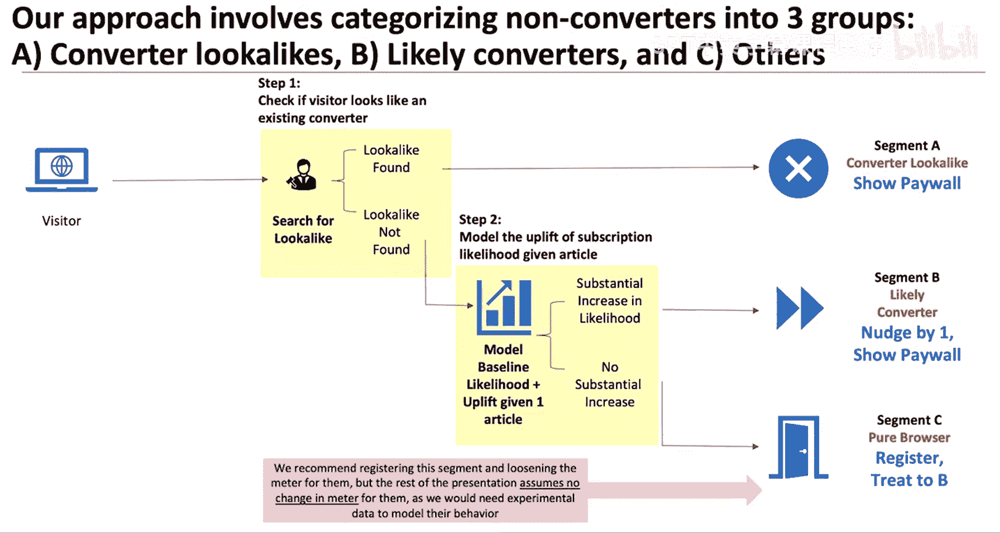

# uPenn《如何运用数据2、3（Python预测分析、数据可视化和叙事）｜How to Use Data》中英字幕 p73 29_将未转化用户分类为类转化者、潜在转化者与.zh_en [BV1LqxEzcEBy_p73]

Here we will talk about our poor on。😡，So this starts with a visitor coming onto the website。

The first thing we would do for them is check whether they look like a converter。

Which is based on a certain distance threshold。If they happen to look like a converter。

 then we classify them into segment a as a converter look alike。

And the action here is to show them that paywork。Because we know that they no like a convert。Now。😡。

If they do not look like a converter。Then we go on to。Understanding the effect。

 giving them one more article would have。So， this means understanding their baseline likelihood to convert and the uplift。

Of on that probability by giving them that one more at。

 If there is a substantial increase in their likelihood to convert。

 we classifiedify them to segment B as a likely converter。We give them that one extra。

 and then we hit them with a paper。That still leaves us with people in segment C。

These people do not look like converters and their likelihood to convert doesn't go up significantly giving by giving them that one extra article。

So we can call them something of your browser。😡，And what we would recommend is to maybe get them to register and show them a large number of articles so that maybe we can get the revenue from them in some other ways。

 maybe through add revenue and there will come a point wherein after treating them with the extra articles。

Their likelihood to convert would increase and they might move up to segment B。Now。

 the historical data that we were working with was based on a less number of articles because the meter was quite type。

 so it was possible for us to model the behavior of segment a and segment B。

But to modern the behavior of segment C， who would get a lot of free articles。

 we would need to run A testing。So going forward in the model。😡。

We are assuming that the meter for segment C remains at J。

That still allows us to model out the gains from segment A and segment B in terms of changing the meter。

So understanding this approach and aligning monitor is really important。

 please let me know if you have any questions here。

We in the room had a distinct preview so we've already gotten our questions asked Okay。

 I guess I guess I do have one or did you say if I missed it perhaps how you what inputs you use to develop the lookalike model。

 like what were the behaviors？Yes， so we will go over that in detail in terms of what features we use to develop the localkaites。

 we did not mention that currently this is just a preview of the approach we will also preview the the outcomes and then we will move on to the details of how we went about doing this and what we found in more detail。

Great， thanks。And we also talked about four segments C。

There are opportunities to find alternative monetization pathways， and so as an example。

 Sam Abbsug and I talked about how maybe you would show them more commerce related articles to try to derive value from segment C through the commissions we get through commerce。

 it could also be a different adMap that provides more ad monetization for those segments。

 so that provides a rich opportunity for alternative treatments。

