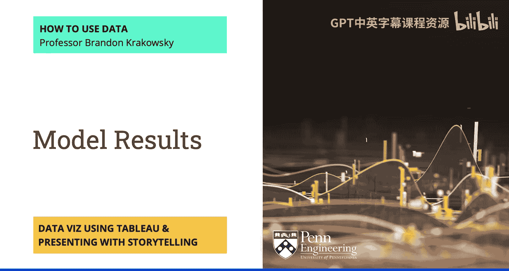
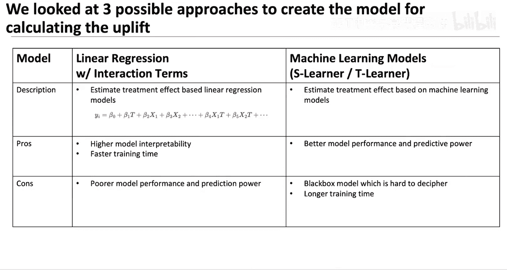
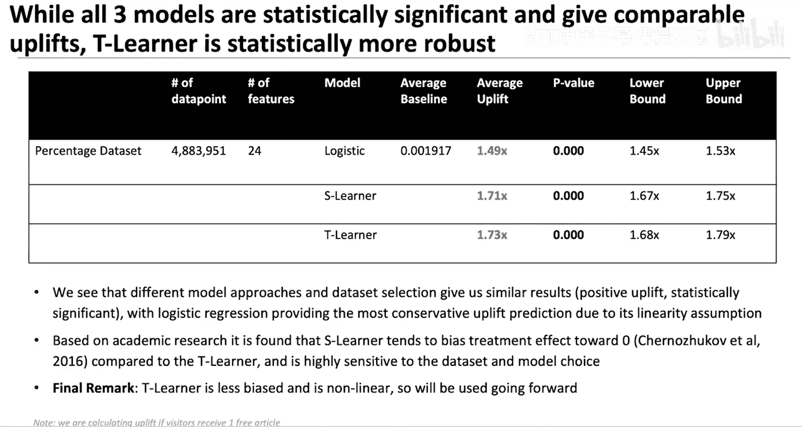
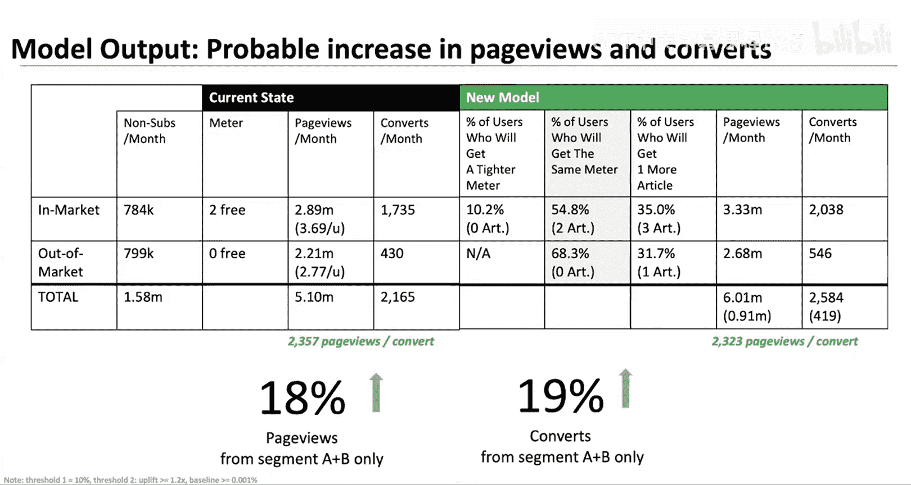

# uPenn《如何运用数据2、3（Python预测分析、数据可视化和叙事）｜How to Use Data》中英字幕 p74 30_模型结果.zh_en [BV1LqxEzcEBy_p74]

This is a preview of what we found based on this。说。

The step0 before even creating a voltage fordynamic meter。

Would be to understand the heterogeneity in the converters and the non converters。

We did this by creating five clusters of converters and five clusters of non converters and mapping them out on certain key dimensions that we will be discussing later。

The main insight here was that there is a decent amount of overlap between the different types of converters and the different types of non convert。

Which allows us the possibility of finding local likes for a large number of non converters。

The first step of creating the model。Was trying to find localalikes and classifying people into segment  A。

The approach we took here was at setting distance threshold this is just how distant they are from some other converter。

So， we saw that a distress threshold of 0。138 classified 10% people as localized。

When we reduce this distress threshold to let's say 0。

1 then the size of people who fall in segment a as converter lookcols drops significantly。

 but when we increase it to let's say 0。15 it doesnt increase so there is something of an inflection point at or above at around the 10% lookcalike mark if we want to be more restrictive we can increase this distance threshold and classify say about 18 to 20%。

The second part of the model that we had discussed earlier was to figure out the probability of conversion and the increase given one moreat。

We found that amongst all the data that we add。The overall baseline probability to convert was 0。02%。

And giving them that one extra article had a 1。7 time jump in that probability over the baseline。

The action here was to look at certain thresholds for the baseline probability and the up。

And we ended up classifying 33% users into segment T。

 those who had the higher propensity after taking away the look guyss。So。

 looking at this segment a of 10% and segment B of 33%。

The overall reserve that we found was there is a 15 to 20% increase in both protect page views and converts we will go over the results in more detail later。

Sure so when we get into this， there's two basic main goals of this model which is for you want to again the probability that a nonconverer changes into an inverer and we also want to find order the useful drivers that turn a nonconverer into a converter so for this we aggregated the data to user level information but however we wanted to make sure that every feature that we checked brought something here to the table。

Now initially what we need to do is we need to get rid of features that are very highly correlated because otherwise they'll just be telling us the same thing so initially we started out with 67 originalal features I managed to cut it down 24 final inputs into our model if you look at the heat map essentially what it's showing is what is the correlation between two separate feature on the both X axis y axis the blue diagonal down the middle as this features matching with themselves and all other features the model and during mild correlation between negative 02 and。

2 after performing our feature selection process。So then we had to determine what model we were going to use essentially we used a certain statistic called AUPRC to grade our different models and the entire idea behind AUPRC is the perfect model has an AURC of 1 so our XGB model got as close as possible 。

7198 so we decided to go with that when making our predictions。Finally。

 we looked at what were the inputs into the lung that were most predictive of how whether or not someone charges from anocatory a converter。

 and from this we found that its the percentage of page user from newsletter letterss。

 the total page counts， percentage of page from desktop， the recency and the frequency。

We noticed that a couple of few things match up with our initial exploratory data analysis or we did any model。

 which is good science because the modeling actually matches up with how the data looks like we also found some new features such as percentage of page desktop and a recent C frequency。

 which are new things we discovered after the our model So moving way forward we're going to be using the percentage such as data for our analysis。

So to actually calculate the uplift， we impaired the performance of free possible approaches。

 so first the linear regression model， which has four model performance that as higher theability。

 we also look at S learnner and T learner from machine learning models with higher and more robust performances。

So actually looking at the results of the three bottle。

 we see that these different model approaches and data selection gives us similar results。

 so that is to say we all have positive uplift and statistically significant uplift of 1。

5 times to one looks at advice however after digging deeper into academic research we've found out that T learner would probably be the most robust model because of the fact that as Ber always ends to 10 towards 0 or the treatment effect of the uplift whereas for the linear regression model it relies on many assumptions for linear so ultimately we decided to use the results from the T learner。

So this is where we have populated the results， this is the current state that we are looking at。

So we are people in market and out of market having a different meaning like in market we get2 three articles out of market we get zero3 articles in terms of page views from both of these we get a total of 5。

1 million page views and we get a total of 21651 words per month。Now， looking at the new one。

So percentage of people who get a tighter meter which is segment a percentage of people who will get one more article which is segment B as the remaining fall section C when we do the math for their behavior we would find that people in segment A would be dealt with a little bit more harshly than they are currently dealt with so certain page views and subscription propensity even go down but this would be more than made up power by the treatment effect of segment B so overall when we do the math we find that we are likely to get a 6。

01 million page views。And 2584 convertverses。Which is an increase of 18% for page views and 19% from converts。

Again， this is only from the IP on segment A and B and we need to do every testing to see the additional impact that segment see。

And that is just one month， one market Houston Proicle。

 and so when you start thinking about the opportunity across our Hirst network across a year。

 that's pretty darn exciting。

