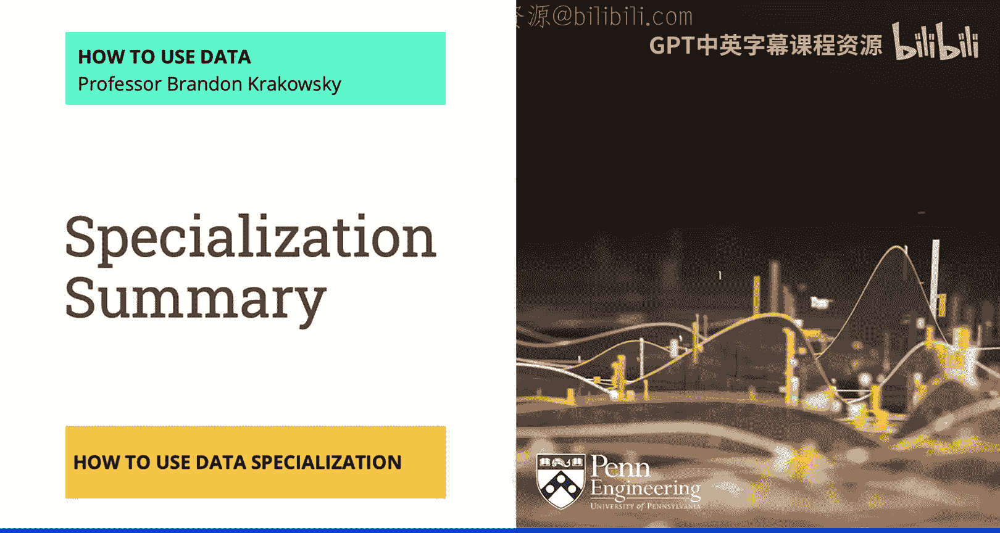
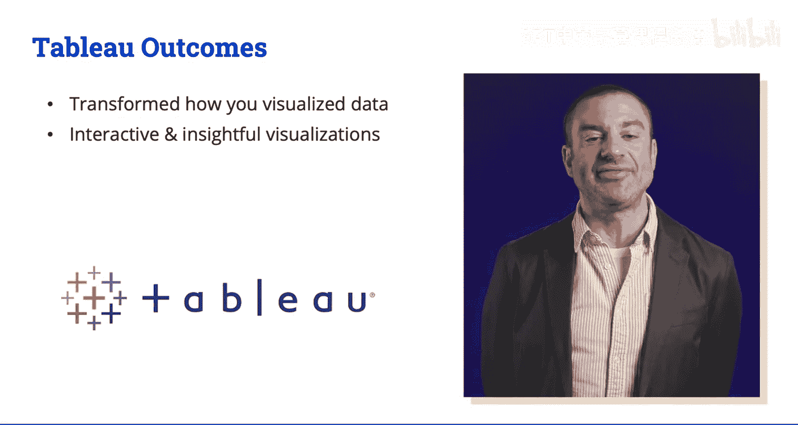

# uPenn《如何运用数据2、3（Python预测分析、数据可视化和叙事）｜How to Use Data》中英字幕 p75 31_如何运用数据课程结语.zh_en [BV1LqxEzcEBy_p75]

As we conclude our how to use data specialization， let's take a moment to appreciate the ground we've covered in the skills we've developed。

 starting with a mix of curiosity and perhaps a bit of apprehension about data。

 you embarked on a comprehensive journey into the world of data analytics。

 You tackled SQL for data wrangling， Python for data analysis and predictive analytics and brought your findings to life with data visualization using tableau and masterful data storytelling。

Throughout the weeks， you've not just learned， but actively applied a variety of techniques and tools。

 In SQL， you navigated the intricacies of data storage。

 Learn to query databases effectively and understood the importance of structuring and joining data。

 Python wasn't just about writing code。 It was about using it as a tool for exploratory data analysis。

 Clean， transforming and deriving meaningful insights from complex data sets。

Your progress with Python extended into the realms of machine learning。

 where you applied models like linear and logistic regression and even explored advanced techniques like decision trees。

 randomand forests and K means clustering。 The final phase of the specialization with tableau transformed how you visualize data。

 You move beyond basic charts to create interactive and insightful visualizations。

 learning to tell a story with your data。 This specialization was a starting point。

 Laing the foundation for continued learning in the vast and evolving field of data and data analytics。

 Thanks for your hard work in unique contributions to the specialization。 As you move forward。

 I hope you continue to explore data with curiosity and use these skills to enhance your professional and academic endeavors。

😊。

