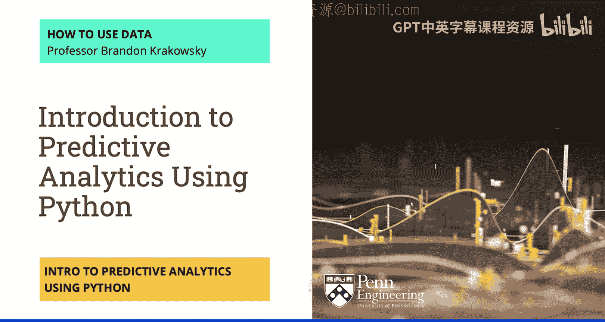
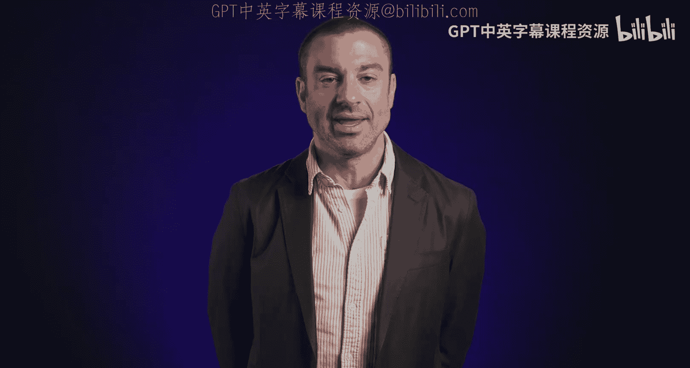
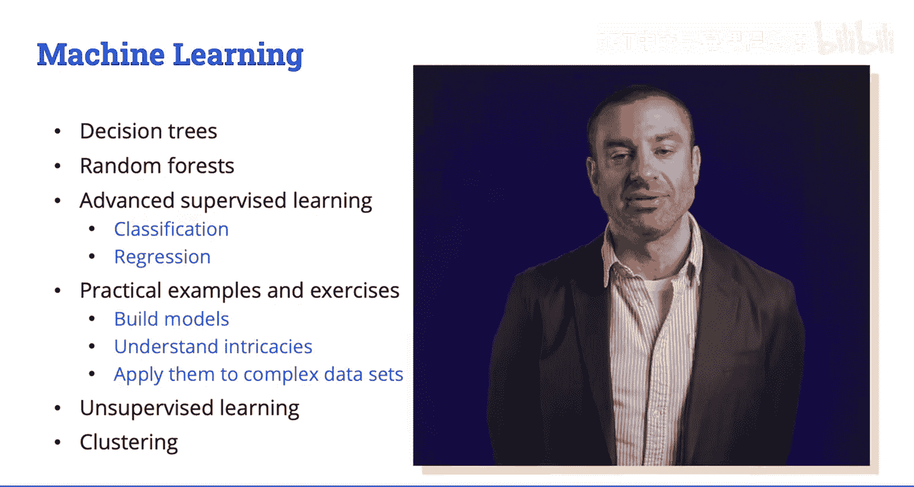
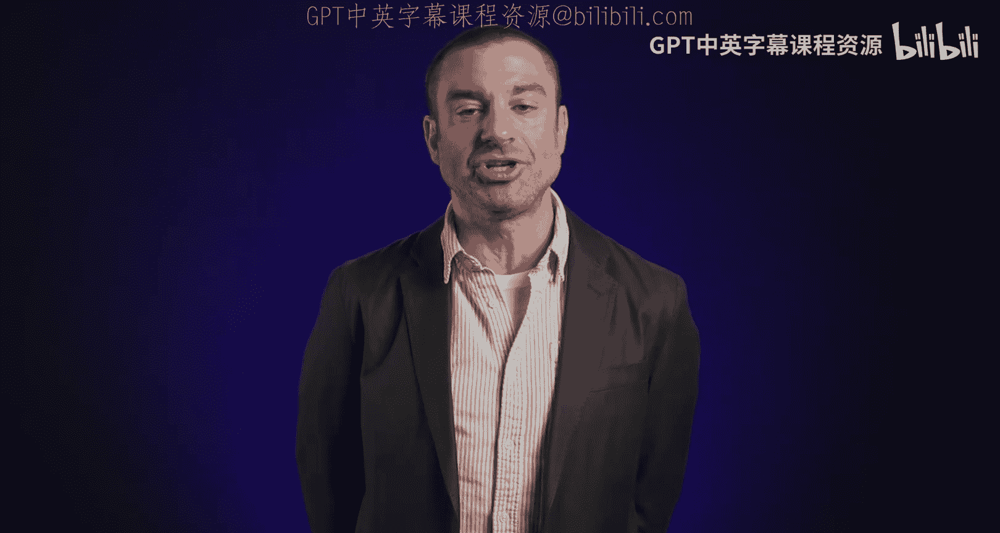

# 第二三部分 2：Python预测分析课程导论 🎯

在本节课中，我们将要学习宾夕法尼亚大学《如何运用数据》系列课程中关于Python预测分析的导论部分。我们将了解预测分析的核心目标、本课程将涵盖的主要技术，以及如何将这些技术应用于解决实际问题。

## 课程概述 📋

欢迎来到我们的预测分析课程。本课程专为提升您使用Python构建、优化和实施预测模型的技能而设计。它作为预测分析的全面导论，将从线性回归和逻辑回归的基础知识开始。

## 预测分析的核心模型 📈

上一节我们介绍了课程的整体目标，本节中我们来看看预测分析的基石模型。这些模型是预测分析的基石，使您能够通过从历史数据中学习来预测未来事件。

我们将涵盖这些模型背后的一些理论，但重点是它们在现实世界场景中的应用，以及评估其性能以确保准确性和可靠性的过程。

## 进阶机器学习技术 🌲

随着课程的深入，我们将更深入地探讨机器学习领域，重点关注决策树和随机森林。这些技术代表了监督学习中更高级的方面，为分类和回归任务提供了强大的工具。

以下是您将通过实践掌握的关键技能：
*   学习如何构建这些模型。
*   理解它们的内在复杂性。
*   将它们应用于复杂数据集以识别模式并进行预测。

## 无监督学习与聚类 🔍

除了监督学习，我们还将介绍无监督学习和聚类的概念。这将拓宽您的分析工具包，并为您提供处理没有预定义标签或类别的数据的技能。

## 课程目标与总结 🏁

在本课程结束时，您不仅将对各种预测分析技术有透彻的理解，还能够应用这些技术解决现实世界的问题，为在数据分析领域的持续成长和探索奠定基础。

本节课中我们一起学习了预测分析课程的整体框架，从基础的回归模型到进阶的决策树、随机森林，再到无监督学习。我们明确了课程的目标是让您掌握使用Python构建和评估预测模型，以解决实际问题的能力。