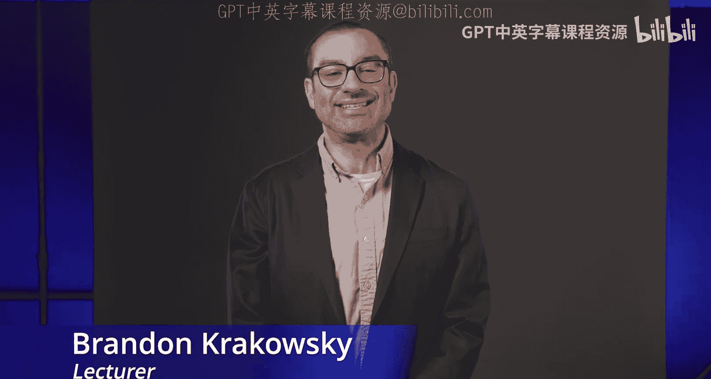
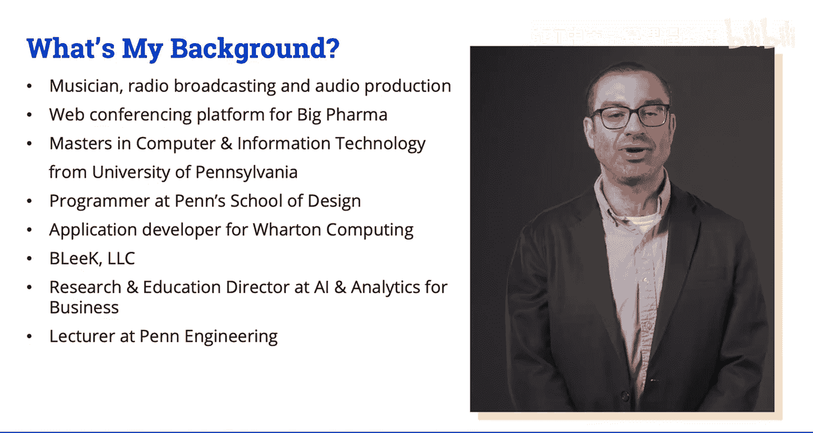
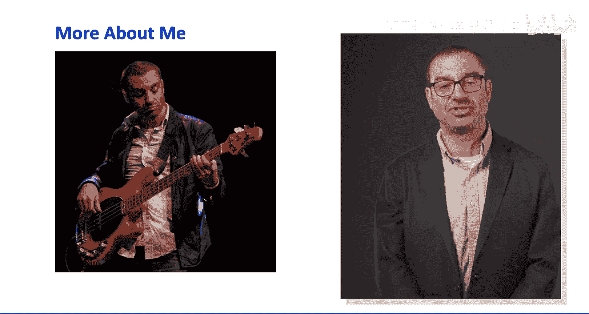
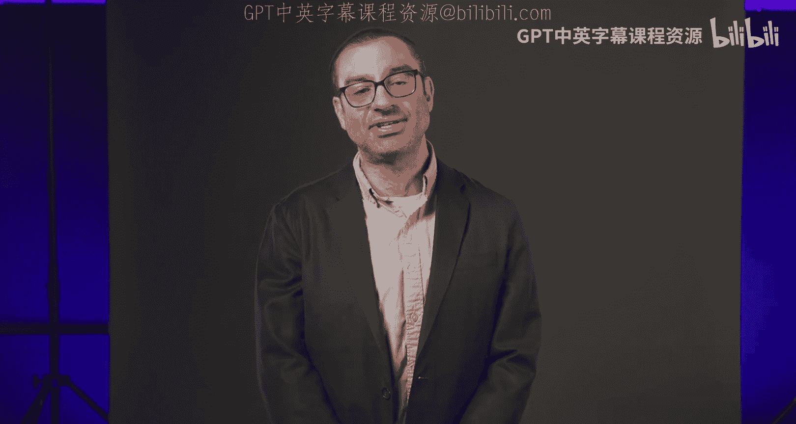

# 第二三部分 3：讲师简介 🧑‍🏫

在本节课中，我们将了解本课程的讲师背景，并明确本课程的目标受众与学习目标。

大家好，我是 Brandon Kraowski，是这门“如何运用数据”课程的讲师。

关于我的背景，我最初是一名音乐家，之后在电台广播和音频制作领域工作。我的编程经验始于 Adobe Flash，我曾使用这个工具为大型制药公司开发了一个实时网络会议平台。

大约在2009年，我获得了宾夕法尼亚大学的计算机与信息技术硕士学位，随后在宾大设计学院担任程序员。

之后，我在沃顿商学院计算部门担任应用开发人员，与教职员工合作开发技术以推进学生项目。在此期间，我创办了自己的公司 Bleak LLC，为多家公司提供编程和自由职业应用开发服务。

我后来转型进入数据与分析领域，并成为“商业人工智能与分析”部门的研究与教育总监。2018年，我成为了宾夕法尼亚大学工程学院的讲师。

更多关于我的信息：我是一名贝斯手，已经演奏贝斯多年。我演奏多种风格的音乐，但更偏爱偏向放克风格的音乐。我最近大幅减少了咖啡摄入，并学会了花更多时间冥想。最重要的是，我是一个重视家庭的人。

## 课程目标受众

本课程面向对数据、数据分析或数据工作仅有极少或完全没有知识和经验的学生和专业人士。

虽然本课程要求具备编程经验，但**不要求**任何数据分析、数据科学或数据可视化的背景知识。

## 课程学习目标

总的来说，本课程是一个极佳的入门课程，适合那些希望学习以下内容的学习者：

以下是本课程将涵盖的核心技能领域：

*   **数据机制**：理解数据的基本原理和处理方式。
*   **执行数据分析**：通过分析数据来获取洞察。
*   **应用数据科学技术**：运用技术进行预测。
*   **应用数据分析**：利用数据分析来回答问题并解决有趣的商业问题。

本节课中，我们一起了解了讲师的多元背景——从音乐到编程再到数据分析，这展示了数据技能应用的广泛可能性。同时，我们也明确了本课程是为编程初学者但数据领域新手所设计，旨在引导大家掌握从数据基础到解决实际商业问题的完整技能链。