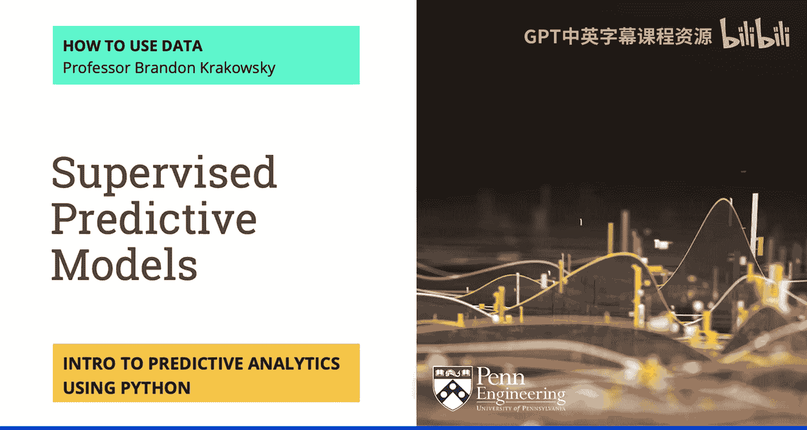
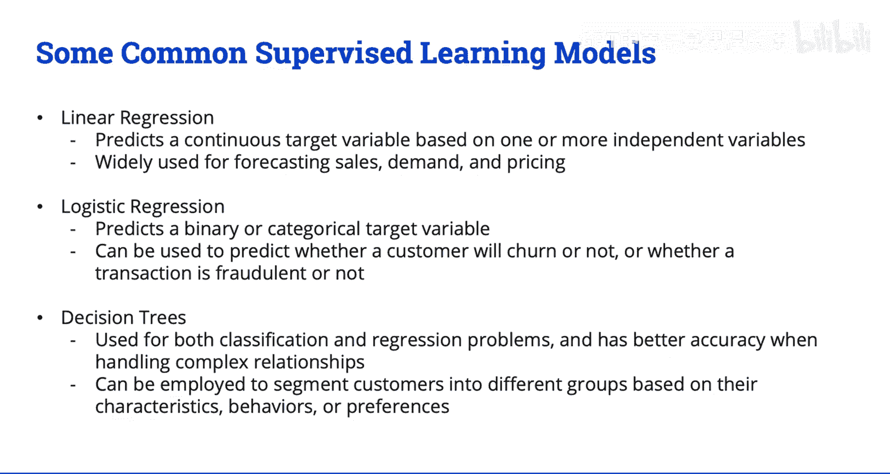

# 第二三部分 5：监督式预测模型

在本节课中，我们将学习监督式预测模型的核心概念、它与无监督学习的区别，以及几种常见的监督学习模型。

## 机器学习流程概述

一个典型的机器学习流程是，将数据集 **Z** 输入到机器学习算法中，以获得一个模型 **F**。

模型 **F** 代表了某些输入特征（例如历史价格）与目标输出（例如未来产品销量）之间的关系。当给定一个新的输入时，模型 **F** 可以利用从数据集 **Z** 中学到的知识，生成相应的预测。

## 监督学习与无监督学习

上一节我们介绍了机器学习的基本流程，本节中我们来看看监督学习与无监督学习的主要区别。

以下是两者的核心区别：

*   **监督学习**：输入数据是带有标签的。模型的输出是预测新输入数据的标签。例如，从一个标记为“垃圾邮件”或“非垃圾邮件”的电子邮件数据集中学习如何分类垃圾邮件。😡
*   **无监督学习**：输入数据是没有标签的。模型的输出是预测数据中结构的表示。例如，将具有相似特征的大量图像分组，而无需手动标记图像内容。

直观地说，监督学习模型试图模仿一组已知的标签示例来进行预测。监督学习和无监督学习技术在预测分析中都有宝贵的应用。

## 常见的监督学习模型

了解了监督学习的基本定义后，我们来看看几种非常常见的监督学习模型。

以下是三种广泛应用的监督学习模型：

1.  **线性回归**：基于一个或多个自变量来预测一个连续的目标变量。😡
    *   **公式**：`y = β₀ + β₁x₁ + β₂x₂ + ... + ε`
    *   **应用**：广泛用于预测销售额、需求和价格。
2.  **逻辑回归**：预测一个二元或分类目标变量。
    *   **应用**：可用于预测客户是否会流失，或者一笔交易是否存在欺诈。
3.  **决策树**：可用于分类和回归问题，在处理复杂关系时具有更好的准确性。
    *   **应用**：可根据客户的特征、行为或偏好，将客户划分为不同的群体。

## 总结

本节课中我们一起学习了监督式预测模型。我们首先了解了机器学习的基本流程，即从数据到模型的映射。然后，我们区分了监督学习（使用带标签的数据进行预测）和无监督学习（发现无标签数据的结构）。最后，我们介绍了线性回归、逻辑回归和决策树这三种常见的监督学习模型及其典型应用场景。