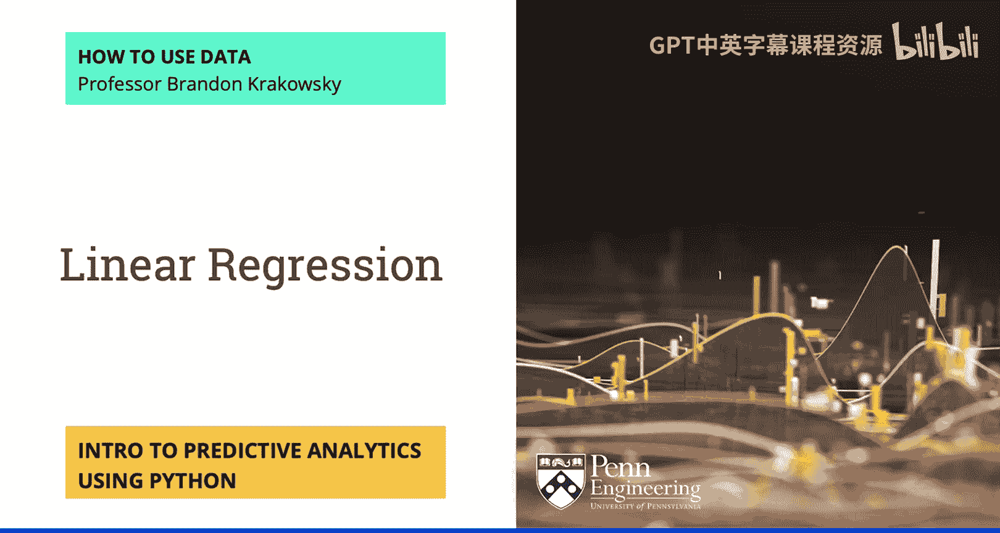
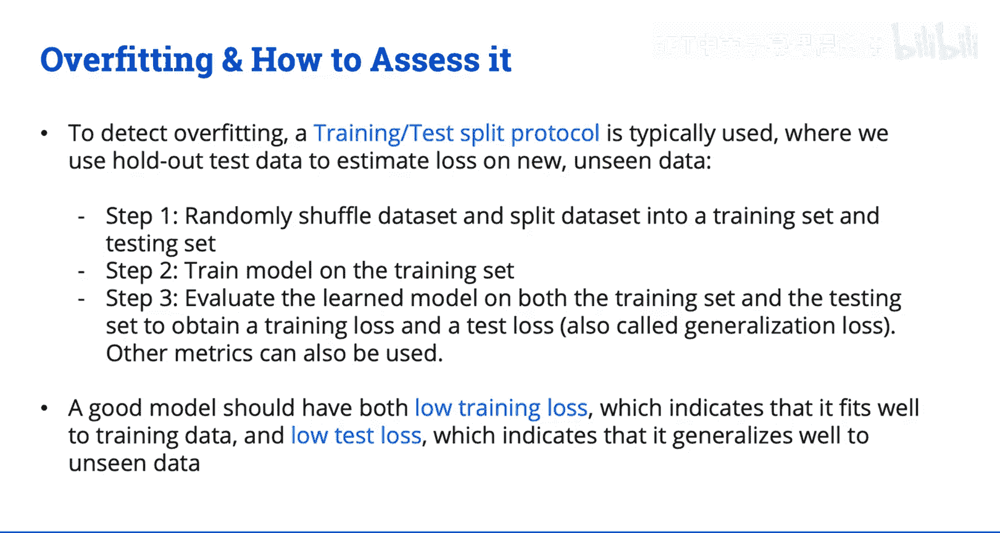

# 第二三部分 6：线性回归 📈



在本节课中，我们将要学习线性回归的基本概念。线性回归是一种用于预测分析的经典机器学习方法，它假设输入变量与输出变量之间存在线性关系。我们将探讨其工作原理、如何寻找最佳模型、如何评估模型性能以及如何避免过拟合问题。

---

## 模型假设与目标 🎯

上一节我们介绍了机器学习流程最终会生成一个模型 `F`。在线性回归中，我们假设这个模型是一个线性模型。换句话说，线性回归假设给定的输入与目标输出之间存在线性关系。

例如，假设我们想根据客户对某产品的订单数量来预测其年龄。在这个例子中，订单数量是输入变量，客户年龄是输出变量。

为了进行线性回归，我们收集了不同客户的数据，包括他们的订单数量和年龄。我们将这些数据绘制在图表上，X轴代表订单数量，Y轴代表年龄。图表上的每个数据点用一个蓝色圆圈表示。

线性回归的目标是找到一条最符合数据点的直线。这条线在图表上用一条红线表示。这条线的位置和斜率是通过一个数学过程确定的，该过程最小化了直线与数据点之间的距离。

一旦我们有了这条线，就可以用它来进行预测。例如，如果我们有一个新客户的订单数量，就可以使用这条线来估计其年龄。这条线代表了我们学到的模型，它允许我们根据输入变量（订单数量）来预测输出变量（年龄）。

---

## 模型参数 🔧

在线性回归中，模型参数指的是决定线性模型具体特征的值。这些参数定义了代表输入变量和输出变量之间关系的直线的斜率和截距。

让我们回到根据订单数量预测客户年龄的例子。在这种情况下，线性回归模型的参数如下：
*   **斜率** 代表输入变量（订单数量）每变化一个单位时，输出变量（年龄）的变化量。
*   **截距** 是直线与Y轴相交的点。

我们如何找到最优的模型参数呢？如果训练数据集有明显的趋势，我们可以很快地画出一条看起来最优的直线。但对于嘈杂的现实数据集，找到最优模型就不那么直接了。在线性回归的训练过程中，算法通过最小化模型的预测值与训练数据中的实际值之间的差异，来学习这些参数的最优值。

---

## 损失函数与评估 📉

我们需要一个指标来衡量模型在机器学习问题中的表现。通常，会定义一个损失函数来评估模型。直观地说，如果预测输出接近期望输出，损失函数的值就小；反之则大。

一个常用的损失函数是**均方误差**（Mean Squared Error, MSE）损失函数。该损失表示训练数据集中所有样本的预测输出与期望输出之间的平均平方差。

最优的线性回归模型会最小化MSE损失。在实践中，我们可以使用Scikit-learn机器学习库中的 `mean_squared_error` 函数来计算MSE。

```python
from sklearn.metrics import mean_squared_error
mse = mean_squared_error(y_true, y_pred)
```

---

## 模型复杂度与过拟合 ⚠️

简单的线性回归涉及一个自变量和一个因变量，而多元线性回归则扩展到包含多个自变量。

**过拟合**发生在学习模型与训练数据集拟合得非常好，但无法推广到新样本的情况。右边的模型在训练数据上没有损失，但实际上并没有捕捉到数据的真实模式。

过拟合是使用复杂模型时可能出现的一个常见问题。当一个模型变得过于复杂时，它可能开始捕捉训练数据中的噪声或随机波动，导致对新出现的、未见过的数据泛化能力差。

为了检测过拟合，通常会使用**训练-测试集划分**协议，即我们使用预留的测试数据来估计模型在新数据上的损失。

以下是该过程的步骤：

第一步，随机打乱数据集，并将数据集分为训练集和测试集。

第二步，在训练集上训练模型。

第三步，在训练集和测试集上评估学习到的模型，以获得训练损失和测试损失（也称为泛化损失）。也可以使用其他指标。

一个好的模型应该同时具有较低的**训练损失**（表明其对训练数据拟合良好）和较低的**测试损失**（表明其对未见数据泛化良好）。

---

## 总结 ✨



本节课中，我们一起学习了线性回归的核心知识。我们了解到线性回归基于输入与输出间的线性关系假设，通过最小化预测值与真实值之间的均方误差来寻找最优的模型参数（斜率和截距）。同时，我们认识到模型复杂度可能导致过拟合，即模型在训练集上表现完美却在未知数据上失效。为了避免此问题，我们引入了训练-测试集划分的方法来评估模型的泛化能力。一个稳健的模型应在训练集和测试集上均表现出较低的损失。