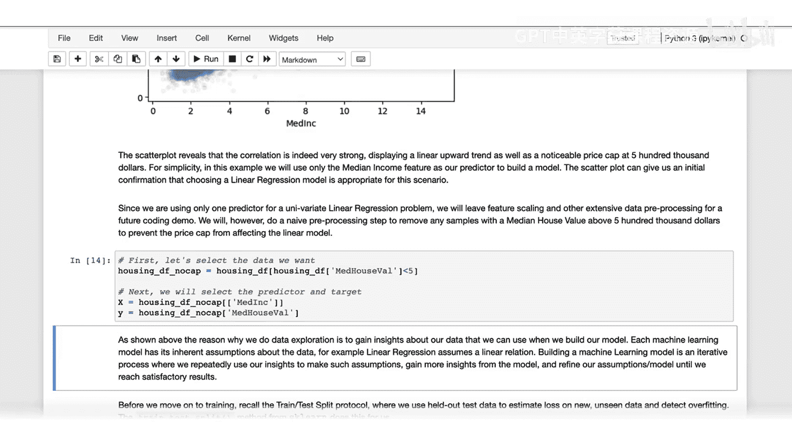

# 第二三部分 8：编程演示：创建相关性矩阵 📊


在本节课中，我们将学习如何通过创建相关性矩阵来探索数据特征与预测目标之间的关系。我们将使用Python的Pandas库来计算相关性，并通过可视化来验证我们的发现。

## 概述

在上一节中，我们介绍了数据集中的多个特征。然而，并非所有特征都对预测目标有意义。为了快速理解特征与目标变量之间的关系，我们将计算并分析一个相关性矩阵。

## 创建相关性矩阵

相关性矩阵可以帮助我们量化不同变量之间的线性关系。其计算出的相关系数值范围在-1到1之间。值越接近1或-1，表示相关性越强；值接近0则表示没有明显的线性相关性。

以下是创建相关性矩阵的步骤：

首先，我们使用数据框的`.corr()`方法来计算相关性矩阵。

```python
correlation_matrix = df.corr()
```

这行代码会生成一个新的数据框，其中包含了数据集中每个属性之间的相关系数。

## 分析相关性

生成的相关性矩阵包含大量信息。为了聚焦于我们需要的内容，我们可以从中选择与目标变量“房屋价值中位数”相关的列。

以下是具体操作：

```python
# 第二三部分 选择与目标变量‘median_house_value’相关的列
target_correlation = correlation_matrix[‘median_house_value’]
```

接下来，我们按降序排列这些值，以便快速识别出与目标最相关的特征。

```python
sorted_correlation = target_correlation.sort_values(ascending=False)
```

排序后，排在第一的是目标变量自身，我们可以暂时忽略它。紧随其后的“收入中位数”与我们的目标值具有最高的正相关性。

## 可视化验证

为了直观地确认这种相关性，我们可以绘制一个散点图。散点图能展示两个连续变量之间的关系模式。

以下是绘制散点图的代码：

```python
import matplotlib.pyplot as plt

plt.scatter(df[‘median_income’], df[‘median_house_value’])
plt.xlabel(‘Median Income’)
plt.ylabel(‘Median House Value’)
plt.show()
```

运行代码后，散点图清晰地显示了“收入中位数”与“房屋价值中位数”之间存在线性相关关系。同时，我们注意到在数值5（代表50万美元）处存在一个价格上限，这表明原始数据为了简化进行了封顶处理。

## 数据预处理

基于以上洞察，在本例的模型中，我们将只使用“收入中位数”这一个特征作为预测器。这个散点图也初步证实了选择线性回归模型对于此场景是合适的。

在构建模型前，我们需要进行一个简单的数据预处理步骤：移除那些房屋价值超过50万美元的样本，以防止价格上限影响线性模型的拟合。

以下是预处理代码：

```python
# 第二三部分 选择房屋价值低于50万美元的数据
df_filtered = df[df[‘median_house_value’] < 5]

# 第二三部分 选择预测器（特征）和目标变量
X = df_filtered[[‘median_income’]]  # 使用双括号以确保结果为DataFrame
y = df_filtered[‘median_house_value’]
```

## 总结



本节课中，我们一起学习了如何通过创建和分析相关性矩阵来探索数据。我们了解到“收入中位数”是与预测目标最相关的特征，并通过散点图可视化了这种线性关系。最后，我们基于数据探索的洞察，进行了简单的数据预处理，为后续构建单变量线性回归模型做好了准备。数据探索是一个迭代过程，它为我们构建和优化机器学习模型提供了至关重要的依据。