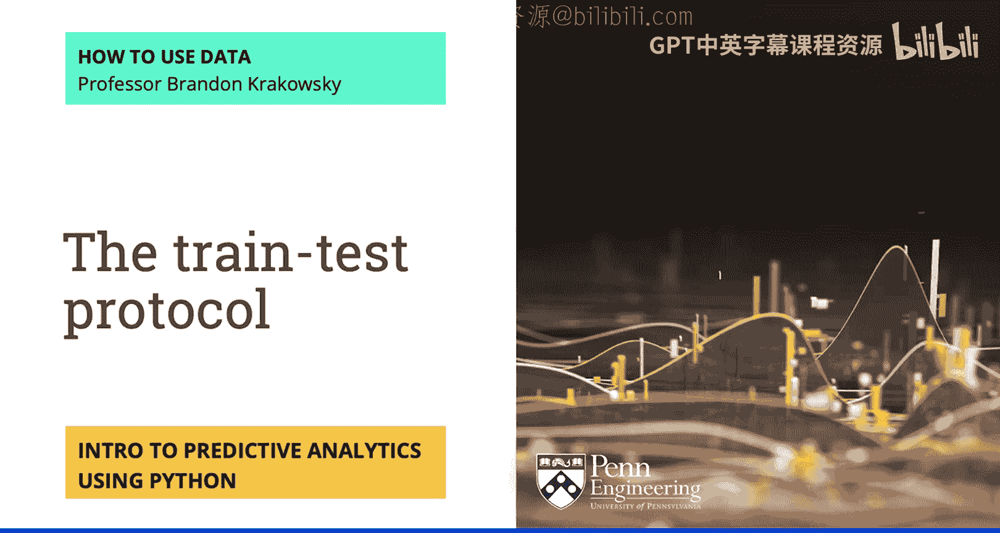
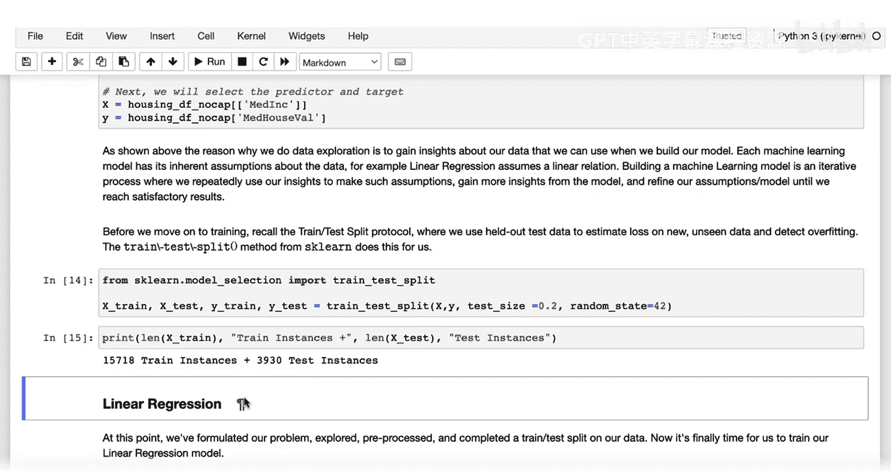

# 第二三部分 9：训练测试集划分

在本节课中，我们将学习机器学习中的一个核心概念：训练测试集划分。我们将了解其目的，并使用Python的Scikit-learn库来实践这一过程。



## 概述

在上一节中，我们完成了数据预处理。本节中，我们将介绍如何将数据集划分为训练集和测试集。这是评估模型泛化能力、防止过拟合的关键步骤。

## 训练测试集划分的原理

在开始训练模型之前，需要回顾训练测试集划分的流程。该流程的核心是使用一部分预留数据来估计模型在未见过的数据上的损失，从而检测模型是否过拟合。

**过拟合**是指模型在训练数据上表现很好，但在新数据上表现不佳的现象。划分数据集可以帮助我们评估这一点。

## 使用Scikit-learn进行划分

Scikit-learn库中的`model_selection`模块为我们提供了便捷的划分方法。

以下是实现步骤：

首先，从`sklearn.model_selection`中导入`train_test_split`函数。

```python
from sklearn.model_selection import train_test_split
```

接着，使用这个函数来划分我们的特征数据`X`和目标数据`y`。我们将测试集的大小设置为原始数据集的20%（`test_size=0.2`）。同时，设置一个随机种子`random_state=42`。

设置随机种子的作用是强制函数在每次运行代码时生成相同的训练-测试划分，从而确保结果可以复现。

```python
X_train, X_test, y_train, y_test = train_test_split(X, y, test_size=0.2, random_state=42)
```

## 检查划分结果

划分完成后，我们可以打印出训练集和测试集的样本数量以进行验证。

```python
print("训练样本数:", len(X_train))
print("测试样本数:", len(X_test))
```

执行代码后，我们将看到超过15000个训练样本和大约4000个测试样本。这符合我们设定的20%测试集比例。



## 总结

本节课中，我们一起学习了训练测试集划分的重要性及操作方法。我们了解到，通过`sklearn.model_selection.train_test_split`函数，可以轻松地将数据划分为用于模型训练的训练集和用于评估模型性能的测试集，并通过设置随机种子保证结果的可复现性。这是构建可靠机器学习模型的基础步骤。