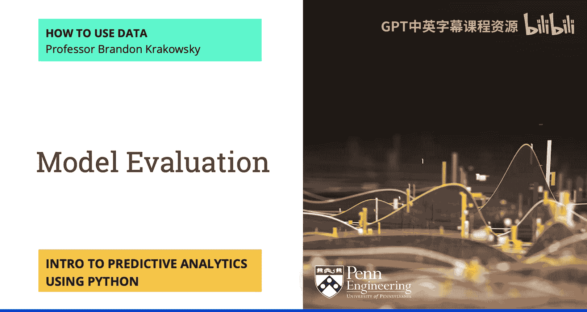
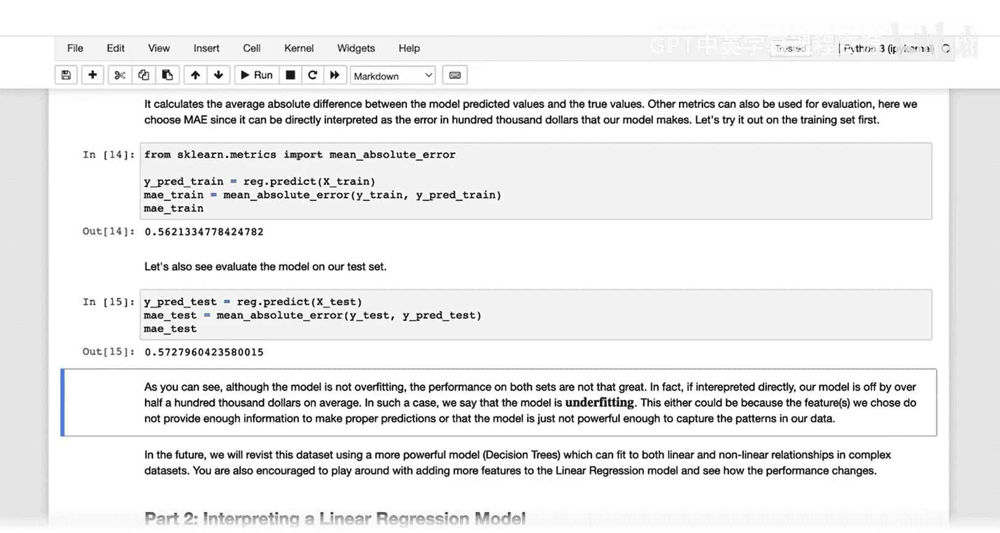

# 第二三部分 11：线性回归模型评估



在本节中，我们将学习如何评估一个线性回归模型的性能。我们将介绍两种常用的评估指标，并通过代码演示如何计算它们在训练集和测试集上的表现。

## 概述

我们已经建立了一个线性回归模型。现在，是时候评估这个模型的表现了。评估模型有多种方法，本节我们将重点介绍两种：均方误差和平均绝对误差。我们将通过计算平均绝对误差来直观地理解模型的预测误差大小。

## 模型评估指标

评估线性回归模型时，有多种函数可供选择。以下是两种核心的评估指标：

1.  **均方误差**：该指标计算预测输出与期望输出之间差值的平方的平均值。
    *   **公式**：`MSE = (1/n) * Σ(y_i - ŷ_i)^2`
2.  **平均绝对误差**：该指标计算预测值与实际值之间绝对差值的平均值。
    *   **公式**：`MAE = (1/n) * Σ|y_i - ŷ_i|`

在本例中，我们选择使用平均绝对误差，因为它可以直接解释为模型在此特定问题中产生的误差（以十万为单位）。当然，根据具体情况，也可以使用其他评估指标。

## 在训练集上评估模型

现在，让我们在训练集上尝试计算平均绝对误差。

以下是具体步骤：
*   首先，从 `sklearn.metrics` 库中导入 `mean_absolute_error` 函数。
*   然后，使用我们拟合好的线性回归模型的 `predict` 函数，传入训练特征 `X_train`，来获取训练集的预测值 `y_pred_train`。
*   最后，使用 `mean_absolute_error` 函数，传入真实值 `y_train` 和上一步得到的预测值进行评估。

```python
# 第二三部分 导入评估指标
from sklearn.metrics import mean_absolute_error

# 第二三部分 获取训练集预测值
y_pred_train = linear_regression_model.predict(X_train)

# 第二三部分 计算训练集上的平均绝对误差
mae_train = mean_absolute_error(y_train, y_pred_train)
print(f"训练集 MAE: {mae_train:.2f}")
```

运行以上代码，我们得到训练集上的平均绝对误差约为 0.56。

## 在测试集上评估模型

上一节我们在训练集上评估了模型，本节我们来看看模型在未见过的测试集上的表现。重复相似的过程，但在测试集上进行。

以下是具体步骤：
*   这次，我们对 `X_test` 进行预测，而不是 `X_train`，从而得到测试数据的预测值 `y_pred_test`。
*   然后，同样使用 `mean_absolute_error` 函数，传入真实值 `y_test` 和我们的预测值 `y_pred_test`。

```python
# 第二三部分 获取测试集预测值
y_pred_test = linear_regression_model.predict(X_test)

# 第二三部分 计算测试集上的平均绝对误差
mae_test = mean_absolute_error(y_test, y_pred_test)
print(f"测试集 MAE: {mae_test:.2f}")
```

运行这段代码，我们可以看到测试集上的平均绝对误差约为 0.57。

## 结果分析与后续步骤

从评估结果可以看出，模型在训练集和测试集上的误差非常接近，这表明模型**没有过拟合**。然而，两者的性能都不算理想。具体来说，如果直接解释 MAE，我们的模型平均误差超过了 0.5（即超过 5 万）。在这种情况下，我们可以说模型存在**欠拟合**。

欠拟合可能由两个原因导致：
1.  我们选择的特征没有提供足够的信息来做出准确的预测。
2.  模型本身不够强大，无法捕捉数据中的复杂模式。

在未来的课程中，我们将使用更强大的模型（如决策树）来重新处理这个数据集，该模型能够拟合复杂数据集中的线性和非线性关系。同时，也鼓励你尝试在当前线性回归模型中添加更多特征，观察模型性能如何变化。

## 总结



本节课中，我们一起学习了如何评估线性回归模型。我们介绍了均方误差和平均绝对误差两个核心指标，并重点使用平均绝对误差评估了模型在训练集和测试集上的表现。我们发现模型存在欠拟合问题，并讨论了可能的原因及后续改进方向。