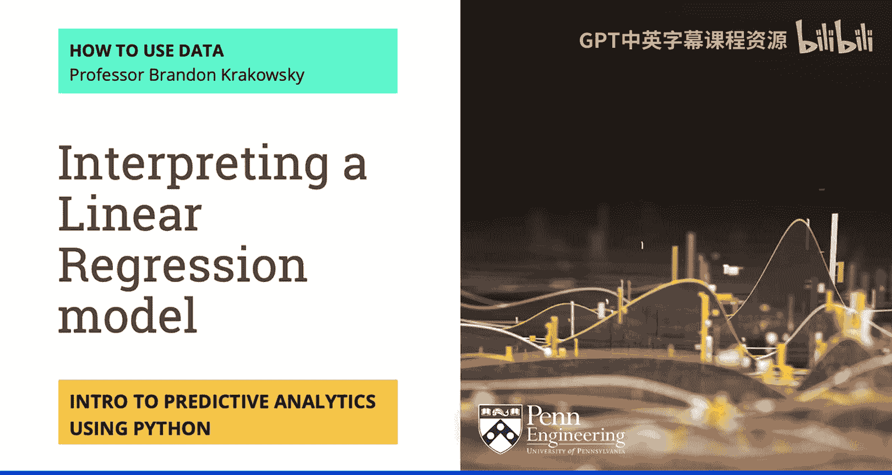
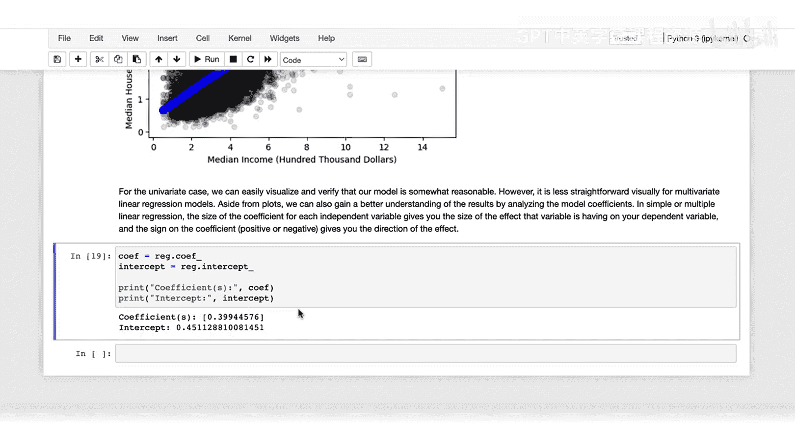

# 第二三部分 12：线性回归模型解读



在本节课中，我们将学习如何解读线性回归模型的结果。我们将通过可视化模型拟合效果和分析模型系数，来理解模型参数的实际含义。

## 模型可视化

上一节我们介绍了如何使用平均绝对误差（MAE）评估模型。本节中，我们来看看如何通过可视化来直观地理解模型的拟合情况。

我们将使用Matplotlib库来绘制图表。以下是绘图步骤：

```python
import matplotlib.pyplot as plt
```

首先，我们绘制原始数据集的散点图，其中X轴代表预测变量（中位数收入），Y轴代表目标变量（中位数房屋价值）。

接着，我们在同一张图上绘制训练好的模型预测线。这条线由训练数据中的X值（`x_train`）和模型预测的Y值（`y_pred`）构成。

运行代码后，我们将看到一张图表。图表上，蓝色的线代表模型的预测结果，黑色的点代表原始数据。

对于单变量线性回归，这种可视化方法能让我们轻松地验证模型是否合理。从图中可以看到，模型呈现正相关趋势，这与原始数据集的整体趋势是一致的。

然而，对于多元线性回归模型，仅靠可视化来理解就变得不那么直观了。

## 模型系数分析

除了绘图，我们还可以通过分析模型系数来更好地理解结果。无论是在简单线性回归还是多元线性回归中，每个自变量的系数大小都代表了该变量对目标变量的影响程度，而系数的正负则代表了影响的方向。

以下是获取并解读模型系数的步骤：

首先，我们从训练好的模型中获取系数（`coef_`）和截距（`intercept_`）属性。

```python
coefficient = model.coef_
intercept = model.intercept_
```

打印这些值后，你会注意到我们得到了一个约为0.4的正系数。在这个案例中，这个系数代表**中位数收入每增加一个单位（即1美元），中位数房屋价值预计会增加约0.4个单位**。

具体来说，如果中位数收入增加100,000美元，中位数房屋价值预计会增加约 0.4 * 100,000 = 40,000美元。

截距约为0.45（单位同样是十万美元）。这代表了**当中位数收入为0时，模型中位数房屋价值的估计值**，可以理解为房屋价值的基准值，大约为45,000美元。

## 总结




本节课中，我们一起学习了如何解读线性回归模型。我们通过将模型预测线绘制在原始数据散点图上，直观地评估了模型的拟合效果。更重要的是，我们分析了模型的系数和截距，理解了它们所代表的实际经济含义：系数表示预测变量对目标变量的影响强度和方向，而截距则代表了所有预测变量为零时目标变量的基准估计值。这些分析步骤是理解和使用线性回归模型的关键。