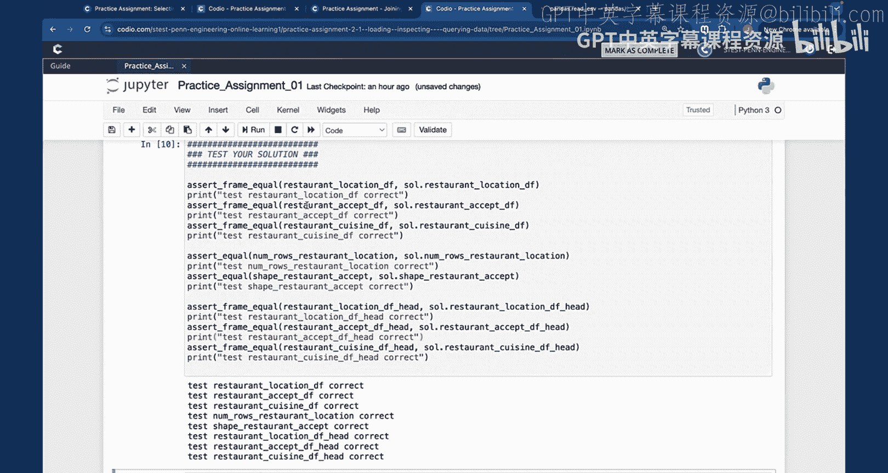
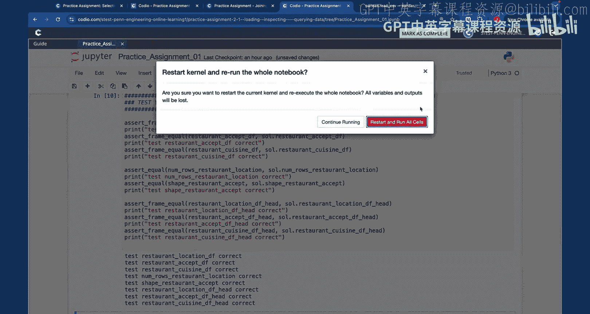
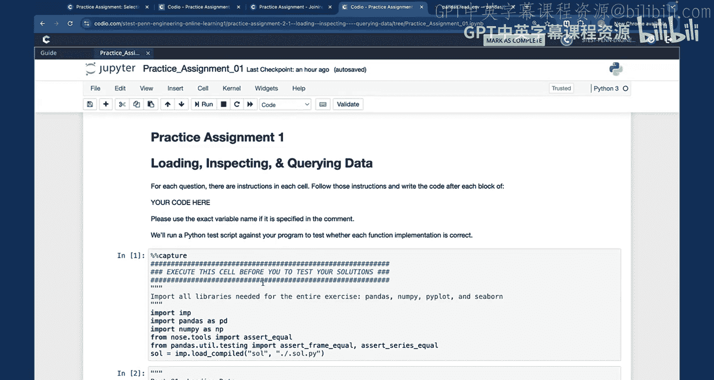

# 第二三部分 13：Codio平台Jupyter Notebook作业指南 🚀

在本教程中，我们将学习如何在Codio平台上使用Jupyter Notebook完成课程作业。Codio是一个优秀的在线平台，它为您提供了预配置的环境，让您可以在Mac、Windows或Linux系统上无缝运行代码。

## 概述

本节将详细介绍从打开作业到最终提交的完整流程，包括如何运行代码、解决问题以及进行最终验证。我们将确保每一步都清晰明了，帮助初学者顺利完成数据分析任务。

## 启动与设置

上一节我们介绍了Codio平台的基本概念，本节中我们来看看如何启动一个具体的作业。

首先，您会看到一个包含Jupyter Notebook说明的作业页面。您可以按照页面上的指示进行操作。

以下是启动作业的具体步骤：
1.  向下滚动页面，并按照提供的PDF文件中的详细作业说明操作。
2.  滚动到底部，勾选确认框。
3.  如果是首次使用，请输入您的法定全名，然后点击“启动应用”按钮。
4.  环境设置通常需要20秒到1分钟。如果页面没有反应，请尝试刷新。

启动后，您将看到一个包含额外说明的引导页面。请从该页面打开Jupyter Notebook文件。

## 执行代码与回答问题

Codio环境已为您预先配置好。现在，我们来学习如何执行代码单元。

要运行第一个代码单元，请按 `Shift + Enter`（在Mac上是 `Shift + Return`）。此操作会导入整个练习所需的所有库。

除了解决方案代码，问题会按步骤列出。请仔细遵循这些问题。

在标记有“在此处编写你的代码”的地方，编写代码来回答问题。

请按顺序执行每个代码单元。测试单元会将您的变量与环境存储的解决方案变量进行比较。

按 `Shift + Enter` 来验证您的变量。您将在单元格下方看到每个测试的结果。

## 故障排除：常见错误

在编写代码时，难免会遇到错误。接下来，我们看看如何解决一些常见问题。

### 文件路径错误

加载数据文件时，一个常见错误是文件路径不正确。

请检查代码中的文件路径。如果路径错误，您将收到“文件未找到”的错误。

例如，这里有一个错误提示：“文件不存在”。您可以看到引发错误的代码行引用。

要修复此错误，请修正代码中的文件路径。错误就出现在这一行代码中。

您可以利用官方文档等资源来理解函数参数。例如，对于 `read_csv` 函数，您可以在这里查看更多信息。

您也可以在这里查看关于文件路径参数的更具体信息。

让我们在这里修正文件路径。如果我们重新运行该单元格中的代码，就不会再收到“文件未找到”的错误了。

### 逻辑错误

如果您的代码能够运行，但返回了错误的结果，请将您的逻辑与项目要求进行比较。

检查变量和计算过程以确保准确性。例如，假设我们因为获取了错误数据框的长度，而将错误信息存储在了变量中。

我们获取的不是 `restaurant_location_df` 的长度，而是 `restaurant_except_df` 的长度。

现在，如果我重新运行这个单元格中的代码，本身不会得到任何错误。但是，如果我重新运行该单元格的测试，您会看到出现了一个断言错误。这里引用了具体失败的测试。

断言语句正在将我的 `num_rows_restaurant_location` 与解决方案中的 `num_rows_restaurant_location` 进行比较。两者不相等。这就是该测试的实际代码，用于比较我的变量和解决方案变量。

让我们向上滚动并修正代码，获取正确数据框（即 `restaurant_location_df`）的长度，然后重新运行测试。您可以看到现在所有测试都通过了。

## 最终验证与提交

在提交之前，重置内核并顺序运行所有单元格是一个好习惯。

使用“内核”菜单中的“重启并运行所有”功能。

验证您的笔记本。如果所有测试都通过，请将您的作业标记为完成。

## 总结

本节课中，我们一起学习了在Codio平台上使用Jupyter Notebook完成作业的完整流程。我们涵盖了从启动环境、执行代码、回答分步问题，到诊断和修复文件路径错误、逻辑错误，以及最终验证和提交作业的所有关键步骤。遵循这些步骤，您将能顺利在Codio和Jupyter Notebook中完成作业。如果遇到挑战，请参考本指南或查阅课程材料。祝您编码愉快，好运！