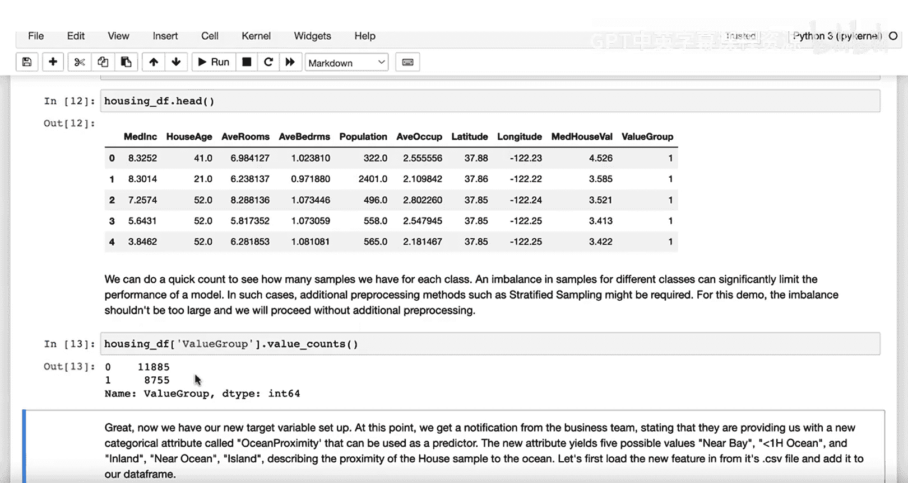

# 第二三部分 14：创建分类属性 🏷️


在本节课程中，我们将学习如何将一个回归问题转化为分类问题。具体来说，我们将使用加州房价数据集，把预测具体房价（数值型目标）的任务，转变为预测房屋属于“高价值”还是“低价值”组别（分类型目标）的任务。

上一节我们介绍了线性回归模型的应用，本节中我们来看看如何为逻辑回归等分类模型准备数据。

## 数据准备与问题重构

首先，我们加载之前使用过的加州房价数据集，并延续之前的设置。该数据集包含了加州各区域的房屋信息汇总，共有8个数值型特征和一个数值型目标变量，名为 `median_house_value`。

假设经过业务讨论，团队不再需要预测具体的房屋中位数价值，而是希望预测房屋样本属于两个价值组别中的哪一个。经过这样的调整，该问题就可以被定义为一个**有监督的二元分类问题**。

## 创建分类标签

我们需要在数据集中创建一个名为 `value_group` 的新列，它将代表新的类别标签。`value_group` 将是一个分类属性。

以下是创建步骤：
1.  我们将“低价值”组编码为 **0**，“高价值”组编码为 **1**。
2.  创建新列时，首先将所有值初始化为 **0**，代表“低价值”类。
3.  然后，使用布尔条件找出满足第二类（即“高价值”类）条件的样本，并将其类别标签设置为 **1**。

我们将使用 `loc` 方法来实现。这个方法允许通过指定布尔数组或列标签来访问特定的行和列。

```python
# 第二三部分 假设 df 是我们的DataFrame，且已包含 ‘median_house_value‘ 列
df[‘value_group‘] = 0  # 初始化新列，全部设为0（低价值组）
df.loc[df[‘median_house_value‘] >= 2, ‘value_group‘] = 1  # 将中位数房价大于等于2的样本标记为1（高价值组）
```

在这段代码中：
*   `df[‘median_house_value‘] >= 2` 是一个布尔条件，用于选择中位数房价大于等于2（即20万美元）的行。
*   `‘value_group‘` 指定了我们想要操作的列。
*   对于满足条件的行，其 `value_group` 列的值将被设置为 **1**。

运行代码后查看前五行数据，可以看到新增了 `value_group` 列，并且任何 `median_house_value` 大于2的行，其值都被设置为1。

## 检查类别分布

不同类别的样本数量不平衡可能会极大地限制模型的性能。在这种情况下，可能需要进行额外的预处理，例如分层采样。

我们可以快速统计每个类别的样本数量来检查平衡性：

```python
class_distribution = df[‘value_group‘].value_counts()
print(class_distribution)
```

对于本例，两个类别的样本数量都接近10，000个，因此类别标签之间不存在严重的不平衡，我们可以继续而不进行额外的预处理。

## 总结



本节课中我们一起学习了如何将回归问题的数值型目标变量转化为分类问题的类别标签。关键步骤包括：定义分类阈值、创建新的分类列、使用 `loc` 方法基于条件赋值，以及检查结果类别的分布以确保数据平衡。这为后续应用逻辑回归等分类模型做好了数据准备。