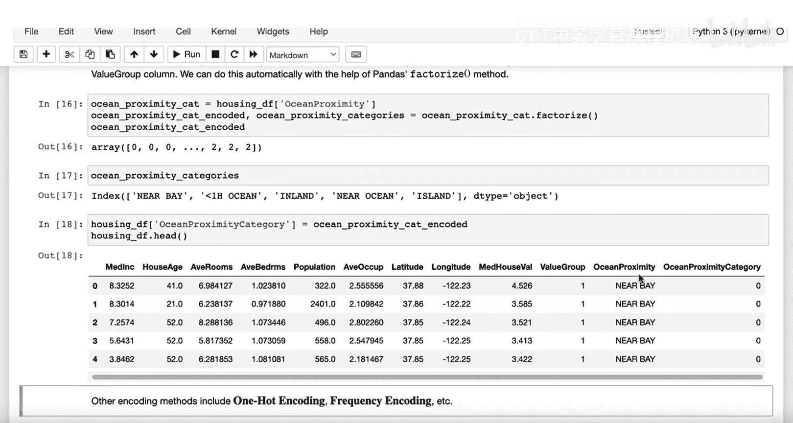

# 第二三部分 16：编程演示：整合新数据 🧩


在本节课中，我们将学习如何将一个新的分类属性整合到现有的数据集中。具体来说，我们将处理一个名为“海洋邻近度”的新特征，并演示如何将其从字符串格式转换为机器学习模型可以处理的数值格式。

---

上一节我们介绍了数据预处理的基本概念，本节中我们来看看如何实际操作，整合一个新的分类变量。

现在我们已经建立了一个新的变量集，业务团队通知我们，他们提供了一个名为“海洋邻近度”的新分类属性，可以作为预测因子使用。这个新属性有五个可能的值，用于描述房屋样本与海洋的接近程度。

我们首先从其CSV文件中加载这个新特征，并将其添加到我们的数据框中。我们将直接使用pandas读取CSV文件。这里我们看到，对于每个样本，都有一个标签来确定其与海洋的接近程度。

我们希望将其添加到原始数据框中，因此创建一个名为`ocean_proximity`的新列。我们将这个新列设置为从CSV文件读取的数据框的副本。

添加新特征后，我们可以快速检查一下数据框的信息。你会注意到，虽然没有缺失值，但我们新的分类属性`ocean_proximity`目前是字符串值。作为人类，我们可以很容易地理解这些字符串。然而，机器学习模型处理的是数值数据。因此，我们需要一个额外的步骤来将分类特征转换为数值。

以下是几种常见的编码方法：

*   **整数编码**：也称为标签编码或序数编码。这类似于手动构建`value_group`列时所做的工作。我们也可以借助pandas的`factorize`方法自动完成。
*   **独热编码**：为每个类别创建一个新的二进制列。
*   **频率编码**：用该类别的出现频率来替换类别标签。

你可以根据具体的业务问题选择合适的编码方法。

接下来，我们演示如何使用整数编码。首先从数据集中选择`ocean_proximity`列，将其放入变量`ocean_proximity_cat`中。然后对这个列应用`factorize`方法。

```python
ocean_proximity_cat_encoded, categories = ocean_proximity_cat.factorize()
```

这将返回该特征的编码值，以及用于编码特征的可用类别。我们可以先检查一下编码值的样子，它们应该是整数。这里我们只看到了0和2，但为了更好地理解，我们可以接着检查类别。总共应该有五个类别，这意味着我们将有从0到4的数值标签。

现在，让我们将这个编码后的属性添加回数据框。我们创建一个名为`ocean_proximity_category`的新列，并使用从`factorize`获得的编码值来设置它。

```python
df['ocean_proximity_category'] = ocean_proximity_cat_encoded
```

我们可以再次检查数据框中的前几个样本。现在，我们有了一个分类的`value_group`，以及一个分类属性`ocean_proximity_category`，它对应着我们获得的新特征中的字符串值，以供参考。

---




本节课中我们一起学习了如何将新的分类数据整合到现有数据集中。关键步骤包括：加载新数据、检查数据类型，以及使用**整数编码**（如`factorize`方法）将字符串分类变量转换为数值形式，以便机器学习模型能够处理。理解并选择合适的编码方法是特征工程中的重要一环。