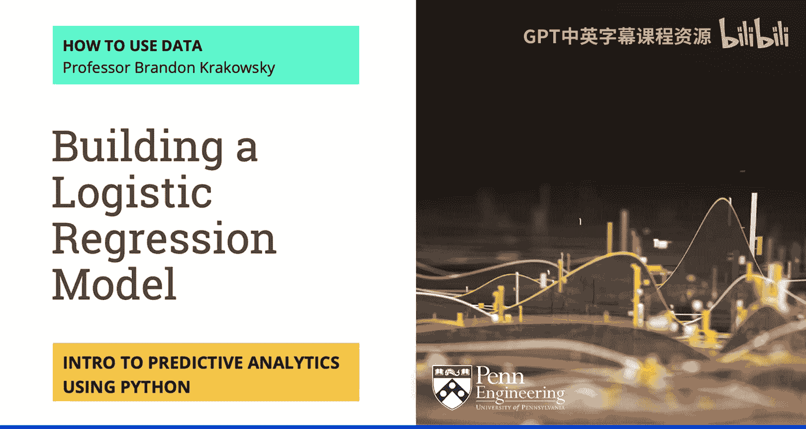
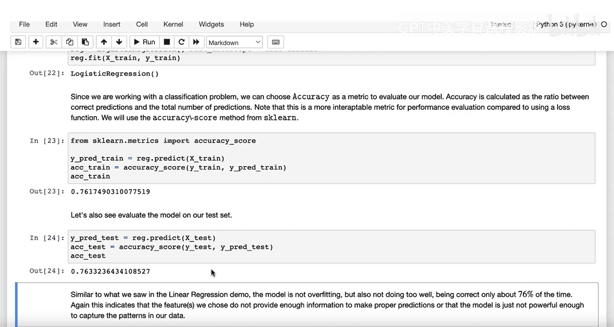

# 第二三部分 17：编程演示：构建逻辑回归模型 🧠



在本节课中，我们将学习如何使用Python的Scikit-learn库构建一个逻辑回归模型。我们将使用两个特征来预测一个分类目标变量，并评估模型的性能。

---

上一节我们介绍了逻辑回归的基本概念，本节中我们来看看如何用代码实现它。我们将使用“中位数收入”和“海洋邻近度”这两个特征，来预测我们之前构建的“价值分组”目标变量。

首先，我们需要提取所需的数据。以下是具体步骤：

以下是数据准备步骤：
*   对于预测变量（特征X），我们有两个：
    *   第一个特征是 `median_income`（中位数收入）。
    *   第二个特征是新构建的分类特征 `ocean_proximity_category`（海洋邻近度类别）。
*   对于我们的目标变量（标签Y），我们将使用新构建的分类目标变量 `value_group`（价值分组）。

正如之前所见，在训练模型之前，我们需要对数据集应用训练集-测试集分割协议。

因此，我们使用Scikit-learn中的 `train_test_split` 方法。我们再次传入我们的X和Y，并设置相同的测试集大小（即原始数据集的20%），同时指定一个随机种子以确保结果可复现。

```python
from sklearn.model_selection import train_test_split

X_train, X_test, y_train, y_test = train_test_split(X, y, test_size=0.2, random_state=42)
```

分割完成后，如果我们检查数据形状，会得到大约16000个训练实例和4000个测试实例。

现在我们可以开始训练模型。我们已经从Scikit-learn导入了逻辑回归模型。

接下来，我们初始化模型。在初始化期间，您可以传入各种参数来更改此模型中的任何设置，这与线性回归模型类似。例如，有一个名为 `fit_intercept` 的参数，您可以更改它以确定要学习的决策边界是否包含截距项。默认情况下，此参数设置为 `True`，我们将保持默认设置。

```python
from sklearn.linear_model import LogisticRegression

model = LogisticRegression(fit_intercept=True)
```

模型初始化后，我们通过传入 `X_train` 和 `y_train` 在训练数据上拟合模型。

```python
model.fit(X_train, y_train)
```

现在，我们有了一个训练好的逻辑回归模型。由于我们处理的是分类问题，可以选择准确率作为评估模型的指标。准确率的计算公式为：**正确预测数 / 总预测数**。请注意，与使用损失函数相比，这是一个更易于理解的性能评估指标。

我们将使用Scikit-learn的 `accuracy_score` 方法进行计算。

首先，我们获取训练集上的预测结果，然后将预测值和真实值传入 `accuracy_score` 方法。

```python
from sklearn.metrics import accuracy_score

y_train_pred = model.predict(X_train)
train_accuracy = accuracy_score(y_train, y_train_pred)
```

这样，我们在训练集上得到了大约76%的准确率。

我们对测试集执行相同的操作：为测试样本进行预测，然后评估真实测试标签与预测测试标签之间的准确率。

```python
y_test_pred = model.predict(X_test)
test_accuracy = accuracy_score(y_test, y_test_pred)
```

然后我们可以检查准确率，同样大约是76%。

与在线性回归演示中看到的情况类似，模型没有过拟合，但表现也不够好，正确率只有大约76%。这再次表明，我们选择的特征没有提供足够的信息来进行正确的预测，或者模型本身不够强大，无法捕捉数据中的模式。

---



本节课中我们一起学习了如何使用Scikit-learn构建和评估一个逻辑回归分类模型。我们完成了从数据准备、训练测试分割、模型训练到性能评估的完整流程，并了解到当前模型的表现（约76%准确率）提示我们可能需要更好的特征或更复杂的模型。