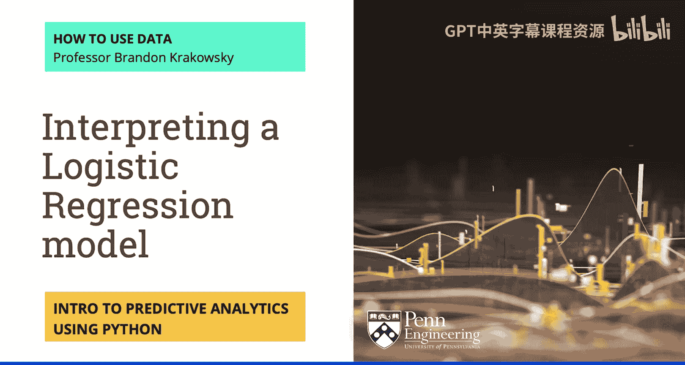
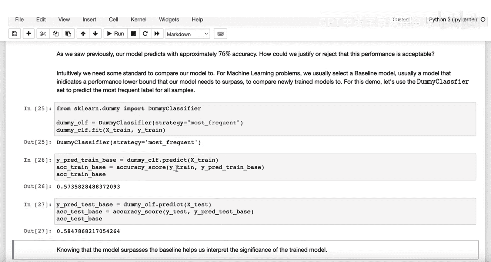

# 第二三部分 18：逻辑回归模型解读与基准比较 📊



在本节课中，我们将学习如何评估逻辑回归模型的性能，并通过与一个简单的基准模型进行比较，来判断模型性能是否可接受。

上一节我们介绍了如何训练和评估一个逻辑回归模型。本节中，我们来看看如何为模型性能设定一个合理的判断标准。

## 模型性能评估

我们的模型预测准确率约为76%。我们需要判断这个性能是否可接受。直观上，我们需要一个标准来与我们的模型进行比较。

对于机器学习问题，我们通常会选择一个**基准模型**。基准模型通常代表一个性能下限，我们新训练的模型需要超越这个下限。

## 建立基准模型

以下是建立基准模型的步骤。

我们将使用一个“虚拟分类器”，该分类器会为所有样本预测出现频率最高的标签。

首先，从 `sklearn` 库中导入 `DummyClassifier`。

```python
from sklearn.dummy import DummyClassifier
```

接着，初始化这个虚拟分类器。这类分类器使用简单的规则对给定数据进行分类。我们将传入一个名为 `strategy` 的参数，用于决定分类器的工作方式。

```python
dummy_clf = DummyClassifier(strategy='most_frequent')
```

将 `strategy` 设置为 `‘most_frequent’`，意味着分类器将始终预测它在训练数据中看到的最频繁的标签。

然后，我们在训练数据上训练这个基准分类器。

```python
dummy_clf.fit(X_train, y_train)
```

## 评估基准模型性能

现在，让我们检查这个基准模型在训练集和测试集上的性能。

与之前类似，我们首先在训练样本上进行预测。

```python
dummy_train_pred = dummy_clf.predict(X_train)
```

我们将使用基准分类器，根据给定的训练集进行预测。

然后，我们将预测的标签与训练集的真实标签进行比较。

```python
from sklearn.metrics import accuracy_score
train_accuracy = accuracy_score(y_train, dummy_train_pred)
```

我们可以检查准确率，在训练集上约为57%。

接着，让我们在测试集上进行预测并检查准确率。

```python
dummy_test_pred = dummy_clf.predict(X_test)
test_accuracy = accuracy_score(y_test, dummy_test_pred)
```

传入真实标签和预测标签，我们得到的准确率分数约为58%。

## 结果解读



结果显示，我们的逻辑回归模型（76%准确率）确实超越了这一基准（58%准确率）。这有助于我们理解所学习模型的重要性，并证明其性能是显著的，而非随机猜测。


本节课中，我们一起学习了如何通过建立一个简单的基准模型（如虚拟分类器）来评估和解读我们训练模型的性能。理解模型相对于一个简单基准的提升，是判断模型实用价值的关键一步。