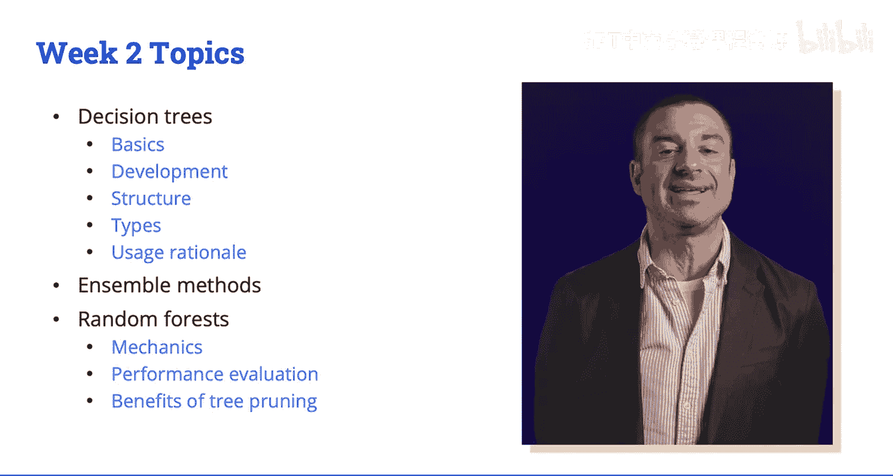

# 第二三部分 21：决策树与高级预测分析导论 🌳


在本节课中，我们将学习预测分析的第二模块。我们将从基础的决策树模型开始，探索其原理与构建方法，然后深入更高级的集成方法——随机森林。通过本模块的学习，你将掌握使用Python构建和解释这些模型的能力，并能够应对更复杂的数据分析挑战。

## 模块概述 📋

模块2将我们的预测分析探索扩展到决策树以及更广泛的高级预测模型类别。

上一节我们介绍了预测分析的基础，本节中我们来看看更具体的模型类型。

## 决策树基础 🌱

我们首先从决策树的基础知识开始，了解它们是什么以及如何构建。

以下是关于决策树的核心要点：
*   **结构与类型**：探索决策树的结构和不同类型。
*   **使用理由**：理解在何种场景下选择使用决策树模型。

决策树通过一系列“是/否”问题对数据进行分割，其结构类似于一棵倒置的树。构建过程的核心是选择最佳分割特征，这通常通过计算**信息增益**或**基尼不纯度**等指标来实现。

```python
# 第二三部分 示例：使用scikit-learn计算基尼不纯度
from sklearn.tree import DecisionTreeClassifier
model = DecisionTreeClassifier(criterion='gini')
```


## 集成方法与随机森林 🌲🌳

在了解了单一决策树之后，我们的旅程将继续深入探讨集成方法。

我们将特别关注**随机森林**。这是一种先进的技术，它通过组合多个决策树来提高预测准确性并防止过拟合。

以下是随机森林的关键机制：
*   **构建机制**：学习随机森林背后的工作原理，包括自助采样和特征随机选择。
*   **性能评估**：了解如何评估随机森林模型的性能。
*   **树剪枝的好处**：理解对决策树进行剪枝如何提升模型泛化能力。

随机森林通过构建多棵决策树并汇总它们的结果（如投票或取平均）来工作，这能有效降低单一模型可能带来的方差。

## 实践与应用 🛠️

通过使用Python构建和解释决策树及随机森林模型，你将逐步理解这些强大的预测工具。

这将使你掌握解决更复杂数据分析挑战所需的技能。

为了巩固学习并增强动手经验，本模块配备了专注于决策树和随机森林的简短练习。

这提供了充足的机会，让你在各种数据集上练习和应用新获得的技能。



## 总结 📝


本节课中我们一起学习了预测分析模块二的核心内容。我们从决策树的基本概念、结构和使用场景出发，进而深入探讨了集成方法中的随机森林，包括其构建机制和优势。最后，我们强调了通过Python实践和练习来巩固这些技能的重要性。掌握这些工具将为你处理更高级的数据分析任务奠定坚实基础。