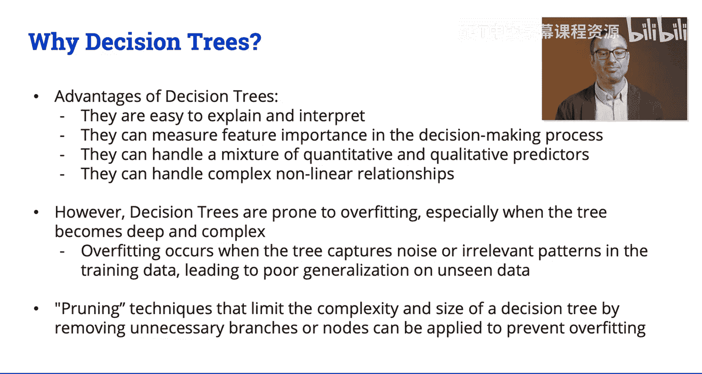

# 第二三部分 22：决策树模型 🎄

在本节课中，我们将要学习决策树模型。决策树是一种直观且强大的预测模型，它通过一系列规则对数据进行分类或回归预测，其过程类似于“二十个问题”游戏。

## 决策树的工作原理

上一节我们介绍了模型评估的基本概念，本节中我们来看看决策树是如何构建和工作的。

决策树模型类似于“二十个问题”游戏。通过不断提问，我们沿着树向下移动，逐步缩小可能性范围，直至得出结论。与游戏类似，我们希望既准确又高效地预测出正确答案。这要求我们提出正确的问题。我们需要考虑哪些问题能提供最多的信息，并将我们引向正确答案。

对于一个给定的训练数据集，决策树的学习过程遵循以下步骤：
1.  首先，选择最佳特征来划分数据集。
2.  其次，将数据集划分为子节点。
3.  最后，如果某个划分中的所有样本都具有相同的标签，则停止该分支的生长；否则，对每个子节点递归地重复步骤1和2。

随着决策树的生长，我们将输入空间分割成多个矩形区域，每个区域包含具有相似标签的数据。

## 模型评估与应用类型

就像逻辑回归一样，为了评估决策树的模型性能，我们需要计算模型的预测准确率。同样，准确率的计算公式为：**正确预测的数量 / 总预测数量**。在实践中，我们可以使用Scikit-learn机器学习库中的 `accuracy_score` 函数。

决策树可以应用于回归和分类两类问题。
*   **回归树**用于数值输出。每个区域包含具有相似输出值的点，输入的预测值是其所在区域输出值的平均值。
*   **分类树**用于类别输出。每个区域包含相同类别的点，输入的预测类别是其所在区域中的多数类。

## 决策树的优缺点

以下是决策树模型的一些主要优点：
*   易于解释和理解。
*   可以衡量特征在决策过程中的重要性。
*   能够处理定量和定性预测变量的混合。
*   能够处理复杂的非线性关系。

在缺点方面，决策树容易过拟合，特别是当树变得又深又复杂时。当树捕捉到训练数据中的噪声或不相关模式时，就会发生过拟合，导致模型在未见数据上泛化能力差。可以通过**剪枝**技术来防止过拟合，即通过移除不必要的分支或节点来限制决策树的复杂性和大小。

## 总结

本节课中我们一起学习了决策树模型。我们了解了它通过递归提问划分数据的核心思想，掌握了其用于回归和分类的不同类型，并认识了其易于解释但需警惕过拟合的优缺点。理解这些是有效应用决策树进行预测分析的基础。