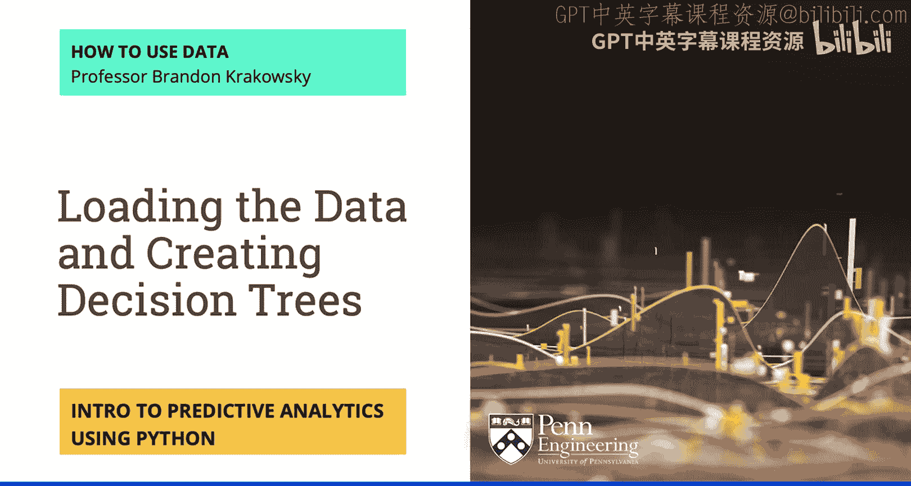
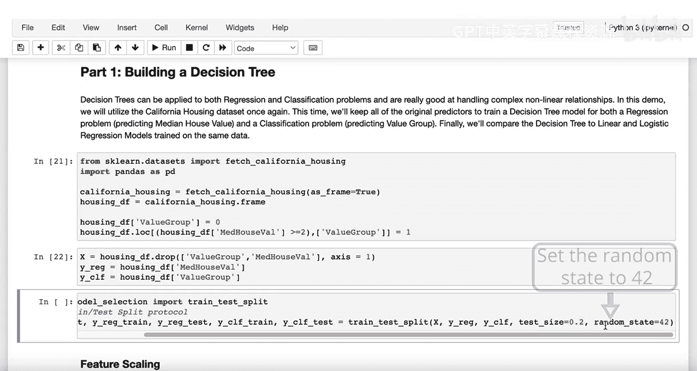

# 第二三部分 23：编程演示：数据加载与决策树创建 🌳

在本节课中，我们将学习如何使用Python加载数据并创建决策树模型。我们将使用加利福尼亚房价数据集，分别针对回归问题（预测房价中位数）和分类问题（预测价值分组）训练决策树模型，并最终与线性回归和逻辑回归模型进行比较。

## 概述与数据准备

决策树可以应用于回归和分类问题，并且非常擅长处理复杂的非线性关系。

在本次演示中，我们将再次利用加利福尼亚房价数据集。这次，我们将保留所有原始预测变量，为回归问题（预测房价中位数）和分类问题（预测价值分组）分别训练一个决策树模型。

首先，和往常一样，我们将加载数据集并进行设置，以复现之前演示中的环境。

以下是数据加载和初始设置的步骤：

1.  加载数据框。
2.  根据分组划分原则创建“价值分组”列，其中房价中位数高于2的被视为类别1，低于2的被视为类别0。
3.  为两个问题划分预测变量和目标变量。
4.  将预测变量设置为除“价值分组”和“房价中位数”列之外的所有列，这两列分别代表分类和回归的目标变量。
5.  将“房价中位数”设为回归目标，将“价值分组”列设为分类目标。
6.  在继续之前，按照训练集-测试集划分协议对所有数据进行划分。

我们为回归和分类案例都准备了训练集和测试集。同样，我们对原始数据集使用20%的测试集大小。

## 模型训练与比较

上一节我们完成了数据的准备工作，本节中我们来看看如何训练决策树模型并进行比较。

我们将分别训练回归决策树和分类决策树，然后使用相同的训练数据训练线性回归和逻辑回归模型，以便进行性能对比。

---

本节课中我们一起学习了如何加载加利福尼亚房价数据集、进行数据预处理、划分训练集与测试集，并初步建立了用于回归和分类的决策树模型框架。在接下来的课程中，我们将深入训练这些模型并评估它们的性能。