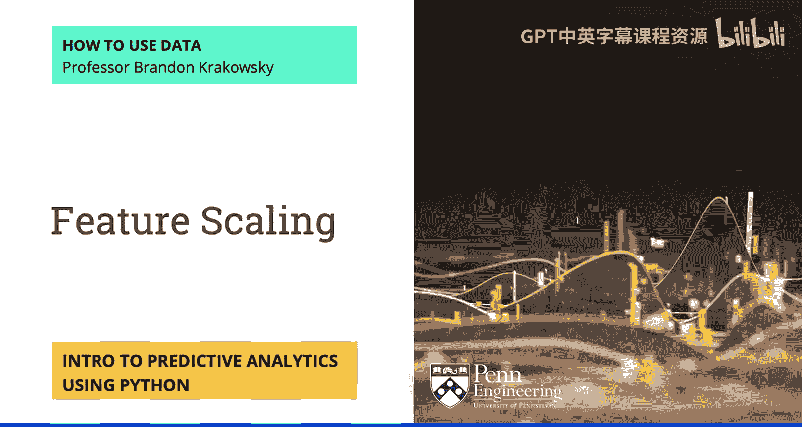
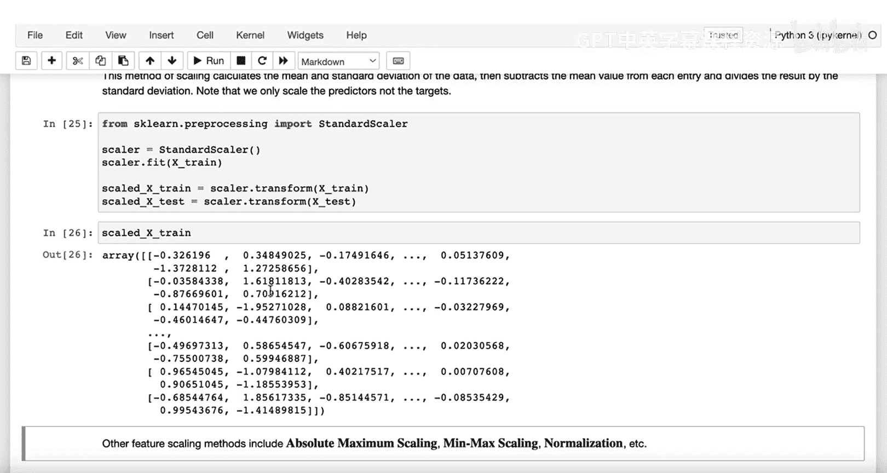

# 第二三部分 24：特征缩放编程演示 🧮



在本节课程中，我们将学习特征缩放的概念及其在机器学习中的重要性。我们将通过一个具体的编程演示，了解如何使用`scikit-learn`库中的`StandardScaler`方法来标准化数据特征，确保不同尺度的特征对模型训练的影响是均衡的。

---

## 查看数据的数值统计信息

首先，我们使用原始数据框并调用`describe`方法来查看数据的统计摘要。

```python
df.describe()
```

在之前的演示中曾提到，当我们观察这些统计数据时，会注意到不同特征之间的尺度存在巨大差异。例如，人口特征的最大值可达35000，而收入中位数特征的最大值仅为15。尽管它们的单位不同，但如果所使用的特征尺度差异巨大，训练出的模型可能会偏向某些特征而忽略其他特征。

## 特征缩放的必要性

为了防止模型因特征尺度不同而产生偏差，我们需要应用特征缩放，将所有特征标准化到一个固定的范围内。

## 使用 StandardScaler 进行特征缩放

在本演示中，我们将使用`scikit-learn`库中的`StandardScaler`方法。该方法通过计算数据的均值和标准差来缩放特征：首先从每个数据点中减去均值，然后将结果除以标准差。

**核心公式**：
`scaled_value = (original_value - mean) / standard_deviation`

请注意，我们只缩放预测变量，而不缩放目标变量。因为模型是从数据的预测变量中学习的。

以下是实施步骤：

1.  **导入并初始化**：从`sklearn.preprocessing`导入`StandardScaler`并初始化缩放模型。
    ```python
    from sklearn.preprocessing import StandardScaler
    scaler = StandardScaler()
    ```

2.  **拟合缩放器**：将缩放器拟合到我们的训练数据上。我们只在`X_train`上调用`fit`方法。
    ```python
    scaler.fit(X_train)
    ```

3.  **转换数据**：使用拟合好的缩放器，通过`transform`方法分别转换训练数据和测试数据。
    ```python
    X_train_scaled = scaler.transform(X_train)
    X_test_scaled = scaler.transform(X_test)
    ```

**重要注意事项**：按照惯例，我们只将缩放器拟合到`X_train`上，然后使用同一个缩放器来转换`X_test`，而不会在`X_test`上重新拟合一个新的缩放器。这是因为测试集对于模型来说应该是一组完全未知的数据。如果在测试集上训练缩放器，就意味着我们计算了测试集的均值和标准差，暗示我们“知道”了测试集的一些信息。因此，通常我们避免在测试集上拟合任何模型。

## 检查缩放结果

转换完成后，我们可以检查缩放后的训练值。你会发现，现在的数值尺度比原来小得多，并且彼此之间似乎保持了一致的尺度。

## 其他缩放方法

除了标准缩放，还有其他特征缩放方法，例如：
*   绝对最大缩放
*   最小-最大缩放（归一化）

对于不同的问题，可能有更适合的缩放方法。你可以通过查阅`scikit-learn`的官方文档来了解更多关于这些缩放方法的信息。

---



**总结**：本节课我们一起学习了特征缩放的重要性。我们了解到，当数据特征尺度差异过大时，会导致模型训练出现偏差。通过使用`scikit-learn`的`StandardScaler`，我们演示了如何将数据标准化，使其均值为0，标准差为1。关键点是，缩放器应仅在训练集上拟合，然后用同一个转换器去转换测试集，以保持数据处理的严谨性。掌握特征缩放是构建稳健机器学习模型的重要一步。