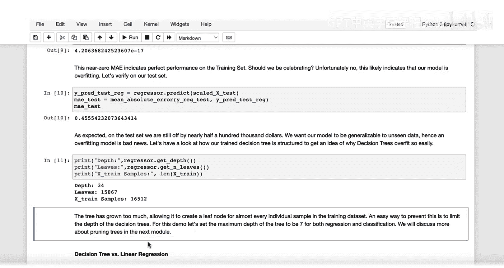

# 第二三部分 25：编程演示：构建决策树模型


在本节课中，我们将学习如何使用Python和Scikit-learn库来构建一个决策树模型。我们将从导入必要的模块开始，训练一个回归决策树，评估其性能，并分析模型过拟合的原因。最后，我们将通过限制树的深度来尝试解决过拟合问题。

---

## 数据准备与模型初始化

上一节我们完成了数据的特征缩放。本节中，我们来看看如何初始化并训练一个决策树回归模型。

首先，我们需要从Scikit-learn库中导入决策树回归器和评估指标。

```python
from sklearn.tree import DecisionTreeRegressor
from sklearn.metrics import mean_absolute_error
```

接着，我们初始化决策树回归器。设置一个随机种子可以确保结果的可复现性。

```python
dt_regressor = DecisionTreeRegressor(random_state=0)
```

---

## 训练模型与评估

模型初始化后，我们可以使用缩放后的训练数据来拟合模型。

```python
dt_regressor.fit(X_train_scaled, y_train)
```

模型训练完成后，我们需要评估它在训练集和测试集上的表现。以下是评估步骤：

首先，在训练集上进行预测并计算平均绝对误差。

```python
train_predictions = dt_regressor.predict(X_train_scaled)
train_mae = mean_absolute_error(y_train, train_predictions)
print(f"训练集MAE: {train_mae}")
```

你会发现，训练集上的MAE几乎为零，这表明模型在训练数据上表现近乎完美。

然而，这通常不是一个好现象，因为它可能意味着模型过拟合了。为了验证这一点，我们需要评估模型在测试集上的表现。

```python
test_predictions = dt_regressor.predict(X_test_scaled)
test_mae = mean_absolute_error(y_test, test_predictions)
print(f"测试集MAE: {test_mae}")
```

运行后，你会看到测试集上的MAE显著更高。这种训练集表现极好而测试集表现较差的情况，明确指出了模型存在过拟合问题。一个好的模型应该同时在训练数据和未见过的测试数据上表现良好。

---

## 分析过拟合原因

为了理解决策树为何会过拟合，让我们查看一下树的结构。

以下是获取树的深度和叶子节点数量的代码：

```python
tree_depth = dt_regressor.get_depth()
n_leaves = dt_regressor.get_n_leaves()
print(f"树深度: {tree_depth}")
print(f"叶子节点数: {n_leaves}")
print(f"训练样本数: {len(X_train)}")
```

执行后，你会发现这棵树非常深，并且最后一层的叶子节点数量几乎与训练样本数相同。这意味着树生长得过深，几乎为每一个训练样本都创建了一个独特的规则，从而学习了训练数据中的噪声，导致过拟合。

---

## 解决过拟合：限制树深度

防止过拟合的一个简单方法是限制决策树的最大深度。这可以阻止树生长得过于复杂。

在本演示中，我们将树的最大深度设置为7。关于更高级的剪枝技术，我们将在后续模块中讨论。

以下是设置最大深度并重新训练模型的代码：

```python
dt_regressor_pruned = DecisionTreeRegressor(max_depth=7, random_state=0)
dt_regressor_pruned.fit(X_train_scaled, y_train)
```

现在，你可以重复之前的评估步骤，比较剪枝前后模型在测试集上的表现，通常会发现泛化能力有所改善。

---



本节课中我们一起学习了如何构建和评估决策树回归模型。我们经历了从模型初始化、训练、评估到诊断过拟合问题的完整流程。关键点在于，一个未经约束的决策树容易对训练数据过拟合，而通过限制其最大深度等简单方法，可以有效提升模型在未知数据上的泛化能力。