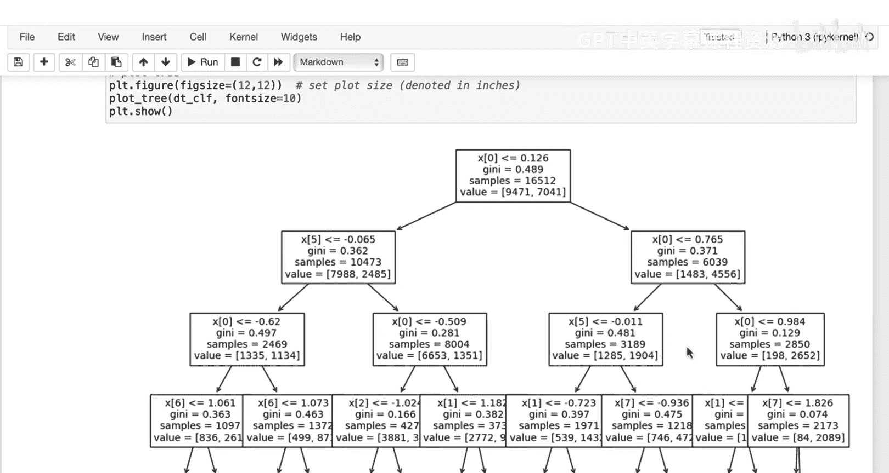

# 第二三部分 28：决策树模型解读与可视化 🧠


在本节课中，我们将学习如何解读和可视化决策树模型。决策树不仅是一个强大的预测工具，其结构本身也极具解释性，能帮助我们理解决策过程并评估特征的重要性。

上一节我们介绍了决策树的基本概念，本节中我们将通过代码实践，深入了解决策树的结构和如何解读它。

## 可视化决策树结构

为了理解决策树如何进行决策，我们首先需要将其结构可视化。以下代码演示了如何使用 `scikit-learn` 和 `matplotlib` 绘制决策树。

```python
from sklearn.tree import plot_tree
import matplotlib.pyplot as plt

# 第二三部分 设置较大的图形尺寸和字体，以便清晰查看每一层
plt.figure(figsize=(20, 12))
plot_tree(model, filled=True, fontsize=10)
plt.show()
```

执行上述代码后，我们将看到决策树的完整结构图。即使我们将树的深度限制为7层，其结构仍然非常复杂。在较低的层级，你会看到大量的节点和叶子，它们覆盖了各种不同的数据情况。

## 解读树节点与决策规则

现在，让我们放大来解读树中的每个节点。在决策树的可视化图中，每个方块代表一个节点，其中包含一个决策规则，该规则将数据分割成两个不同的部分。

以下是解读单个节点的关键要素：

*   **决策规则**：例如 `X[6] <= -0.065`。这表示基于第6个特征（例如“平均占用率”）的值是否小于等于-0.065来做决策。
*   **样本划分**：例如 `samples = 10000`。这表示到达该节点的总样本数约为10000个。规则会将它们分到左右子节点，例如约8000个进入右节点，约2500个进入左节点。
*   **基尼指数**：例如 `gini = 0.5`。这是一个介于0和1之间的值，用于衡量节点中样本分类的“纯度”。值越接近0，说明该节点中样本的类别越纯（几乎都属于同一类）；值越高，则类别混合度越高。

在每一层，模型都会根据一个特征及其阈值做出决策，从而将数据一分为二。

## 控制模型复杂度与过拟合

从复杂的树结构中，我们需要关注一个关键问题：决策树在训练时很容易迅速变得非常庞大和复杂。

这是一个在训练决策树时需要特别注意的重要问题。它们可以非常快速、轻易地生长得非常大。

因此，你需要添加一定的限制条件，以确保你的树不会变得过于庞大和复杂，从而对训练数据产生过拟合。常用的限制参数包括 `max_depth`（最大深度）、`min_samples_split`（节点分裂所需最小样本数）等。



本节课中我们一起学习了如何可视化决策树的结构，并解读了其中的节点、决策规则和纯度指标。同时，我们也认识到控制决策树复杂度以防止过拟合的重要性。理解这些内容有助于我们更好地运用和解释决策树模型。