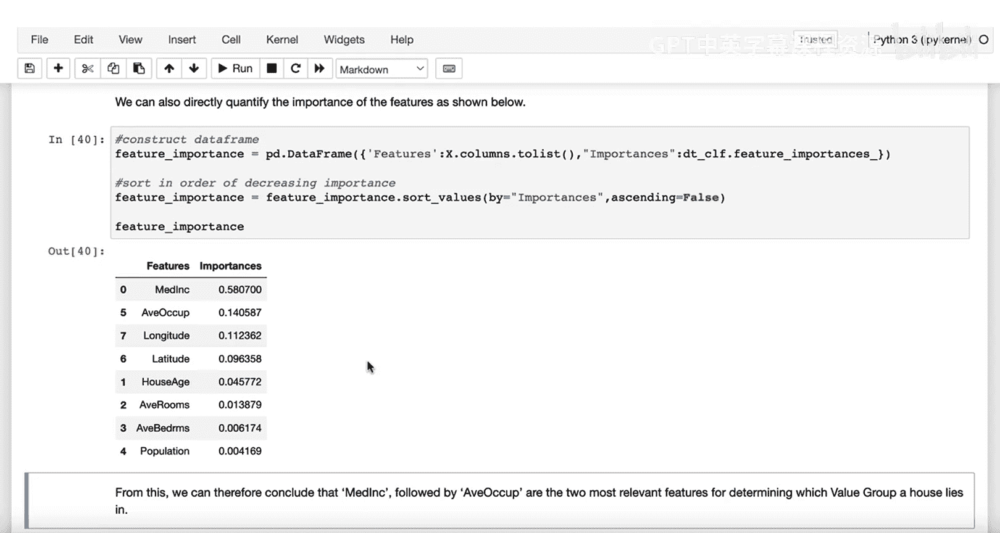

# 第二三部分 29：特征重要性量化与解读


在本节中，我们将学习如何从已构建的决策树模型中量化并解读各个特征的重要性。上一节我们介绍了决策树的结构和决策规则，本节中我们来看看如何将这些规则转化为可量化的特征重要性指标。

随着在决策树中向下遍历，数据会被分割成更小的分区。这个过程会持续进行，直到到达一个叶节点，在该节点中可以得出结论：此节点内的所有样本都具有相同的标签或非常相似的值。在树形图中，方块的位置越高，表明该决策规则的重要性越高。就分割质量而言，节点位置越高，分割效果越好。从树的结构来看，参与分割的特征越重要。

通过这些决策规则，我们可以更好地了解决策在预测过程中是如何做出的。这些规则反过来可以在实际的人类决策过程中作为参考。

我们也可以直接量化特征的重要性，如下所示。

以下是具体步骤，我们将创建一个Pandas DataFrame来存储特征及其重要性。

首先，创建一个名为`features`的列，其数据来源于原始预测变量`X`的列名。

```python
# 第二三部分 假设 X 是包含特征的DataFrame
features = X.columns.tolist()
```

接着，创建一个名为`importances`的列表，用于存储每个特征的重要性值。这可以通过访问决策树分类器的`feature_importances_`属性来获得。

```python
importances = dt_model.feature_importances_
```

一旦构建好包含特征名和重要性值的数据，我们将DataFrame中的行按照重要性降序排列。

```python
# 第二三部分 创建DataFrame
importance_df = pd.DataFrame({'feature': features, 'importance': importances})
# 第二三部分 按重要性降序排序
importance_df = importance_df.sort_values(by='importance', ascending=False)
```

我们可以检查这个Pandas DataFrame。其中包含了每个特征及其对应的重要性值。

从这个DataFrame中，我们可以看到`median income`（收入中位数），其次是`average occupancy`（平均入住率），是决定一个房屋样本属于哪个价值群体的两个最相关的特征。



本节课中我们一起学习了如何从决策树模型中提取和解读特征重要性。我们了解到，通过分析树的结构和量化特征重要性，可以识别出对预测结果影响最大的关键因素，这有助于我们理解模型并指导现实决策。