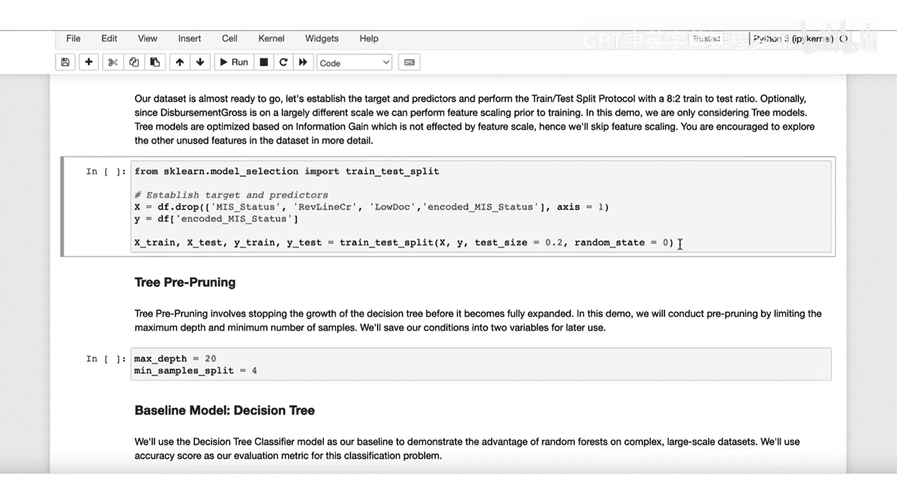

# 第二三部分 33：随机森林数据加载与预处理 📊


在本节课中，我们将学习如何为一个实际的商业问题——贷款分类，准备数据。我们将使用来自美国小企业管理局（SBA）的数据集，通过随机森林模型来预测贷款是被批准还是被拒绝。课程的核心是数据加载、清洗和预处理，为后续的模型训练打下坚实基础。

## 数据加载与初步观察

首先，我们从CSV文件加载数据集。为了简化演示，我们将删除一些在本例中不会用到的特征列。

以下是本演示将包含的特征：
*   **NoEmp**：企业员工数量。
*   **NewExist**：企业状态（现有或新创）。
*   **CreateJob**：创造的就业岗位数。
*   **RetainedJob**：保留的就业岗位数。
*   **UrbanRural**：企业位于城市、农村或未定义区域。
*   **RevLineCr**：是否有循环信用额度。
*   **LowDoc**：是否为低文档贷款项目。
*   **DisbursementGross**：贷款发放总额。
*   **MIS_Status**：贷款状态（目标变量）。`“P I F”` 表示全额偿还（批准），`“CHGOFF”` 表示坏账核销（拒绝）。

我们可以使用 `df.info()` 快速浏览数据概况。数据集中大约有90万条记录，包含数值型和非数值型数据。同时，我们注意到某些特征在部分记录中存在缺失值。

## 数据清洗：处理缺失值与无效标签

由于这是一个未经预处理的真实世界数据集，我们需要谨慎处理潜在的错误条目，例如缺失值或无效、不一致的标签。

上一节我们介绍了数据概况，本节中我们来看看如何处理数据中的“杂质”。

### 处理缺失值

对于在 `NewExist`、`RevLineCr`、`LowDoc` 以及目标变量 `MIS_Status` 中发现的缺失值，我们采取直接删除包含缺失值记录的方法。

```python
df.dropna(inplace=True)
```

执行此操作后，数据条目数量减少，但所有缺失值已被移除。

### 处理无效的分类标签

接下来，我们检查包含非数值数据的变量：`RevLineCr`、`LowDoc` 和 `MIS_Status`。根据描述，这些应是二元分类标签。

以下是检查各列唯一值及其样本数量的方法：
```python
print(df[‘RevLineCr’].value_counts())
print(df[‘LowDoc’].value_counts())
print(df[‘MIS_Status’].value_counts())
```

检查发现：
*   `RevLineCr` 和 `LowDoc` 列中，除了预期的 “Y” 和 “N” 外，还存在其他未在描述中提及的无效标签。
*   `MIS_Status` 的标签与描述一致，没有无效标签。

因此，我们需要从数据集中删除包含无效标签的记录。

```python
# 第二三部分 创建布尔条件，筛选出 RevLineCr 和 LowDoc 列中标签为 ‘Y’ 或 ‘N’ 的记录
valid_data = df[(df[‘RevLineCr’].isin([‘Y’, ‘N’])) & (df[‘LowDoc’].isin([‘Y’, ‘N’]))]
df = valid_data
```

### 处理数值型分类特征

`NewExist` 和 `UrbanRural` 虽然是数值，但代表分类信息。我们需要确保其取值与描述一致（`NewExist` 应为1或2；`UrbanRural` 应为0、1或2）。

检查发现 `NewExist` 列中存在意外的标签 `0`。我们同样移除这些记录。

```python
df = df[df[‘NewExist’] != 0]
```

至此，我们已清除了所有分类变量中的不一致数据。

## 数据转换：编码与格式化

现在，我们将清理后的非数值数据转换为数值格式，以便模型处理。

### 分类变量编码

对于分类变量 `RevLineCr`、`LowDoc` 和 `MIS_Status`，我们可以使用Pandas的 `factorize()` 方法进行整数编码。

```python
# 第二三部分 对 RevLineCr 列进行编码
df[‘RevLineCr_encoded’], revlinecr_labels = pd.factorize(df[‘RevLineCr’])
# 第二三部分 对 LowDoc 列进行编码
df[‘LowDoc_encoded’], lowdoc_labels = pd.factorize(df[‘LowDoc’])
# 第二三部分 对目标变量 MIS_Status 列进行编码
df[‘MIS_Status_encoded’], target_labels = pd.factorize(df[‘MIS_Status’])
```

编码后，数据框中会新增三列包含数值标签的列。

### 格式化数值字符串

`DisbursementGross` 列本应是数值，但存储格式包含美元符号（`$`）和逗号（`,`），阻碍了其被识别为数值类型。我们需要将其转换为浮点数。

```python
df[‘DisbursementGross’] = df[‘DisbursementGross’].apply(lambda x: float(x.strip().replace(‘$’, ‘’).replace(‘,’, ‘’)))
```

应用此转换后，`DisbursementGross` 列的数据类型变为 `float64`。

## 准备训练与测试数据

所有预处理步骤完成后，我们的数据集已完全数值化且无缺失值，可以用于训练随机森林模型。

我们首先定义目标变量和预测特征，然后按照8:2的比例划分训练集和测试集。

```python
from sklearn.model_selection import train_test_split

# 第二三部分 定义预测特征 X：移除原始分类文本列和已编码的目标变量列
X = df.drop([‘MIS_Status’, ‘RevLineCr’, ‘LowDoc’, ‘MIS_Status_encoded’], axis=1)
# 第二三部分 定义目标变量 y：使用编码后的贷款状态
y = df[‘MIS_Status_encoded’]

# 第二三部分 划分数据集
X_train, X_test, y_train, y_test = train_test_split(X, y, test_size=0.2, random_state=0)
```

**注意**：`DisbursementGross` 的数值尺度远大于其他特征。对于基于信息增益进行优化的树模型（如随机森林），特征尺度不影响模型性能，因此本例中我们跳过了特征缩放步骤。鼓励你探索数据集中其他未使用的特征。

## 总结



本节课中我们一起学习了为随机森林模型准备数据的完整流程。我们从加载SBA贷款数据集开始，逐步进行了数据清洗（处理缺失值和无效标签）、数据转换（分类变量编码和字符串格式化），最后定义了特征和目标并完成了数据集划分。经过这些步骤，我们得到了一个干净、可用于机器学习模型训练的数值化数据集。在接下来的课程中，我们将使用这个预处理好的数据来构建和评估随机森林分类模型。