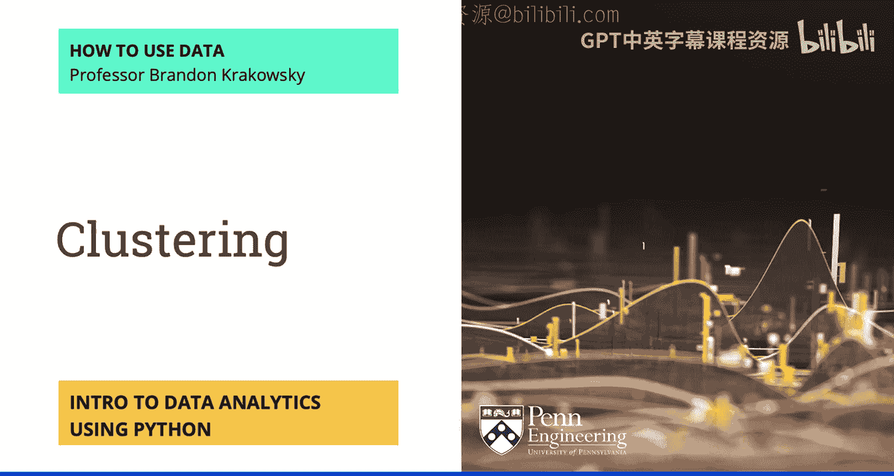
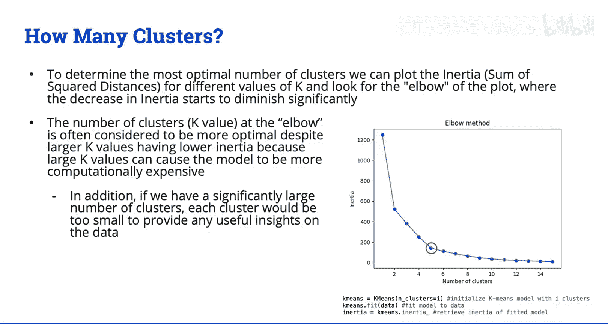

# 第二三部分 39：聚类与K均值算法概述



在本节课中，我们将要学习一种名为“聚类”的无监督学习技术。我们将了解其基本概念、常见算法，并重点学习K均值聚类算法的原理与实现步骤。

聚类是一种无监督学习技术，用于根据数据点内在的特征或相似性，将相似的实例或数据点分组在一起。聚类的目标是在没有先验类别标签或目标值知识的情况下，识别数据集中的自然分组或簇。聚类广泛应用于多个领域，包括客户细分、图像分析、文档分类、异常检测和推荐系统。它对于数据探索、模式发现、可视化以及理解复杂数据集非常有帮助。

存在多种类型的聚类算法，每种算法都有其自身的方法和特点。一些例子包括：
*   **K均值聚类**：这是最流行的聚类算法之一。它将数据划分为K个簇，其中K是预先确定的数字，通过最小化数据点与其簇质心之间的平方距离之和来实现。
*   **层次聚类**：通过基于相似性迭代地合并或拆分簇来创建簇的层次结构，直到满足停止标准。
*   **高斯混合模型**：假设数据是由多个高斯分布混合生成的。该模型通过估计这些高斯分布的参数来将数据点分配到不同的簇。

聚类算法的选择取决于数据的性质、期望的簇属性，以及最终要解决的具体问题。

在本模块中，我们将详细介绍K均值聚类。

## 聚类分析：2：K均值聚类算法详解

上一节我们介绍了聚类的概念和常见算法类型，本节中我们来看看最常用的K均值聚类算法的具体步骤。

K均值聚类的目标是根据相似性，将数据划分为K个簇，其中K是预先确定的数字。

以下是K均值聚类算法的步骤：
1.  **初始化质心**：随机选择K个数据点作为K个簇的初始质心。
2.  **分配数据点**：通过最小化数据点与簇质心之间的距离来将数据划分到K个簇中。换句话说，对于每个数据点，我们识别其最近的质心，并将该点归入相应的簇。
3.  **更新质心**：对于新形成的K个点簇，通过计算簇中所有点的平均值来得到新的质心。
4.  **迭代优化**：重复步骤2和步骤3，直到簇不再发生变化或达到停止标准。

与监督学习场景不同，在执行聚类时，我们通常不知道正确答案。因此，我们不能使用准确率或均方误差来确定哪个簇数量能让模型表现最佳。

然而，回想一下，K均值聚类的目标是最小化数据点与质心之间的距离。因此，我们可以定义一个称为**平方距离和**（也称为**惯性**）的指标，它计算数据点与其所属簇的质心之间的欧几里得距离的平方和。

在实践中，我们可以使用Scikit-learn库中`sklearn.cluster.KMeans`模型的`inertia_`属性来获取该值。

```python
from sklearn.cluster import KMeans
# 第二三部分 假设X是数据
kmeans = KMeans(n_clusters=3)
kmeans.fit(X)
inertia = kmeans.inertia_
print(f"模型的惯性（平方距离和）为：{inertia}")
```

## 聚类分析：3：如何确定最佳簇数量（K值）

上一节我们学习了K均值算法的运行过程，并引入了“惯性”作为评估指标。本节中我们来看看如何利用这个指标来确定最佳的簇数量K。

为了确定最优的簇数量，我们可以绘制不同K值对应的惯性（即平方距离和）曲线，并寻找曲线的“肘部”。在“肘部”点，惯性的下降速度开始显著减缓。该点对应的K值通常被认为是最优的，尽管更大的K值会导致惯性更低。

选择“肘部”对应的K值而非更大的K值，主要基于以下考虑：
*   **计算成本**：更大的K值会导致模型计算更加昂贵。
*   **实用性**：如果簇的数量显著过大，每个簇会变得太小，无法提供任何关于数据的有用见解。



本节课中我们一起学习了聚类分析的基本概念，重点剖析了K均值聚类算法的原理、步骤和关键指标“惯性”。我们还掌握了通过“肘部法则”来确定最佳簇数量K的实用方法。聚类是一种强大的数据探索工具，能帮助我们在无标签的数据中发现内在的结构和模式。