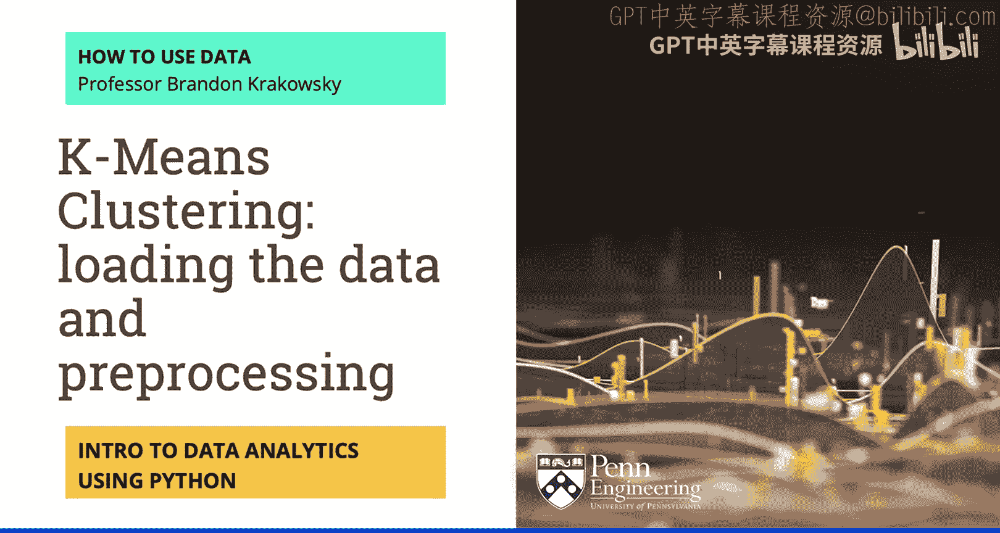
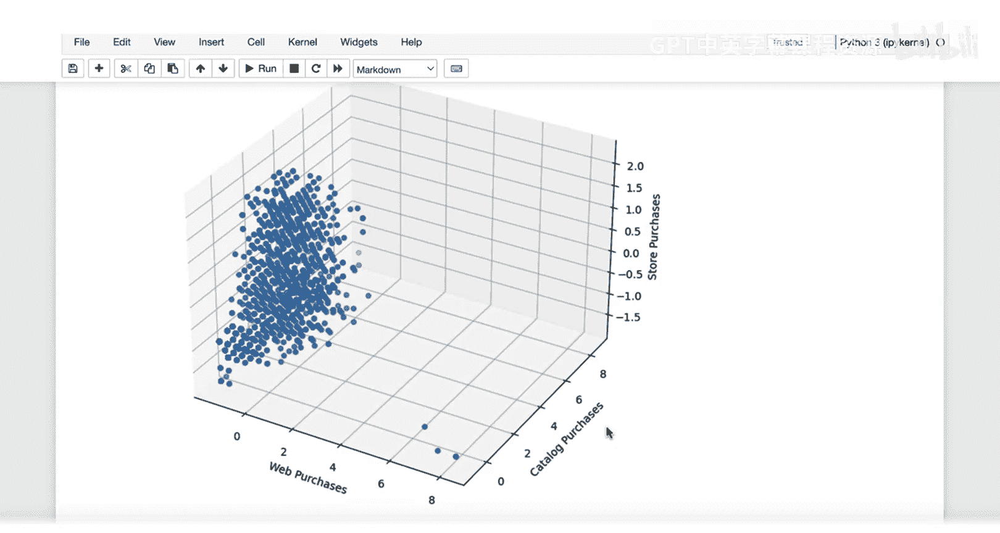

# 第二三部分 40：数据加载与预处理 📊



在本章中，我们将学习如何为K均值聚类模型准备数据。我们将从一个杂货店客户数据集中加载数据，选择相关特征，并进行必要的预处理，例如特征缩放。这些步骤是任何机器学习项目成功的基础。

## 概述

客户细分是指根据客户特征的相似性，将客户划分为不同组别的过程。在本编程示例中，我们将对一家杂货店数据库中的客户记录进行无监督的K均值聚类。数据集包含2240个客户数据样本，每个样本有29个属性，涵盖了客户个人信息（如收入、教育程度、出生年份）、购买信息（如在不同类型产品上的花费）以及活动信息（如每月网站访问次数）。为了在本演示中便于可视化，我们将从29个属性中仅选择3个用于聚类。我们鼓励您查看完整的数据和描述。

## 数据加载与初步检查

首先，我们将使用Pandas库读取数据集的CSV文件，并将其存储在一个Pandas数据框中。然后，使用`info`方法检查我们正在使用的数据集中的特征。

```python
import pandas as pd

# 第二三部分 读取CSV文件
df = pd.read_csv('customer_data.csv')
# 第二三部分 查看数据框信息
df.info()
```

在原始数据集中，正如前面提到的，我们有29个属性。这意味着我们正在处理一个相对高维的数据集。高维数据的问题是，如果我们想绘制数据点，很难直观地进行可视化。

## 特征选择

因此，在本演示中，我们将选择29个属性中的一个子集，而不是使用全部。我们将重点关注客户活动，并根据**网站购买次数**、**目录购买次数**和**门店购买次数**进行聚类。这里的目标是基于这三个特征，获得能反映特定购买行为的客户群。

以下是选择这三个特征的方法：

```python
# 第二三部分 从原始数据框中索引出我们需要的三个特征
df_purchase = df[['NumWebPurchases', 'NumCatalogPurchases', 'NumStorePurchases']]
# 第二三部分 使用head方法检查数据集的前几个样本
df_purchase.head()
```

现在，我们可以再次查看这个子集的信息：

```python
df_purchase.info()
```

我们有三个特征，它们都是数值型的整数，并且似乎没有任何缺失值。这些计数都是非空的。

## 数据描述与缩放必要性

我们还可以查看数据的描述性统计，因为我们处理的是数值数据：

```python
df_purchase.describe()
```

我们可以看到均值、标准差、最小值和最大值。对于这些特征，它们没有处于完全不同的尺度上，并且在统计上没有明显的错误。然而，即使尺度差异不大，进行特征缩放仍然是有益的。

## 数据预处理：特征缩放

我们已经有了数值数据，并且没有缺失值，因此可以直接使用特征缩放器进行数据预处理。这里我们使用Scikit-learn库中的`StandardScaler`。它可以使缩放后的数据具有零均值和单位标准差。

以下是进行特征缩放的步骤：

```python
from sklearn.preprocessing import StandardScaler

# 第二三部分 初始化缩放器
scaler = StandardScaler()
# 第二三部分 将缩放器拟合到我们的数据
scaler.fit(df_purchase)
# 第二三部分 转换数据并创建新的数据框
scaled_df = pd.DataFrame(scaler.transform(df_purchase), columns=df_purchase.columns)
# 第二三部分 描述缩放后的数据框
scaled_df.describe()
```

现在我们可以看到缩放后的值。均值非常接近0，标准差非常接近1。现在，我们的三个特征都已被正确缩放。

## 数据可视化

由于我们正在处理的数据只有三个维度（即三个特征），我们甚至可以在进行聚类之前，将数据以3D散点图的形式绘制出来，看看是否有任何明显的边界可以用来分割数据。

以下是创建3D散点图的代码：

```python
import matplotlib.pyplot as plt
from mpl_toolkits.mplot3d import Axes3D

fig = plt.figure()
ax = fig.add_subplot(111, projection='3d')
ax.scatter(scaled_df['NumWebPurchases'], scaled_df['NumCatalogPurchases'], scaled_df['NumStorePurchases'])
ax.set_xlabel('Web Purchases (scaled)')
ax.set_ylabel('Catalog Purchases (scaled)')
ax.set_zlabel('Store Purchases (scaled)')
plt.show()
```

如果我们观察这个数据集，大部分数据集中在这里，我们确实在周围有一些离群点。根据具体问题，在执行聚类或应用任何其他模型之前，您可能希望也可能不希望将这些离群点从数据集中移除。在本例中，我们将保持原样，因为这些离群点似乎不是非常嘈杂，它们可能会落入某个聚类中。

从这些结果来看，我们用人眼并没有发现任何明显的聚类，但这不必担心，因为那将是K均值聚类模型的工作。

## 总结



在本章中，我们一起学习了为K均值聚类准备数据的关键步骤。我们从加载和检查高维数据集开始，然后选择了三个与客户购买行为相关的核心特征。接着，我们探讨了特征缩放的重要性，并使用`StandardScaler`对数据进行了标准化处理，使其均值为0，标准差为1。最后，我们将处理后的数据在三维空间中可视化，初步观察了其分布情况，为下一章应用K均值聚类算法奠定了基础。