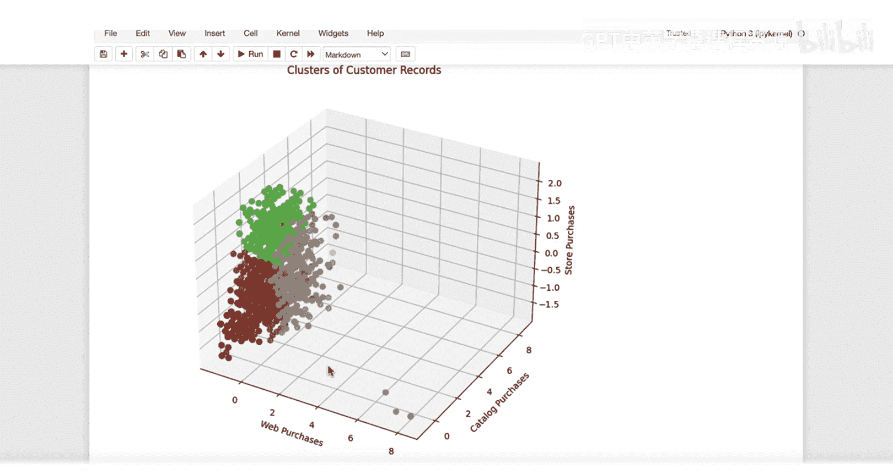

# 第二三部分 42：编程演示：最终K均值聚类模型 🧩


在本节课中，我们将学习如何定义并应用最终的K均值聚类模型，将数据点划分为五个群组，并可视化聚类结果。

---

上一节我们介绍了数据预处理和模型参数选择，本节中我们来看看如何构建最终的K均值模型并分析其结果。

我们使用以下设置来定义最终的K均值模型，其中聚类数量设置为5。

```python
# 第二三部分 定义K均值模型，设置聚类数为5
final_model = KMeans(n_clusters=5)
```

我们可以通过使用`Fit Predict`方法来访问聚类标签。此方法的作用是将我们的模型拟合到所提供的数据（即`scaleDf`），并同时预测该数据集中每个数据点的聚类标签。

```python
# 第二三部分 拟合模型并预测聚类标签
cluster_labels = final_model.fit_predict(scaleDf)
```

对于每个数据点，都会有一个聚类标签。我们可以将这些标签存储在一个名为`clusters`的新列中。

```python
# 第二三部分 将聚类标签作为新列添加到数据框中
scaleDf['clusters'] = cluster_labels
```

以下是查看前几个样本的方法。

```python
# 第二三部分 查看数据框的前几行，包括新的聚类标签列
print(scaleDf.head())
```

请注意，除了前三个特征外，每个样本现在还有一个聚类标签。我们可以利用这个标签，在三维散点图中用不同颜色可视化数据点，从而使聚类结果清晰可见。

```python
# 第二三部分 绘制三维散点图，根据聚类标签着色
fig = plt.figure()
ax = fig.add_subplot(111, projection='3d')
# 第二三部分 使用前三个特征作为坐标轴
x = scaleDf.iloc[:, 0]
y = scaleDf.iloc[:, 1]
z = scaleDf.iloc[:, 2]
# 第二三部分 根据聚类标签分配颜色
colors = scaleDf['clusters']
scatter = ax.scatter(x, y, z, c=colors, cmap='viridis')
plt.show()
```

这里我们仍然使用相同的X、Y、Z轴（即前三个特征）。此外，我们传入一个基于此处聚类标签的颜色值或颜色标签，并指定一个颜色映射，使得在绘制点时，每个聚类标签都能映射到特定的颜色。

执行此代码后，我们将看到聚类已被标记。我们得到了一个灰色组、绿色组、棕色组、红色组和橙色组，总计五个聚类。聚类之间似乎确实存在边界。

---

既然我们已经清晰地标记了聚类，下一步就是更详细地研究每个聚类具有哪些特征。

---



本节课中我们一起学习了如何定义K均值模型、使用`fit_predict`方法获取聚类标签、将结果可视化在三维散点图中，并初步观察了聚类之间的分离情况。这为后续深入分析每个聚类的特性奠定了基础。