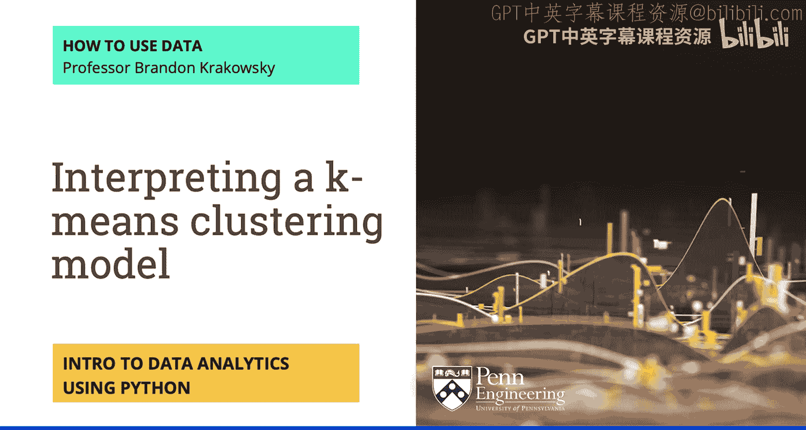
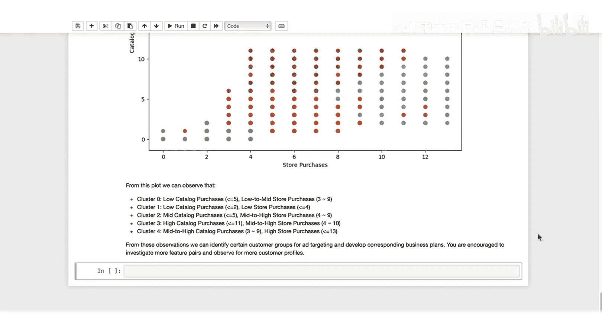

# 第二三部分 43：K均值聚类模型解读 🧩



在本节课中，我们将学习如何解读K均值聚类模型的结果。聚类是一种无监督学习，没有标准答案来评估模型。因此，本节的核心目标是理解如何解释聚类形成的模式，并从中提取有意义的商业洞察。

## 观察聚类分布 📊

上一节我们介绍了如何构建K均值聚类模型，本节中我们来看看如何解读其结果。首先，我们可以通过观察每个簇中数据样本的分布来获得初步理解。

以下是查看聚类分布的步骤：

```python
# 第二三部分 假设 `labels` 是模型预测的簇标签
cluster_counts = pd.Series(labels).value_counts().sort_index()
x = cluster_counts.index  # 簇标签（横轴）
y = cluster_counts.values # 每个簇的样本数（纵轴）

# 第二三部分 创建条形图
plt.bar(x, y)
plt.xlabel('Cluster Label')
plt.ylabel('Number of Points')
plt.title('Distribution of Data Across Clusters')
plt.show()
```

通过生成的条形图，我们可以发现，例如，簇0可能占据了数据的大部分，而其余四个簇的分布则相对平均。观察聚类分布有助于我们初步了解客户群体在不同簇中的权重。例如，如果簇0具有我们希望强调的特征，并且该组内客户数量庞大，这可能意味着我们在制定某些决策时需要优先考虑这个客户群。

## 分析簇内特征 🔍

除了分布，分析每个簇内部的特征同样重要。在本演示中，我们只使用了三个特征，因此可以直接可视化数据点。然而，对于更高维度的数据，直接可视化并不可行。取而代之，我们可以通过绘制我们想要调查的特征对来展示聚类点，从而对客户群进行画像分析。

让我们以“门店购买次数”和“目录购买次数”作为特征对来观察聚类点。请注意，为了解读原始模式，我们将使用原始数据而非标准化后的数据。

以下是创建特征对散点图的步骤：

```python
# 第二三部分 假设 `original_data` 是原始数据框，`labels` 是簇标签
original_data['cluster_label'] = labels

# 第二三部分 绘制散点图
plt.scatter(original_data['NumStorePurchases'],
            original_data['NumCatalogPurchases'],
            c=original_data['cluster_label'],
            cmap='viridis')
plt.xlabel('Number of Store Purchases')
plt.ylabel('Number of Catalog Purchases')
plt.colorbar(label='Cluster Label')
plt.title('Clusters Visualized by Store and Catalog Purchases')
plt.show()
```

将图形放大以便更清晰地观察，我们可以看到不同簇之间存在着一定的决策边界，顶部有色标指示簇标签。从这个图中，我们可以直接观察到每个簇的某些特征：

*   **簇0**：数据样本的目录购买次数较低（≤5），门店购买次数处于中低水平（约3-9次）。
*   **簇1**：目录购买次数低（≤2），门店购买次数也低（≤4）。
*   **簇2**：目录购买次数中等（≤5），门店购买次数处于中高水平（约4-9次）。
*   **簇3**：目录购买次数高（≤11），门店购买次数处于中高水平（约4-10次）。
*   **簇4**：目录购买次数处于中高水平（约3-9次），门店购买次数高（≤13）。

## 从洞察到行动 🎯

基于以上观察，我们可以识别出特定的客户群体，用于广告定向和制定相应的商业计划。

例如，如果某个群体明显倾向于通过目录购买，我们可能希望将广告投入重点放在该平台，而不是针对这些客户的门店渠道。同样，鼓励你调查更多的特征组合，以获得更全面的客户画像。



本节课中我们一起学习了如何解读K均值聚类模型。我们首先通过条形图分析了不同簇的样本分布，了解了客户群的大致构成。接着，我们通过特征对散点图深入分析了每个簇的典型行为特征，例如购买偏好。最后，我们探讨了如何将这些数据洞察转化为实际的商业行动，如精准广告投放。通过结合分布分析和特征分析，我们可以从无标签的数据中提取出有价值的模式，为决策提供支持。