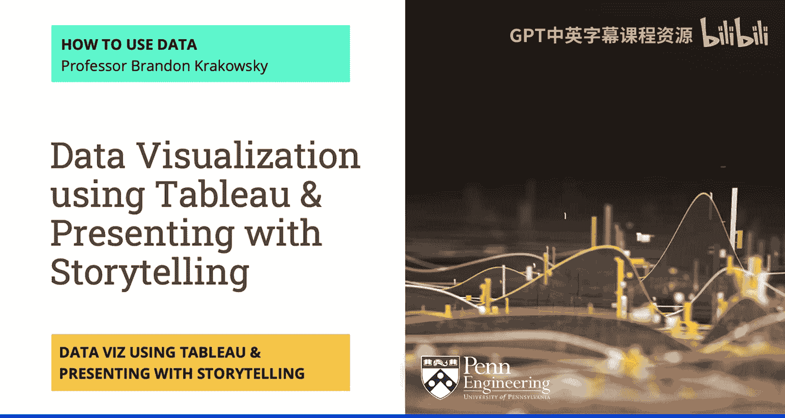
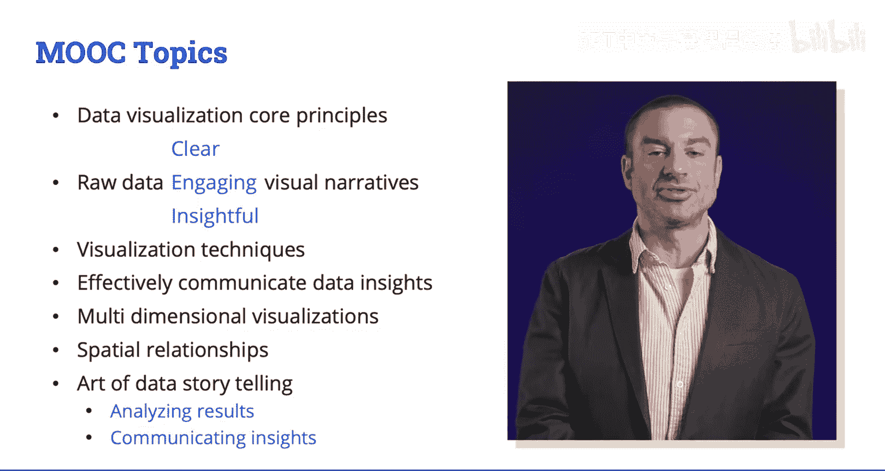

# 第二三部分 46：使用Tableau进行数据可视化及叙事化呈现课程简介

在本课程中，我们将详细探索如何使用Tableau进行数据可视化。Tableau是行业领先的工具，用于创建丰富且交互式的数据可视化图表。此外，本课程还将重点介绍洞察力呈现的关键技能，以及如何构建引人入胜的数据叙事。

上一节我们了解了课程的整体目标，本节中我们来看看课程的具体内容安排。

课程从有效数据可视化的核心原则开始，为您提供将原始数据转化为清晰、引人入胜且富有洞察力的视觉叙事所需的知识。您将学习如何运用各种可视化技术，从简单的一维图表到能够揭示复杂数据关系和模式的复杂可视化。

随着学习的深入，您将探索高级主题，包括多维可视化和空间关系可视化。这些技术对于分析和呈现来自多个表格及不同来源的数据至关重要。

课程同样聚焦于数据叙事的艺术。这项技能将分析的严谨性与创造力相结合，旨在构建不仅能传递信息，还能吸引并说服受众的故事。

以下是本课程将涵盖的最佳实践：
*   分析结果的最佳实践。
*   创建引人注目的数据分析演示文稿。
*   以利益相关者易于理解的方式传达洞察。

在本节课中，我们一起学习了Tableau数据可视化与叙事课程的核心内容。课程结束时，您将熟练掌握Tableau数据可视化和数据叙事的精妙技艺，从而能够有效地呈现您的分析和发现。这项专业技能对于旨在提升演示技巧、并通过强有力的数据驱动叙事推动行动的数据专业人士而言，是不可或缺的。